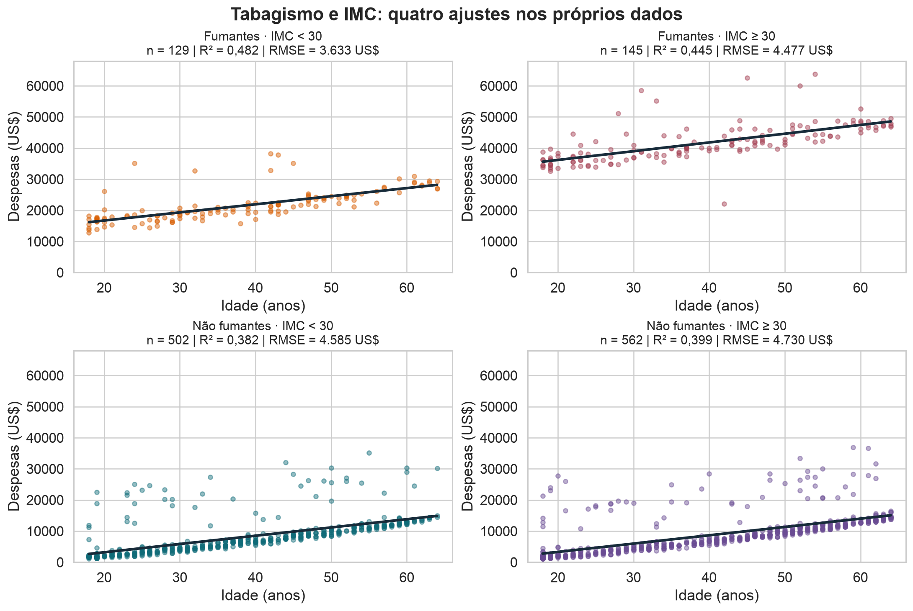
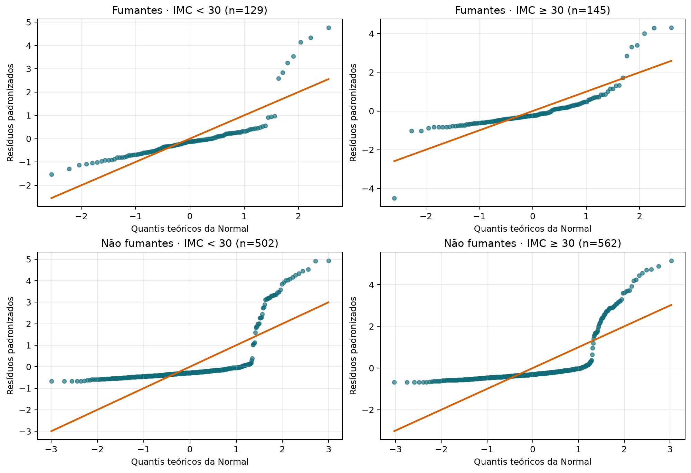

## Objetivos

Este guia desenvolve a regressão linear simples como um modelo estatístico para a média condicional. Ao final, você deverá saber formular o problema de mínimos quadrados, derivar seus estimadores, interpretar o ajuste e reconhecer suas limitações.

## Como estudar este capítulo

A regressão começa com uma mudança de pergunta. Em vez de resumir apenas a associação entre `age` e `charges`, queremos descrever **como o valor médio de despesas varia com a idade**. A reta é uma aproximação dessa média condicional, não uma promessa de acertar a despesa de cada pessoa.

O capítulo acompanha uma análise completa: conhecemos a base, visualizamos a relação, definimos o modelo, encontramos a reta que minimiza os erros quadráticos e verificamos o que ficou nos resíduos. As derivações mostram de onde vêm os coeficientes; elas não substituem a interpretação. Em cada etapa, procure responder três perguntas: o que entrou no cálculo, o que saiu dele e qual afirmação substantiva esse resultado sustenta.

Ao abrir um bloco de código, relacione seus elementos ao texto. `X` representa os valores do preditor, `y` a resposta, `fitted` os valores médios estimados e `residuals` a diferença entre observado e ajustado. Essa tradução entre conceito e objeto computacional é parte central do aprendizado.

## Base de dados de apoio

Usaremos a base **Medical Insurance Cost**, disponibilizada no [Kaggle](https://www.kaggle.com/datasets/mosapabdelghany/medical-insurance-cost-dataset) sob licença CC0. Cada linha representa uma pessoa segurada. A resposta `charges` registra despesas médicas em dólares; `age` será o preditor. A variável `smoker` ajudará a revelar estrutura que a reta simples não captura.

```{python}
from pathlib import Path
import numpy as np
import pandas as pd
import matplotlib.pyplot as plt
import seaborn as sns

sns.set_theme(style="whitegrid", context="notebook")
rng = np.random.default_rng(20260827)

data_path = Path("../16-correlacao/data/insurance.csv")
df = pd.read_csv(data_path)
df.head()
```

## Auditoria e análise descritiva

Antes de ajustar uma reta, precisamos conhecer unidade observacional, escala, ausências, duplicatas e distribuição das variáveis.

```{python}
df.info()
```

```{python}
df[["age", "charges", "bmi", "children"]].describe().round(2)
```

```{python}
pd.DataFrame({
    "ausências": df.isna().sum(),
    "valores_distintos": df.nunique(),
})
```

```{python}
print("Linhas duplicadas:", df.duplicated().sum())
df["smoker"].value_counts().rename_axis("smoker").to_frame("n")
```

::: {.callout-note title="Interpretação"}
Há uma linha exatamente duplicada, mas não há identificador para concluir se ela é erro ou duas pessoas com os mesmos registros. Portanto, não a removemos automaticamente. As despesas são assimétricas e fumantes têm valores muito maiores; isso será importante nos resíduos.
:::

```{python}
fig, axes = plt.subplots(1, 3, figsize=(13, 3.6))
sns.histplot(df, x="age", ax=axes[0])
sns.histplot(df, x="charges", ax=axes[1])
sns.boxplot(df, x="smoker", y="charges", ax=axes[2])
plt.tight_layout()
plt.show()
```

## Da média global à média condicional

Sem usar a idade, a melhor previsão constante sob perda quadrática é a média global. Ao separar idades em faixas, observamos que a média das despesas muda com $X$.

```{python}
bins = pd.cut(df["age"], bins=np.arange(17.5, 68, 5))
local = (df.groupby(bins, observed=True)
           .agg(idade_média=("age", "mean"),
                despesa_média=("charges", "mean"),
                n=("charges", "size")))
local.round(2)
```

::: {.callout-note title="Interpretação"}
As médias por faixa etária sugerem crescimento das despesas com a idade, mas a quantidade de observações e a dispersão dentro de cada faixa também importam. A regressão substituirá esses degraus por uma função contínua; isso simplifica o padrão, mas não elimina a variabilidade individual.
:::

O alvo da regressão é a função

$$m(x)=E[Y\mid X=x],$$

isto é, a média da distribuição de $Y$ entre unidades que possuem $X=x$. Na regressão linear simples, aproximamos esse alvo por

$$E[Y_i\mid X_i=x_i]=\beta_0+\beta_1x_i.$$

## Modelo estatístico e seus termos

Escrevemos

$$Y_i=\beta_0+\beta_1x_i+\varepsilon_i,
\qquad E[\varepsilon_i\mid X_i=x_i]=0.$$

- $Y_i$: resposta aleatória da observação $i$;
- $x_i$: valor observado do preditor;
- $\beta_0$: intercepto populacional;
- $\beta_1$: variação da média de $Y$ associada ao aumento de uma unidade em $X$;
- $\varepsilon_i$: desvio aleatório de $Y_i$ em relação à média condicional.

O erro $\varepsilon_i$ é uma quantidade populacional não observada. Depois do ajuste, calculamos o **resíduo** $e_i=y_i-\widehat y_i$.

## O critério de mínimos quadrados

Para candidatos $b_0$ e $b_1$, definimos

$$\widehat y_i=b_0+b_1x_i,\qquad e_i=y_i-\widehat y_i.$$

A soma dos resíduos ao quadrado é

$$\operatorname{SSE}(b_0,b_1)=
\sum_{i=1}^n(y_i-b_0-b_1x_i)^2.$$

Aqui, $n$ é o número de observações, e $b_0,b_1$ são valores candidatos. As estimativas $\widehat\beta_0,\widehat\beta_1$ são os valores que minimizam a SSE. Elevar ao quadrado evita cancelamentos e penaliza fortemente erros grandes, mas também torna o ajuste sensível a observações extremas.

## Derivação do intercepto

Derivando a SSE em relação a $b_0$:

$$
\frac{\partial\operatorname{SSE}}{\partial b_0}
=-2\sum_{i=1}^n(y_i-b_0-b_1x_i).
$$

No mínimo, igualamos a derivada a zero:

$$
\sum_{i=1}^ny_i-nb_0-b_1\sum_{i=1}^nx_i=0.
$$

Como $\bar x=n^{-1}\sum_i x_i$ e $\bar y=n^{-1}\sum_i y_i$,

$$\widehat\beta_0=\bar y-\widehat\beta_1\bar x.$$

Logo, a reta ajustada passa pelo ponto $(\bar x,\bar y)$.

## Derivação da inclinação

Substituindo $b_0=\bar y-b_1\bar x$, o resíduo se torna

$$y_i-\bar y-b_1(x_i-\bar x).$$

Derivando em relação a $b_1$ e igualando a zero:

$$
-2\sum_{i=1}^n(x_i-\bar x)
\left[(y_i-\bar y)-b_1(x_i-\bar x)\right]=0.
$$

Portanto,

$$
\widehat\beta_1=
\frac{\sum_{i=1}^n(x_i-\bar x)(y_i-\bar y)}
{\sum_{i=1}^n(x_i-\bar x)^2},
\qquad
\widehat\beta_0=\bar y-\widehat\beta_1\bar x.
$$

O numerador mede a variação conjunta de $X$ e $Y$; o denominador mede a variação de $X$. Se todos os $x_i$ forem iguais, o denominador é zero e a inclinação não pode ser estimada.

## Relação com covariância e correlação

Usando covariância e variância amostrais calculadas com o mesmo denominador,

$$\widehat\beta_1=\frac{s_{XY}}{s_X^2}
=r\frac{s_Y}{s_X}.$$

Assim, a inclinação depende da unidade das variáveis. Se padronizarmos $X$ e $Y$ para média zero e desvio-padrão um, a inclinação passa a ser exatamente a correlação de Pearson $r$.

## Implementação convencional

```{python}
x = df["age"].to_numpy(dtype=float)
y = df["charges"].to_numpy(dtype=float)

xbar, ybar = x.mean(), y.mean()
b1 = np.sum((x-xbar)*(y-ybar)) / np.sum((x-xbar)**2)
b0 = ybar-b1*xbar
yhat = b0+b1*x
resid = y-yhat

pd.Series({"intercepto": b0, "inclinação": b1}).round(4)
```

O modelo ajustado é aproximadamente

$$\widehat{charges}=3165{,}89+257{,}72\,age.$$

::: {.callout-note title="Interpretação"}
Dentro do intervalo observado, um ano adicional de idade está associado a um acréscimo médio previsto de cerca de US$ 257,72. O intercepto corresponde à previsão para idade zero, que está fora dos dados; portanto, serve para posicionar a reta, mas não possui interpretação prática direta.
:::

```{python}
plt.figure(figsize=(8, 5))
sns.scatterplot(data=df, x="age", y="charges", hue="smoker", alpha=.45)
order = np.argsort(x)
plt.plot(x[order], yhat[order], color="#d95f02", linewidth=3,
         label="mínimos quadrados")
plt.legend()
plt.show()
```

::: {.callout-note title="Interpretação"}
A reta acompanha uma tendência média crescente, mas os pontos permanecem muito dispersos ao redor dela. A separação visual entre fumantes e não fumantes antecipa que idade, sozinha, não descreve adequadamente a estrutura das despesas.
:::

## Qualidade do ajuste

Definimos

$$
R^2=1-\frac{\sum_i(y_i-\widehat y_i)^2}
{\sum_i(y_i-\bar y)^2}.
$$

O numerador é a variação residual (SSE); o denominador é a variação total (SST). No modelo simples com intercepto, $R^2=r^2$.

```{python}
sse = np.sum(resid**2)
sst = np.sum((y-ybar)**2)
r2 = 1-sse/sst
rmse = np.sqrt(np.mean(resid**2))
pd.Series({"R²": r2, "RMSE": rmse, "correlação²": np.corrcoef(x, y)[0, 1]**2}).round(4)
```

::: {.callout-note title="Interpretação"}
A idade explica apenas cerca de 8,9% da variação amostral das despesas. Isso não torna a inclinação inútil, mas mostra que uma reta baseada somente em idade é uma previsão individual muito imprecisa.
:::

## Diagnóstico dos resíduos

Resíduos devem ser examinados contra valores ajustados e contra variáveis omitidas relevantes.

```{python}
diagnostics = pd.DataFrame({
    "ajustado": yhat,
    "resíduo": resid,
    "fumante": df["smoker"],
})
diagnostics.groupby("fumante")["resíduo"].agg(["count", "mean", "std"]).round(2)
```

```{python}
fig, axes = plt.subplots(1, 2, figsize=(11, 4))
sns.scatterplot(data=diagnostics, x="ajustado", y="resíduo",
                hue="fumante", alpha=.55, ax=axes[0])
axes[0].axhline(0, color="black", linestyle="--")
sns.histplot(data=diagnostics, x="resíduo", hue="fumante",
             element="step", stat="density", common_norm=False, ax=axes[1])
plt.tight_layout()
plt.show()
```

::: {.callout-note title="Interpretação"}
Os resíduos são sistematicamente positivos para fumantes e negativos para não fumantes. Portanto, a condição de média zero não parece plausível quando condicionamos apenas em idade. O diagnóstico sugere ampliar o modelo; não basta celebrar uma inclinação estatisticamente diferente de zero.
:::

## Hipóteses e o que elas sustentam

- **Linearidade da média:** $E[Y\mid X=x]=\beta_0+\beta_1x$ sustenta a interpretação da reta.
- **Média condicional zero:** $E[\varepsilon\mid X]=0$ evita viés sistemático na função média.
- **Independência entre unidades:** sustenta fórmulas usuais de incerteza.
- **Variância constante:** simplifica o erro-padrão clássico; não é necessária para calcular a reta.
- **Normalidade condicional:** é útil para inferência exata em pequenas amostras, não para obter os coeficientes de mínimos quadrados.

## Incerteza da inclinação por bootstrap

No bootstrap pareado, reamostramos pares $(x_i,y_i)$ para preservar sua associação.

```{python}
def slope(xv, yv):
    return np.sum((xv-xv.mean())*(yv-yv.mean())) / np.sum((xv-xv.mean())**2)

B = 4000
boot_slopes = np.empty(B)
for b in range(B):
    idx = rng.integers(0, len(df), len(df))
    boot_slopes[b] = slope(x[idx], y[idx])

np.quantile(boot_slopes, [0.025, 0.5, 0.975]).round(3)
```

::: {.callout-note title="Interpretação"}
O intervalo percentil descreve a incerteza amostral sob a ideia de que a amostra observada representa adequadamente a população. Ele não corrige confundimento, seleção ou especificação inadequada do modelo.
:::

## Teste por permutação

Sob a hipótese nula de ausência de associação, permutamos $Y$ em relação a $X$ e recalculamos a inclinação.

```{python}
P = 4000
perm_slopes = np.array([slope(x, rng.permutation(y)) for _ in range(P)])
p_value = (1+np.sum(np.abs(perm_slopes) >= abs(b1))) / (P+1)
pd.Series({"inclinação_observada": b1, "p_valor_bilateral": p_value}).round(6)
```

::: {.callout-note title="Interpretação"}
Um valor-p pequeno indica que uma inclinação tão extrema seria rara após romper a associação. Isso não transforma a associação entre idade e despesas em efeito causal.
:::

## Previsão média não é previsão individual

$\widehat y(x_0)=\widehat\beta_0+\widehat\beta_1x_0$ estima a média para unidades com $X=x_0$. Um intervalo para essa média é mais estreito que um intervalo de previsão para uma nova unidade, pois este último inclui também a variabilidade individual dos erros. A construção paramétrica desses intervalos será aprofundada depois.

## Como acompanhar uma regressão do início ao fim

Uma regressão não começa pelo comando que ajusta a reta. O caminho de análise é:

1. **Definir a pergunta.** Aqui queremos descrever como a despesa média varia
   com a idade. Isso não é o mesmo que afirmar que envelhecer causa a diferença.
2. **Conhecer as variáveis.** Verificamos unidade, valores ausentes, amplitude e
   possíveis grupos, como fumantes e não fumantes.
3. **Visualizar.** O diagrama de dispersão mostra se uma reta é uma aproximação
   razoável e revela regiões com poucos dados ou valores influentes.
4. **Escolher o critério.** Mínimos quadrados escolhe a reta que minimiza a soma
   dos quadrados dos resíduos.
5. **Interpretar os coeficientes.** O intercepto é a previsão quando a idade é
   zero; como esse valor está fora da faixa relevante, ele tem pouca utilidade
   substantiva. A inclinação descreve a variação média prevista por ano.
6. **Ler os resíduos.** Padrões nos resíduos indicam aspectos que a reta não
   representou, como curvatura, grupos ou mudança de variabilidade.
7. **Quantificar incerteza.** Bootstrap e permutação respondem perguntas
   diferentes sobre estabilidade e associação.

::: {.callout-note title="Interpretação do resultado"}
Uma inclinação positiva resume uma tendência média. Ela não significa que todas
as pessoas mais velhas tenham despesas maiores nem que a reta produza uma
previsão individual exata.
:::

## Quatro ajustes por tabagismo e IMC

Vamos investigar se o IMC ajuda a distinguir os patamares de despesas dentro de cada grupo de tabagismo. Cruzamos `smoker` com duas faixas de `bmi`: IMC < 30 e IMC ≥ 30, em kg/m². Cada pessoa pertence a um único subgrupo.

**A despesa não é usada para definir os grupos.** O corte em 30 é fixo neste exercício; não foi escolhido pela maximização do R². Essa divisão substitui os cortes visuais da versão anterior. Não pressupomos que cada faixa corresponda exatamente a uma nuvem alta ou baixa.

A hipótese de autocuidado continua sendo apenas uma hipótese: IMC não mede diretamente hábitos, prevenção ou adesão a tratamentos. Não classificamos as pessoas como quem se cuida mais ou menos.

### Ajustes e métricas reproduzíveis

O código verifica ausências nas colunas utilizadas, define os quatro grupos e ajusta despesas em função da idade por mínimos quadrados com intercepto. O RMSE usa o denominador n; o R² usa a média da resposta do próprio subgrupo como referência.

```{python}
"""Quatro ajustes por tabagismo e faixa de IMC, sem selecionar pela resposta."""

from pathlib import Path

import matplotlib.pyplot as plt
import numpy as np
import pandas as pd
import seaborn as sns


def ajustar_grupos(df):
    dados = df.copy()
    if dados[["age", "charges", "bmi", "smoker"]].isna().any().any():
        raise ValueError("Verifique os valores ausentes antes de definir os grupos.")
    dados["faixa_imc"] = np.where(dados.bmi < 30, "IMC < 30", "IMC ≥ 30")
    resultados = []
    for smoker, nome in [("yes", "Fumantes"), ("no", "Não fumantes")]:
        for faixa_imc in ["IMC < 30", "IMC ≥ 30"]:
            grupo = dados[dados.smoker.eq(smoker) & dados.faixa_imc.eq(faixa_imc)]
            x, y = grupo.age.to_numpy(), grupo.charges.to_numpy()
            b1 = np.sum((x-x.mean())*(y-y.mean())) / np.sum((x-x.mean())**2)
            b0 = y.mean() - b1*x.mean()
            residuos = y - (b0 + b1*x)
            resultados.append({"grupo": nome, "faixa_imc": faixa_imc, "n": len(grupo),
                               "b0": b0, "b1": b1,
                               "R2": 1 - np.sum(residuos**2)/np.sum((y-y.mean())**2),
                               "RMSE": np.sqrt(np.mean(residuos**2))})
    return dados, pd.DataFrame(resultados)


def desenhar_grupos(dados, resultados):
    sns.set_theme(style="whitegrid", context="notebook", font_scale=1.2)
    linhas = len(resultados) // 2
    fig, axes = plt.subplots(linhas, 2, figsize=(12, 4 * linhas), sharex=True, sharey=True,
                             layout="constrained")
    for ax, (_, row), cor in zip(axes.flat, resultados.iterrows(),
                                 ["#d95f02", "#a33d50", "#0f6b78", "#6a4c93"]):
        smoker = "yes" if row.grupo == "Fumantes" else "no"
        grupo = dados[dados.smoker.eq(smoker) & dados.faixa_imc.eq(row.faixa_imc)]
        ax.scatter(grupo.age, grupo.charges, s=17, alpha=.45, color=cor)
        xx = np.array([grupo.age.min(), grupo.age.max()])
        ax.plot(xx, row.b0 + row.b1*xx, color="#172b3a", lw=2.5)
        texto = f"n = {row.n} | R² = {row.R2:.3f} | RMSE = {row.RMSE:,.0f} US$"
        texto = texto.replace(",", "X").replace(".", ",").replace("X", ".")
        ax.set_title(f"{row.grupo} · {row.faixa_imc}\n{texto}", fontsize=12)
        ax.set(xlabel="Idade (anos)", ylabel="Despesas (US$)",
               xlim=(16, 66), ylim=(0, 68000))
        ax.tick_params(labelleft=True, labelbottom=True)
    fig.suptitle("Tabagismo e IMC: quatro ajustes nos próprios dados", fontweight="bold")
    return fig

dados_imc, resultados_imc = ajustar_grupos(df)
resultados_imc.round(3)
```

| Grupo | Faixa de IMC | n | Intercepto | Inclinação | R² | RMSE (dólares) |
|---|---|---:|---:|---:|---:|---:|
| Fumantes | < 30 | 129 | 11.503,356 | 260,640 | 0,482 | 3.633,164 |
| Fumantes | ≥ 30 | 145 | 30.558,127 | 281,153 | 0,445 | 4.477,149 |
| Não fumantes | < 30 | 502 | −2.118,374 | 265,947 | 0,382 | 4.584,746 |
| Não fumantes | ≥ 30 | 562 | −2.029,051 | 267,393 | 0,399 | 4.729,811 |

A tabela registra os resultados para consulta mesmo sem executar o notebook.

```{python}
fig = desenhar_grupos(dados_imc, resultados_imc)
plt.show()
```

{fig-alt="Quatro ajustes por tabagismo e IMC: patamares diferentes entre fumantes e retas semelhantes entre não fumantes."}

### Discussão da análise

Entre fumantes, o recorte por IMC separa bem dois patamares: o grupo com IMC ≥ 30 tem despesas ajustadas maiores ao longo das idades observadas. As inclinações são relativamente próximas, aproximadamente 261 e 281 dólares por ano, mas há pontos afastados das retas nos dois grupos.

Entre não fumantes, as retas são muito semelhantes: inclinações de aproximadamente 266 e 267 dólares por ano e interceptos próximos. Ambas as faixas de IMC contêm pessoas nos patamares baixo e alto de despesas. **O corte em IMC não separa as duas nuvens dos não fumantes.** A estrutura restante pede outros preditores e uma investigação dos resíduos.

R² varia de 0,382 a 0,482 e o RMSE de aproximadamente 3.633 a 4.730 dólares. A média e a variabilidade total são específicas de cada subgrupo; por isso, R² e RMSE respondem a perguntas diferentes. O intercepto corresponde à idade zero, fora da faixa observada, e não deve receber interpretação clínica.

A classificação por tabagismo e IMC pode ser feita sem conhecer a despesa da pessoa. Isso evita selecionar grupos pela resposta, mas não transforma as métricas de treinamento em estimativas de generalização: seria necessário separar dados de avaliação antes do ajuste. Os resultados não demonstram efeito causal de tabagismo ou IMC, nem medem autocuidado.

### Normalidade dos resíduos dos quatro ajustes

O QQ-plot compara os quantis dos resíduos padronizados aos quantis de uma Normal padrão, com a diagonal como referência. Padronizar remove média e escala, não assimetria ou caudas pesadas.

Usamos [`normal_ad`, do statsmodels](https://www.statsmodels.org/v0.13.5/generated/statsmodels.stats.diagnostic.normal_ad.html) para o teste de Anderson–Darling com média e variância estimadas. Ele devolve a estatística A² e um valor-p aproximado.

```{python}
"""QQ-plots e Anderson-Darling exploratório dos quatro ajustes."""

import matplotlib.pyplot as plt
import numpy as np
import pandas as pd
from scipy import stats
from statsmodels.stats.diagnostic import normal_ad


def diagnosticar_normalidade(dados, resultados):
    linhas_figura = len(resultados) // 2
    fig, axes = plt.subplots(linhas_figura, 2, figsize=(11, 3.75 * linhas_figura), layout="constrained")
    linhas = []
    for ax, (_, row) in zip(axes.flat, resultados.iterrows()):
        smoker = "yes" if row.grupo == "Fumantes" else "no"
        grupo = dados[dados.smoker.eq(smoker) & dados.faixa_imc.eq(row.faixa_imc)]
        residuos = grupo.charges.to_numpy() - (row.b0 + row.b1*grupo.age.to_numpy())
        z = (residuos - residuos.mean()) / residuos.std(ddof=1)
        teoricos, observados = stats.probplot(z, dist="norm", fit=False)
        ax.scatter(teoricos, observados, s=20, alpha=.65, color="#0f6b78")
        limites = [min(teoricos), max(teoricos)]
        ax.plot(limites, limites, color="#d95f02", lw=2)
        ax.set(title=f"{row.grupo} · {row.faixa_imc} (n={row.n})",
               xlabel="Quantis teóricos da Normal", ylabel="Resíduos padronizados")
        ax.grid(alpha=.25)
        estatistica, p = normal_ad(residuos)
        linhas.append({"grupo": row.grupo, "faixa_imc": row.faixa_imc, "n": row.n,
                       "A2": float(estatistica), "valor_p": float(p)})
    return fig, pd.DataFrame(linhas)

fig_normalidade, testes_normalidade = diagnosticar_normalidade(
    dados_imc, resultados_imc
)
plt.show()
```

{fig-alt="QQ-plots dos resíduos dos quatro grupos definidos por tabagismo e faixa de IMC, todos com desvios da Normal."}

```{python}
testes_normalidade.assign(
    valor_p_exibido=testes_normalidade.valor_p.map(
        lambda p: "< 0,001" if p < 0.001 else f"{p:.3f}"
    ),
    leitura_5_porcento=np.where(
        testes_normalidade.valor_p < 0.05, "Rejeita", "Não rejeita"
    )
)[["grupo", "faixa_imc", "n", "A2", "valor_p_exibido", "leitura_5_porcento"]]
```

| Grupo | Faixa de IMC | A² | Valor-p aproximado |
|---|---|---:|---:|
| Fumantes | < 30 | 10,996 | < 0,001 |
| Fumantes | ≥ 30 | 10,697 | < 0,001 |
| Não fumantes | < 30 | 104,361 | < 0,001 |
| Não fumantes | ≥ 30 | 109,327 | < 0,001 |

**Discussão.** Os quatro QQ-plots exibem desvios importantes, sobretudo na cauda direita. Nos não fumantes, a mistura de patamares de despesas permanece mesmo após separar por IMC. O teste rejeita nominalmente normalidade nos quatro grupos a 5%. Isso difere do recorte anterior por despesas: estamos analisando outros grupos e outros resíduos.

Os valores-p muito pequenos são apresentados como < 0,001. A aproximação numérica pode retornar zero para estatísticas muito grandes; esse zero não significa probabilidade matematicamente nula. O tamanho da amostra influencia a sensibilidade do teste, portanto a leitura gráfica deve acompanhar a tabela.

**Limites.** Os resíduos são calculados a partir de retas estimadas: têm restrições, como soma zero, e não são observações independentes com variância necessariamente igual. O teste usual não corrige esses efeitos. Seus valores-p são referências exploratórias; não prometemos nível de 5% exato para esse procedimento aplicado aos resíduos. Não aplicamos correção pelos quatro testes. Diferentemente da versão anterior, a resposta não é usada para selecionar os grupos.

Normalidade não é necessária para calcular OLS. O diagnóstico não verifica independência, homoscedasticidade, causalidade nem a hipótese de autocuidado. Para investigar autocuidado, seriam necessários dados sobre hábitos, prevenção, adesão, condições de saúde e acesso ao atendimento.

### Para explorar

1. Experimente cortes de IMC em 28 e 32. Compare tamanho dos grupos, coeficientes, R² e RMSE; não escolha o corte apenas pelo melhor ajuste.
2. Sobreponha as retas das duas faixas de IMC dentro de cada grupo de tabagismo. Em qual grupo elas se distinguem?
3. Compare quatro retas com apenas duas, uma por tabagismo, usando dados separados para avaliação.
4. Por que agrupar por IMC não equivale a medir autocuidado?
5. O que os QQ-plots revelam que R² e RMSE não mostram?

## O que fica para as próximas aulas

- **Máxima verossimilhança:** formulará uma distribuição para $Y\mid X$ e mostrará quando mínimos quadrados emerge desse modelo probabilístico.
- **Gradiente descendente:** substituirá a solução fechada por atualizações iterativas dos parâmetros.

Nesta aula, a solução foi obtida diretamente por derivação do critério de mínimos quadrados. A interpretação geométrica por projeção não foi retomada.

## Questões de revisão

1. Por que a reta ajustada passa por $(\bar x,\bar y)$?
2. Em que situação a inclinação não pode ser calculada?
3. Por que $R^2$ baixo não implica automaticamente inclinação igual a zero?
4. O padrão dos resíduos por tabagismo revela qual limitação do modelo?
5. Qual é a diferença entre um intervalo para a média e um intervalo de previsão individual?

## Bibliografia

- James, G.; Witten, D.; Hastie, T.; Tibshirani, R. *An Introduction to Statistical Learning*, cap. 3.
- Diez, D.; Barr, C.; Çetinkaya-Rundel, M. *OpenIntro Statistics*, seção sobre regressão linear.
- Wasserman, L. *All of Statistics*, seções sobre regressão linear e mínimos quadrados.
- Bruce, P.; Bruce, A.; Gedeck, P. *Practical Statistics for Data Scientists*, capítulo sobre regressão.
