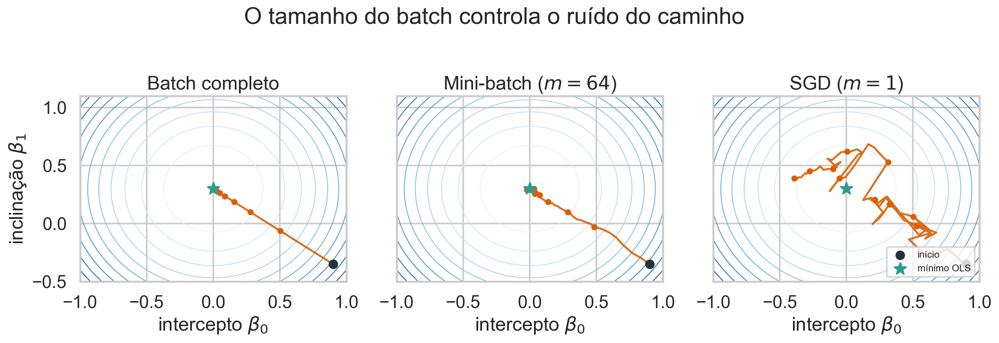
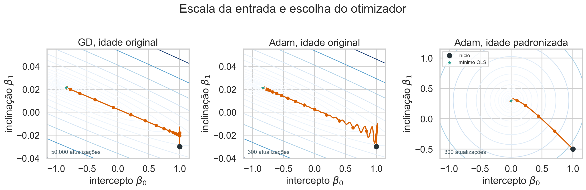

## Objetivos

Este guia mostra como minimizar numericamente a perda quadrática, primeiro com
um parâmetro e depois com intercepto e inclinação. Também compara batch, SGD e
mini-batch e verifica o resultado contra a solução OLS.

## Como estudar este capítulo

Nas aulas anteriores conseguimos encontrar os coeficientes da regressão por uma solução direta. O gradiente descendente resolve a mesma tarefa por aproximações sucessivas: parte de um palpite, mede como a perda muda ao redor dele e dá um pequeno passo na direção que reduz essa perda.

Para entender o algoritmo, acompanhe quatro objetos: os **parâmetros atuais**, a **perda**, o **gradiente** e a **taxa de aprendizado**. O gradiente indica direção e intensidade local da mudança; a taxa determina quanto dessa indicação será usado. Depois de cada atualização, calculamos tudo novamente porque o ponto de partida mudou.

Os gráficos de convergência não são ornamentais. Eles permitem verificar se a perda diminui, se o passo é pequeno demais, se o algoritmo oscila ou se diverge. O objetivo deste capítulo é que você consiga não apenas executar o algoritmo, mas também explicar por que uma execução funcionou ou falhou.

## Base de dados de apoio

Usaremos [Medical Insurance Cost](https://www.kaggle.com/datasets/mosapabdelghany/medical-insurance-cost-dataset), do Kaggle. A continuidade com as Aulas 17–19 permite conferir o resultado iterativo contra a solução OLS conhecida.

```{python}
from pathlib import Path
import numpy as np
import pandas as pd
import matplotlib.pyplot as plt
import seaborn as sns

sns.set_theme(style="whitegrid", context="notebook")
rng = np.random.default_rng(20260827)
df = pd.read_csv(Path("../16-correlacao/data/insurance.csv"))
df[["age", "charges", "smoker"]].head()
```

::: {.callout-note title="Interpretação"}
Cada linha representa uma pessoa. O objetivo computacional será reproduzir a reta OLS de despesas por idade, não construir uma explicação causal das despesas.
:::

## Por que padronizar?

```{python}
x = df["age"].to_numpy(float)
y = df["charges"].to_numpy(float)
xz = (x-x.mean())/x.std()
yz = (y-y.mean())/y.std()
pd.DataFrame({"original_x": x, "padronizado_x": xz,
              "original_y": y, "padronizado_y": yz}).describe().round(3)
```

Padronizar coloca as variáveis em escalas comparáveis. Isso não é necessário para a fórmula fechada de OLS, mas melhora a geometria da otimização iterativa.

Para isolar esse efeito, mantemos a resposta padronizada nos dois casos e mudamos apenas a escala da idade. As curvas de nível representam valores iguais de $J(\beta_0,\beta_1)$; a linha laranja registra as atualizações do gradiente.

```{python}
def contour_surface(xx, intercepts, slopes):
    beta0, beta1 = np.meshgrid(intercepts, slopes)
    objective = (
        np.mean(yz**2)
        - 2*beta0*np.mean(yz)
        - 2*beta1*np.mean(xx*yz)
        + beta0**2
        + 2*beta0*beta1*np.mean(xx)
        + beta1**2*np.mean(xx**2)
    )
    return beta0, beta1, objective

def gradient_path(xx, start, learning_rate, steps):
    theta = np.array(start, dtype=float)
    history = []
    for iteration in range(steps):
        difference = (theta[0]+theta[1]*xx)-yz
        history.append((iteration, *theta, np.mean(difference**2)))
        gradient = np.array([2*np.mean(difference), 2*np.mean(xx*difference)])
        theta -= learning_rate*gradient
    return np.asarray(history)

def ols_coefficients(xx):
    design = np.column_stack([np.ones(len(xx)), xx])
    return np.linalg.solve(design.T@design, design.T@yz)

raw_intercepts = np.linspace(-1.15, 1.15, 180)
raw_slopes = np.linspace(-.04, .055, 180)
std_intercepts = np.linspace(-1.15, 1.15, 180)
std_slopes = np.linspace(-.65, 1.15, 180)
Ar, Br, Zr = contour_surface(x, raw_intercepts, raw_slopes)
As, Bs, Zs = contour_surface(xz, std_intercepts, std_slopes)

path_raw = gradient_path(x, [1, -.03], learning_rate=.0005, steps=50000)
path_std = gradient_path(xz, [1, -.5], learning_rate=.2, steps=20)
theta_raw = ols_coefficients(x)
theta_std = ols_coefficients(xz)
raw_marks = np.unique(np.r_[np.arange(10),
                            [20, 50, 100, 300, 1000, 3000, 10000, 30000, 49999]])

fig, axes = plt.subplots(1, 2, figsize=(12, 4.8))
axes[0].contour(Ar, Br, Zr, levels=Zr.min()+np.geomspace(.002, 8, 16), cmap="Blues")
axes[0].plot(path_raw[:, 1], path_raw[:, 2], color="#d95f02")
axes[0].plot(path_raw[raw_marks, 1], path_raw[raw_marks, 2], "o", color="#d95f02", ms=3)
axes[0].scatter(*theta_raw, color="#2a9d8f", s=70, label="mínimo OLS", zorder=4)
axes[0].scatter(path_raw[0, 1], path_raw[0, 2], color="#263238", s=45, label="início", zorder=4)
axes[0].set(xlabel=r"intercepto $\beta_0$", ylabel=r"inclinação $\beta_1$",
            title="Sem padronização: vale estreito")
axes[0].legend(fontsize=8)

from mpl_toolkits.axes_grid1.inset_locator import inset_axes, mark_inset
zoom = inset_axes(axes[0], width="40%", height="40%", loc="upper right", borderpad=.8)
zoom.contour(Ar, Br, Zr, levels=Zr.min()+np.geomspace(.002, 8, 16), cmap="Blues")
zoom.plot(path_raw[:12, 1], path_raw[:12, 2], "o-", color="#d95f02", ms=3)
zoom.scatter(path_raw[0, 1], path_raw[0, 2], color="#263238", s=35, zorder=4)
zoom.set(xlim=(.992, 1.002), ylim=(-.032, -.011), title="Primeiras 12 iterações")
zoom.tick_params(labelsize=7)
mark_inset(axes[0], zoom, loc1=1, loc2=4, fc="none", ec="#546e7a", lw=1)

axes[1].contour(As, Bs, Zs, levels=Zs.min()+np.geomspace(.002, 4, 16), cmap="Blues")
axes[1].plot(path_std[:, 1], path_std[:, 2], "o-", color="#d95f02", ms=3)
axes[1].scatter(*theta_std, color="#2a9d8f", s=70, label="mínimo OLS", zorder=4)
axes[1].scatter(path_std[0, 1], path_std[0, 2], color="#263238", s=45, label="início", zorder=4)
axes[1].set(xlabel=r"intercepto $\beta_0$", ylabel=r"inclinação $\beta_1$",
            title="Com padronização: caminho direto")
axes[1].legend(fontsize=8)
plt.tight_layout()
plt.show()
```

```{python}
def hessian_condition_number(xx):
    design = np.column_stack([np.ones(len(xx)), xx])
    hessian = 2*design.T@design/len(xx)
    return np.linalg.cond(hessian)

pd.Series({
    "idade original": hessian_condition_number(x),
    "idade padronizada": hessian_condition_number(xz),
}, name="número de condição da Hessiana").round(1)
```

::: {.callout-note title="Interpretação"}
Sem padronização, uma direção da superfície é mais de 15 mil vezes mais curva que a outra. Uma taxa segura precisa ser muito pequena, e o algoritmo alterna correções na inclinação enquanto avança lentamente pelo vale. Depois da padronização, as duas direções têm curvaturas semelhantes e o caminho até o mínimo fica quase direto. As taxas dos painéis são diferentes porque usar $\kappa=0{,}2$ na escala original faria o algoritmo divergir.
:::

## Um parâmetro: regressão pela origem

Considere $\widehat y_i=\beta x_i$. A perda individual e o objetivo empírico são

$$
\rho_i(\beta)=(y_i-\beta x_i)^2,
\qquad
J(\beta)=\frac1n\sum_i\rho_i(\beta).
$$

A derivada é

$$J'(\beta)=\frac2n\sum_i x_i(\beta x_i-y_i).$$

```{python}
def loss_one(beta):
    return np.mean((yz-beta*xz)**2)

def grad_one(beta):
    return 2*np.mean(xz*(beta*xz-yz))

beta_ols = np.sum(xz*yz)/np.sum(xz**2)
pd.Series({"beta_OLS": beta_ols, "gradiente_em_OLS": grad_one(beta_ols)})
```

::: {.callout-note title="Interpretação"}
Como as duas variáveis estão padronizadas, a inclinação OLS é a correlação de Pearson: aproximadamente 0,299. O gradiente praticamente zero confirma que estamos no mínimo numérico.
:::

## Implementação do gradiente descendente

$$\beta_{t+1}=\beta_t-\kappa J'(\beta_t).$$

```{python}
def gradient_descent_one(beta0=-0.7, learning_rate=.25, max_iter=100, tol=1e-10):
    beta = beta0
    history = []
    for iteration in range(max_iter):
        loss = loss_one(beta)
        gradient = grad_one(beta)
        history.append((iteration, beta, loss, gradient))
        beta_new = beta-learning_rate*gradient
        if abs(beta_new-beta) < tol:
            beta = beta_new
            break
        beta = beta_new
    return beta, pd.DataFrame(history, columns=["iteração", "beta", "perda", "gradiente"])

beta_gd, history = gradient_descent_one()
pd.Series({"beta_GD": beta_gd, "beta_OLS": beta_ols,
           "diferença": beta_gd-beta_ols, "iterações": len(history)})
```

::: {.callout-note title="Interpretação"}
Gradiente descendente não produz uma nova estimativa estatística neste caso: ele é um método computacional que aproxima o mesmo minimizador de OLS.
:::

```{python}
fig, axes = plt.subplots(1, 2, figsize=(11, 4))
axes[0].plot(history["iteração"], history["beta"])
axes[0].axhline(beta_ols, color="darkorange", linestyle="--")
axes[0].set(xlabel="iteração", ylabel="beta", title="Parâmetro")
axes[1].plot(history["iteração"], history["perda"])
axes[1].axhline(loss_one(beta_ols), color="darkorange", linestyle="--", label="mínimo OLS")
axes[1].set(xlabel="iteração", ylabel=r"$J(\beta_t)$", title="A perda se estabiliza")
axes[1].legend()
plt.tight_layout(); plt.show()
```

## Taxa de aprendizado

```{python}
summary = []
for learning_rate in [.02, .25, .9, 1.05]:
    beta, hist = gradient_descent_one(learning_rate=learning_rate, max_iter=80, tol=0)
    summary.append({"taxa_aprendizado": learning_rate, "beta_final": beta,
                    "perda_final": loss_one(beta),
                    "menor_perda": hist.perda.min()})
pd.DataFrame(summary)
```

::: {.callout-note title="Interpretação"}
Taxa pequena converge lentamente; uma taxa adequada reduz rapidamente a perda; taxa excessiva oscila ou diverge. A direção do gradiente é local e não determina sozinha o tamanho seguro do passo.
:::

## Dois parâmetros

Agora

$$J(\beta_0,\beta_1)=\frac1n\sum_i(y_i-\beta_0-\beta_1x_i)^2,$$

$$
\nabla J=\frac2n
\begin{bmatrix}
\sum_i d_i\\
\sum_i x_id_i
\end{bmatrix}.
$$

Aqui, $d_i=\widehat y_i-y_i$ mantém a convenção **previsão menos observado**.

```{python}
def loss_grad(theta, xx=xz, yy=yz):
    prediction = theta[0]+theta[1]*xx
    difference = prediction-yy
    loss = np.mean(difference**2)
    gradient = np.array([2*np.mean(difference), 2*np.mean(xx*difference)])
    return loss, gradient

def fit_batch(learning_rate=.2, max_iter=200):
    theta = np.zeros(2)
    out = []
    for t in range(max_iter):
        loss, gradient = loss_grad(theta)
        out.append((t, *theta, loss, np.linalg.norm(gradient)))
        theta = theta-learning_rate*gradient
    return theta, pd.DataFrame(out, columns=["iteração","beta0","beta1","perda","norma_grad"])

theta_gd, hist2 = fit_batch()
theta_gd
```

::: {.callout-note title="Atualização simultânea"}
A função calcula o vetor `gradient` inteiro usando o mesmo valor de `theta`.
Somente depois executa `theta = theta - learning_rate * gradient`, atualizando intercepto
e inclinação juntos. Alterar um coeficiente antes de calcular o gradiente do
outro misturaria parâmetros de duas iterações diferentes.
:::

Na escala padronizada, o intercepto é aproximadamente zero e a inclinação é aproximadamente 0,299.

```{python}
X = np.column_stack([np.ones(len(xz)), xz])
theta_ols = np.linalg.solve(X.T@X, X.T@yz)
pd.DataFrame({"GD": theta_gd, "OLS": theta_ols,
              "diferença": theta_gd-theta_ols}, index=["beta0", "beta1"])
```

::: {.callout-note title="Interpretação"}
A comparação contra uma solução conhecida é um teste de implementação. Se GD não se aproxima de OLS nesta perda convexa, devemos investigar código, taxa, escala ou critério de parada.
:::

## Verificação numérica do gradiente

Uma aproximação por diferenças finitas é

$$
\frac{\partial J}{\partial\theta_j}
\approx\frac{J(\theta+h e_j)-J(\theta-h e_j)}{2h}.
$$

```{python}
theta_test = np.array([.3, -.2])
_, analytic = loss_grad(theta_test)
h = 1e-6
numeric = []
for j in range(2):
    step = np.zeros(2); step[j] = h
    numeric.append((loss_grad(theta_test+step)[0]-loss_grad(theta_test-step)[0])/(2*h))
pd.DataFrame({"analítico": analytic, "numérico": numeric}, index=["beta0", "beta1"])
```

::: {.callout-note title="Interpretação"}
Gradient checking detecta sinais trocados, fatores esquecidos e erros de indexação. Essa prática continua útil em modelos muito maiores.
:::

## Batch, SGD e mini-batch

O código de `fit_batch` calculou o gradiente médio com **todas** as observações
e só então atualizou os parâmetros. Agora vamos escrever separadamente as duas
alternativas que fazem mais de uma atualização por época. A separação deixa
explícita uma diferença importante: SGD e mini-batch não são apenas o mesmo
laço com nomes diferentes; eles usam quantidades diferentes de informação para
escolher cada passo.

### Gradiente descendente estocástico (SGD)

No SGD, uma observação produz um gradiente e uma atualização. Para a observação
$i$, usamos

$$
g_i(\theta)=\nabla_\theta\rho_i(\theta),
\qquad
\theta\leftarrow\theta-\kappa g_i(\theta),
$$

em que $\rho_i(\theta)$ é a perda quadrática da observação $i$, $\theta$ é o
vetor $(\beta_0,\beta_1)^\top$ e $\kappa$ é a taxa de aprendizado. Uma época
termina depois que todas as $n$ observações foram visitadas uma vez.

```{python}
def fit_sgd(learning_rate=.01, epochs=30, seed=20261111):
    theta = np.zeros(2)
    records = []
    generator = np.random.default_rng(seed)

    for epoch in range(epochs):
        # Uma nova ordem evita repetir sempre a mesma sequência de passos.
        order = generator.permutation(len(xz))

        for i in order:
            # Os colchetes mantêm x e y como vetores de uma observação.
            _, gradient = loss_grad(theta, xz[[i]], yz[[i]])

            # SGD atualiza imediatamente: uma observação, uma atualização.
            theta = theta - learning_rate * gradient

        # Avaliamos a perda completa apenas para acompanhar a convergência.
        records.append((epoch, *theta, loss_grad(theta)[0]))

    return theta, pd.DataFrame(records, columns=["época","beta0","beta1","perda"])

theta_sgd, history_sgd = fit_sgd()
pd.Series({
    "beta0_SGD": theta_sgd[0],
    "beta1_SGD": theta_sgd[1],
    "perda_final": history_sgd.iloc[-1]["perda"],
    "atualizações": 30 * len(xz),
})
```

::: {.callout-note title="Interpretação"}
Cada gradiente do SGD é barato, mas representa apenas uma observação. Por isso,
os passos oscilam em torno da direção média da amostra. O algoritmo ainda
precisa completar várias épocas: visitar um único ponto por vez não significa
treinar com apenas um ponto.
:::

### Gradiente descendente em mini-batches

No mini-batch, a atualização usa a média dos gradientes de um grupo $B$ com
$m$ observações:

$$
g_B(\theta)=\frac1m\sum_{i\in B}\nabla_\theta\rho_i(\theta),
\qquad
\theta\leftarrow\theta-\kappa g_B(\theta).
$$

O valor de $\theta$ permanece fixo durante o cálculo dos $m$ gradientes que
formam a média. A atualização ocorre somente depois que o lote foi processado.

```{python}
def fit_minibatch(batch_size=64, learning_rate=.04, epochs=30, seed=20261111):
    theta = np.zeros(2)
    records = []
    generator = np.random.default_rng(seed)

    for epoch in range(epochs):
        # Embaralhamos antes de formar os lotes da nova época.
        order = generator.permutation(len(xz))

        for start in range(0, len(order), batch_size):
            batch_ids = order[start:start + batch_size]

            # loss_grad devolve a média dos gradientes dentro deste lote.
            _, gradient = loss_grad(theta, xz[batch_ids], yz[batch_ids])

            # Uma atualização por lote, não uma atualização por observação.
            theta = theta - learning_rate * gradient

        records.append((epoch, *theta, loss_grad(theta)[0]))

    return theta, pd.DataFrame(
        records, columns=["época", "beta0", "beta1", "perda"]
    )

theta_minibatch, history_minibatch = fit_minibatch(batch_size=64)
pd.Series({
    "beta0_mini_batch": theta_minibatch[0],
    "beta1_mini_batch": theta_minibatch[1],
    "perda_final": history_minibatch.iloc[-1]["perda"],
    "atualizações_por_época": int(np.ceil(len(xz) / 64)),
})
```

::: {.callout-note title="Interpretação"}
O mini-batch suaviza parte do ruído do SGD porque cada direção resume várias
observações, mas atualiza os parâmetros antes de percorrer toda a amostra. O
último lote pode ter menos de 64 elementos; dividir pela quantidade realmente
presente no lote, como `loss_grad` faz com `np.mean`, evita dar peso incorreto a
essa atualização.
:::

### Comparação usando a mesma regressão

Para comparar os três métodos, executamos novamente o batch completo e reunimos
as estimativas com a solução OLS. As taxas de aprendizado não precisam ser
iguais: o ruído e a frequência das atualizações mudam com o tamanho do lote.

```{python}
theta_batch, history_batch = fit_batch(learning_rate=.2, max_iter=200)

comparison = pd.DataFrame(
    [theta_ols, theta_batch, theta_minibatch, theta_sgd],
    index=["OLS", "batch completo", "mini-batch (m=64)", "SGD (m=1)"],
    columns=["beta0", "beta1"],
)
comparison["perda na amostra completa"] = [
    loss_grad(theta)[0] for theta in comparison[["beta0", "beta1"]].to_numpy()
]
comparison.round(5)
```

::: {.callout-note title="Interpretação"}
Batch completo segue um caminho suave, porém cada atualização percorre toda a
amostra. SGD faz atualizações baratas e ruidosas. Mini-batch ocupa uma posição
intermediária entre custo e estabilidade. Como a perda desta regressão é
convexa, os três métodos se aproximam do mesmo mínimo OLS quando a taxa, o número
de épocas e o critério de parada são adequados.
:::

{fig-alt="A mesma superfície quadrática de perda com os caminhos do gradiente batch, mini-batch e SGD."}

Os três caminhos partem do mesmo ponto, usam a mesma taxa de aprendizado e
mostram 70 atualizações. O batch completo usa a direção exata calculada na
amostra inteira. O mini-batch estima essa direção com 64 observações. O SGD usa
apenas uma observação e, por isso, apresenta oscilações maiores. Em uma
execução específica, ele pode terminar longe do mínimo mesmo que suas direções
sejam corretas em média.

## A ordem das amostras em uma época

Considere uma permutação $\pi^{(e)}=(\pi^{(e)}_1,\ldots,\pi^{(e)}_n)$ dos índices da amostra na época $e$. Mini-batch e SGD sorteiam uma nova permutação no início de cada época. O batch completo pode ler os dados nessa ordem, mas o resultado de sua média não depende dela.

```{python}
sample_order = np.array([4, 1, 9, 2, 11, 6, 3, 12, 7, 5, 10, 8])
positions = np.arange(len(sample_order))*1.2
blue, green, orange = "#1f6f8b", "#2a9d8f", "#d95f02"

fig, ax = plt.subplots(figsize=(13, 4.5))
row_specs = [
    ("Batch completo", 2, [blue]*12, [11], "1 atualização"),
    ("Mini-batch ($m=4$)", 1, [blue]*4+[green]*4+[orange]*4,
     [3, 7, 11], "3 atualizações"),
    ("SGD ($m=1$)", 0, [orange]*12, list(range(12)), "12 atualizações"),
]

for label, y_row, colors, update_after, count_label in row_specs:
    ax.scatter(positions, np.full(12, y_row), marker="s", s=420,
               color=colors, edgecolor="white")
    for x_pos, sample_id in zip(positions, sample_order):
        ax.text(x_pos, y_row, str(sample_id), ha="center", va="center",
                color="white", fontsize=9, fontweight="bold")
    update_x = positions[np.asarray(update_after)]+.52
    ax.scatter(update_x, np.full(len(update_x), y_row), marker="|",
               s=400, color="#263238", linewidth=2)
    ax.text(-1.05, y_row, label, ha="right", va="center",
            fontsize=12, fontweight="bold")
    ax.text(positions[-1]+1.1, y_row, count_label, va="center", fontsize=10)

ax.text(positions.mean(), 2.6, "Mesma ordem embaralhada em uma época",
        ha="center", fontsize=15)
ax.text(positions.mean(), -.62, "A barra preta marca uma atualização dos parâmetros",
        ha="center", fontsize=10)
ax.set(xlim=(-2.2, positions[-1]+3), ylim=(-.8, 2.8))
ax.axis("off")
plt.show()
```

::: {.callout-note title="Interpretação"}
No batch completo, o algoritmo lê a época inteira antes de atualizar. Com mini-batches de quatro observações, a mesma época produz três atualizações. No SGD, cada observação produz uma atualização, por isso a sequência influencia mais fortemente o caminho.
:::

O procedimento operacional fica assim:

1. **Batch completo:** mantenha $\theta$ fixo enquanto calcula os gradientes das $n$ observações. Tire a média desses $n$ vetores e faça uma única atualização. Essa atualização encerra a época.
2. **Mini-batch:** embaralhe os índices, divida-os em grupos de tamanho $m$ e mantenha $\theta$ fixo apenas dentro de cada grupo. Tire a média dos $m$ gradientes, atualize os parâmetros e passe ao grupo seguinte. Uma época termina quando todos os grupos foram processados.
3. **SGD:** embaralhe os índices e apresente uma observação de cada vez. Calcule seu gradiente e atualize imediatamente. Depois de $n$ atualizações, todas as observações foram visitadas e a época termina. A época seguinte começa com uma nova permutação.

Os métodos repetem várias épocas até atingir um critério de parada. O mini-batch ocupa a posição intermediária: usa mais observações que o SGD em cada atualização, mas atualiza com mais frequência que o batch completo.

::: {.callout-note title="Convenção usada nesta aula"}
Estamos usando épocas formadas por uma permutação sem reposição da amostra. Algumas formulações teóricas do SGD sorteiam observações com reposição; nesse caso, “época” é apenas uma convenção para contar aproximadamente $n$ sorteios.
:::

## Por que a ordem importa?

No batch completo, todas as derivadas são calculadas no mesmo ponto $\theta$:

$$
g(\theta;\pi)
=\frac1n\sum_{j=1}^n\nabla\rho_{\pi_j}(\theta)
=\frac1n\sum_{i=1}^n\nabla\rho_i(\theta).
$$

Como a soma não depende da permutação $\pi$, a ordem de leitura não altera o gradiente completo. A atualização ocorre somente depois de calcular e tirar a média dos gradientes de todas as observações.

No mini-batch, a permutação define os grupos

$$
B_{t,k}=\{\pi_{(k-1)m+1},\ldots,\pi_{km}\},
$$

e cada grupo atualiza os parâmetros antes do cálculo seguinte:

$$
\theta_{t,k+1}=\theta_{t,k}
-\kappa\frac1m\sum_{i\in B_{t,k}}\nabla\rho_i(\theta_{t,k}).
$$

Portanto, outra ordem forma outros grupos e avalia os gradientes em uma sequência diferente de valores de $\theta$. No SGD, $m=1$, então cada observação altera o ponto no qual o gradiente da próxima observação será calculado.

::: {.callout-note title="Prática recomendada"}
Em dados independentes, embaralhe novamente os índices no início de cada época do mini-batch ou do SGD. Isso evita que uma ordenação por grupo, resposta ou coleta produza sequências sistemáticas de gradientes. O batch completo não precisa ser embaralhado para produzir o mesmo gradiente. Em séries temporais, dados espaciais ou observações agrupadas, não embaralhe automaticamente: preserve a dependência relevante ou use batches compatíveis com a estrutura da coleta.
:::

## Adam: passos adaptativos por parâmetro

O gradiente descendente básico aplica a mesma taxa global a todas as
coordenadas de $\theta$. Adam, abreviação de *Adaptive Moment Estimation*,
combina duas médias móveis para adaptar essa atualização.

Para evitar colisões com $m$, já usado para o tamanho do mini-batch, e com os
coeficientes $\beta$ da regressão, usaremos $u_t$, $s_t$, $\gamma_1$ e
$\gamma_2$. A literatura costuma representar as mesmas quantidades por
$m_t$, $v_t$, $\beta_1$ e $\beta_2$.

Se $g_t=\nabla J(\theta_t)$, o primeiro resumo acompanha a direção média dos
gradientes:

$$
u_t=\gamma_1u_{t-1}+(1-\gamma_1)g_t.
$$

Imagine uma bola descendo um vale. Se a inclinação aponta repetidamente para a
mesma direção, a bola acumula velocidade. De modo semelhante, $u_t$ preserva
parte dos gradientes anteriores e produz uma espécie de inércia.

O segundo acompanha a escala recente de cada componente:

$$
s_{t,j}=\gamma_2s_{t-1,j}+(1-\gamma_2)g_{t,j}^{,2},
$$

em que $j$ identifica uma coordenada do vetor de parâmetros. Esse segundo
resumo funciona como um freio adaptativo: direções com gradientes recentes
maiores recebem passos relativamente menores. Assim, a bola mantém movimento
ao longo do vale sem atravessar repetidamente suas paredes mais íngremes.

Adam corrige o efeito da inicialização $u_0=s_0=0$:

$$
\widehat u_t=\frac{u_t}{1-\gamma_1^t},
\qquad
\widehat s_t=\frac{s_t}{1-\gamma_2^t}.
$$

Finalmente, atualiza cada parâmetro por

$$
\theta_{t+1}=\theta_t-
\kappa\frac{\widehat u_t}{\sqrt{\widehat s_t}+\varepsilon}.
$$

Aqui, $\kappa$ controla a escala global do passo, $\gamma_1$ e $\gamma_2$
controlam quanto histórico as médias preservam, e $\varepsilon$ evita uma
divisão por zero. Valores iniciais usuais são $\kappa=0{,}001$,
$\gamma_1=0{,}9$, $\gamma_2=0{,}999$ e $\varepsilon=10^{-8}$, mas eles ainda
podem precisar de ajuste.

### Por que corrigir o viés inicial?

Na primeira iteração,

$$
u_1=(1-\gamma_1)g_1,
\qquad
s_{1,j}=(1-\gamma_2)g_{1,j}^{,2}.
$$

Esses valores ficam próximos de zero porque as médias começaram em zero. As
correções devolvem a escala do primeiro gradiente:

$$
\widehat u_1=g_1,
\qquad
\widehat s_{1,j}=g_{1,j}^{,2}.
$$

Quando $t$ aumenta, $\gamma_1^t$ e $\gamma_2^t$ tendem a zero. Por isso, a
correção afeta principalmente o início da otimização.

### Adam aplicado à mesma regressão

O código abaixo ajusta o modelo com a idade na escala original e repete o
processo com a idade padronizada. Assim, podemos comparar a convergência de
Adam no vale estreito dos dados brutos e na geometria mais circular produzida
pela normalização.

```{python}
#| label: adam-regressao
#| echo: true
def fit_adam(xx=x, yy=yz, start=(1.0, -.03), learning_rate=.02, steps=300,
             gamma1=.9, gamma2=.999, epsilon=1e-8):
    theta = np.array(start, dtype=float)
    u = np.zeros_like(theta)
    s = np.zeros_like(theta)
    history = []

    for t in range(1, steps+1):
        prediction = theta[0]+theta[1]*xx
        difference = prediction-yy
        gradient = np.array([
            2*np.mean(difference),
            2*np.mean(xx*difference),
        ])
        u = gamma1*u+(1-gamma1)*gradient
        s = gamma2*s+(1-gamma2)*gradient**2
        u_corrected = u/(1-gamma1**t)
        s_corrected = s/(1-gamma2**t)
        theta -= learning_rate*u_corrected/(np.sqrt(s_corrected)+epsilon)
        history.append((t, *theta, np.mean((yy-theta[0]-theta[1]*xx)**2)))

    return theta, pd.DataFrame(
        history, columns=["iteração", "beta0", "beta1", "perda"]
    )

theta_adam_raw, history_adam_raw = fit_adam()
theta_adam_std, history_adam_std = fit_adam(
    xx=xz, start=(1.0, -.5)
)
X_raw = np.column_stack([np.ones(len(x)), x])
theta_ols_raw = np.linalg.solve(X_raw.T@X_raw, X_raw.T@yz)
X_std = np.column_stack([np.ones(len(xz)), xz])
theta_ols_std = np.linalg.solve(X_std.T@X_std, X_std.T@yz)

display(pd.DataFrame(
    {"Adam": theta_adam_raw, "OLS": theta_ols_raw,
     "diferença": theta_adam_raw-theta_ols_raw},
    index=["beta0", "beta1"],
).round(5))

prediction_adam_raw = X_raw@theta_adam_raw
prediction_ols_raw = X_raw@theta_ols_raw
prediction_adam_std = X_std@theta_adam_std
prediction_ols_std = X_std@theta_ols_std

pd.DataFrame({
    "entrada": ["idade original", "idade padronizada"],
    "atualizações": [len(history_adam_raw), len(history_adam_std)],
    "perda final": [history_adam_raw.iloc[-1]["perda"],
                    history_adam_std.iloc[-1]["perda"]],
    "RMSE entre previsões Adam e OLS": [
        np.sqrt(np.mean((prediction_adam_raw-prediction_ols_raw)**2)),
        np.sqrt(np.mean((prediction_adam_std-prediction_ols_std)**2)),
    ],
}).round(6)
```

{fig-alt="Três painéis de curvas de nível comparando gradiente descendente com a idade original, Adam com a idade original e Adam com a idade padronizada."}

::: {.callout-note title="Interpretação"}
Adam aproxima a solução OLS com menos atualizações neste exemplo porque ajusta
o passo de cada coeficiente à escala recente de seus gradientes. Portanto, ele
tolera melhor a diferença de escala entre o intercepto e a idade e consegue
convergir aqui sem normalizar $x$. Isso não transforma Adam em uma escolha
automática nem prova que normalização seja sempre dispensável. Com a idade
padronizada, as curvas de nível ficam mais circulares e o caminho se torna mais
direto, mesmo mantendo a mesma taxa e o mesmo número de atualizações. Adam
mantém dois vetores extras, ainda exige uma taxa global e não substitui o
diagnóstico de convergência. Para esta regressão simples, OLS continua sendo a
solução de referência.
:::


## O algoritmo explicado passo a passo

Gradiente descendente repete uma ideia simples:

1. **Começar com parâmetros iniciais.** Eles podem ser zero ou pequenos valores
   aleatórios, dependendo do modelo.
2. **Produzir previsões.** Usamos os parâmetros atuais para calcular
   $\widehat y$.
3. **Medir o erro.** A função de perda resume quão ruins são essas previsões.
4. **Calcular o gradiente.** Ele informa em qual direção a perda aumenta mais
   rapidamente para cada parâmetro.
5. **Andar na direção contrária.** Atualizamos
   $\beta\leftarrow\beta-\kappa\nabla J(\beta)$.
6. **Repetir até estabilizar.** Monitoramos perda, gradiente e mudanças nos
   parâmetros.

$\kappa$ é a taxa de aprendizado. Ela controla o tamanho do passo, não a direção.
Se for muito pequena, o algoritmo demora; se for muito grande, pode ultrapassar
o mínimo repetidamente ou divergir.

## Como diagnosticar a execução

- **A perda cai suavemente:** comportamento esperado no exemplo quadrático.
- **A perda oscila:** a taxa pode estar alta ou as escalas muito diferentes.
- **A perda vira `NaN`:** passos grandes podem ter causado estouro numérico.
- **A perda para longe da referência OLS:** reveja derivada, sinal, intercepto e
  padronização.
- **Treino melhora e validação piora:** o problema é generalização, não
  convergência computacional.

::: {.callout-warning title="Convergência não é qualidade científica"}
Chegar a uma perda pequena mostra que o algoritmo otimizou o objetivo. Não
garante que o modelo generalize, que os dados representem a população ou que a
relação seja causal.
:::

## Questões de revisão

1. Derive o gradiente de $J(\beta_0,\beta_1)$.
2. Explique por que subtraímos, e não somamos, o gradiente.
3. Diferencie iteração, batch e época.
4. Por que padronização pode acelerar convergência?
5. Diferencie batch completo, mini-batch e SGD.
6. Qual é a função de $u_t$ e $s_t$ no Adam?
7. Por que Adam corrige as médias móveis nas primeiras iterações?
8. Como você testaria uma implementação de GD para regressão?

## Bibliografia

- Data 100, *Principles and Techniques of Data Science*, otimização.
- James et al., *An Introduction to Statistical Learning*.
- Kingma e Ba, *Adam: A Method for Stochastic Optimization*.
- Ruder, *An Overview of Gradient Descent Optimization Algorithms*.
