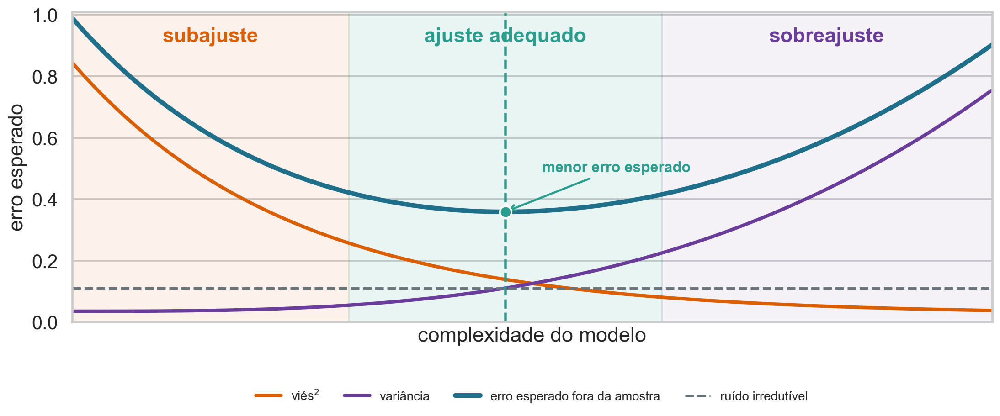
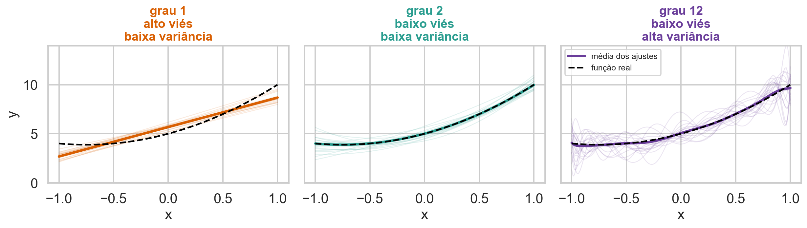
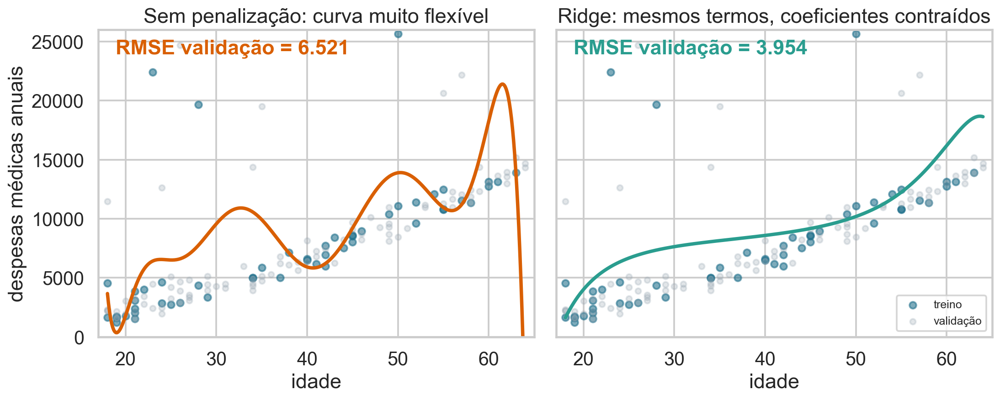
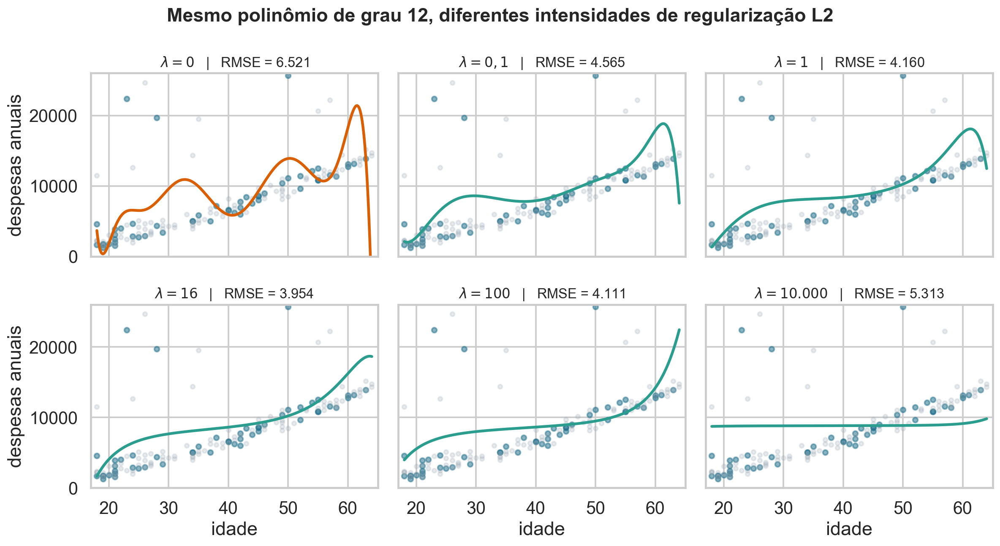
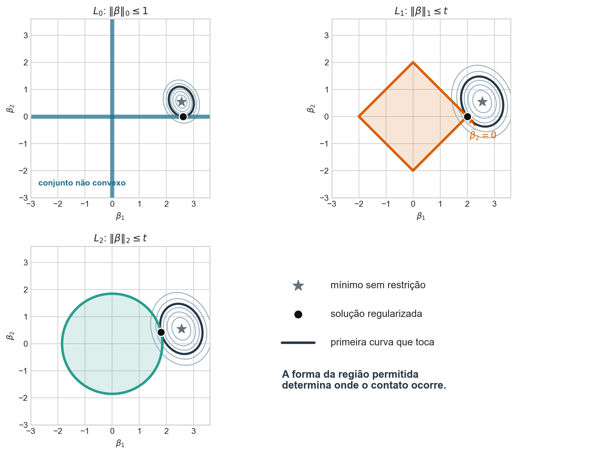
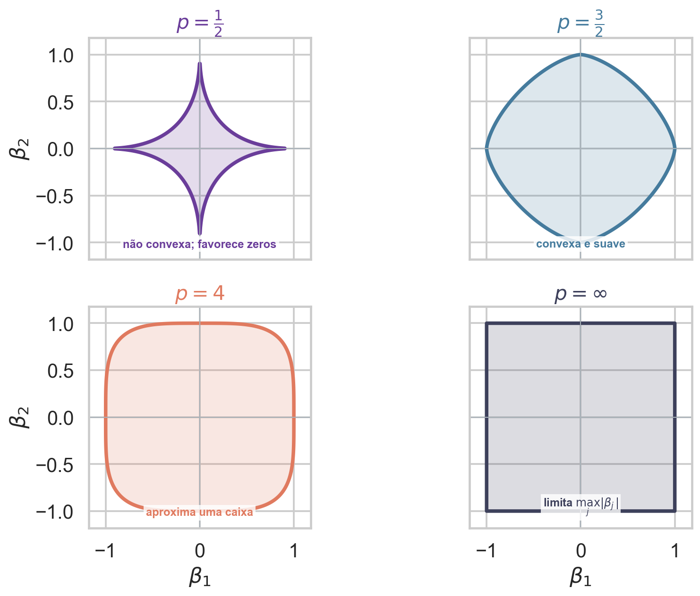

## Objetivos

Este guia explica por que baixo erro de treinamento não garante generalização, deriva Ridge e compara as penalizações $L_0$, $L_1$ e $L_2$. O estudo numérico usa apenas NumPy para tornar explícitas as etapas de padronização, ajuste e validação.

## Como estudar este capítulo

Um modelo pode aprender tão bem os detalhes da amostra de treinamento que passa a reproduzir também seu ruído. Regularização responde a esse problema acrescentando ao ajuste um custo para modelos excessivamente complexos. Aceitamos um pouco mais de erro no treinamento em troca de coeficientes mais estáveis e melhor desempenho em dados novos.

O parâmetro $\lambda$ controla essa troca: quando é pequeno, a prioridade permanece no ajuste; quando cresce, a penalização ganha força. Ridge reduz continuamente os coeficientes, enquanto Lasso pode levar alguns exatamente a zero. Nenhuma delas torna automaticamente o modelo bom: representação, divisão dos dados e validação continuam essenciais.

Preste atenção especial à ordem do processo. A padronização deve ser aprendida somente com o conjunto de treinamento de cada divisão; $\lambda$ deve ser escolhido na validação; o teste deve ser usado uma única vez para estimar o desempenho final. Essa disciplina evita que informação futura influencie o modelo.

## Base de dados de apoio

Usaremos [Medical Insurance Cost](https://www.kaggle.com/datasets/mosapabdelghany/medical-insurance-cost-dataset), do Kaggle. Cada linha representa uma pessoa segurada; `charges` registra despesas e os demais campos descrevem idade, IMC, tabagismo, sexo, filhos e região.

```{python}
from pathlib import Path
import numpy as np
import pandas as pd
import matplotlib.pyplot as plt
import seaborn as sns

sns.set_theme(style="whitegrid", context="notebook")
rng = np.random.default_rng(20260827)
df = pd.read_csv(Path("../16-correlacao/data/insurance.csv"))
df.head()
```

```{python}
df.info()
```

```{python}
df.describe(include="all").T
```

::: {.callout-note title="Interpretação"}
A base contém 1.338 observações sem valores ausentes. `charges` é assimétrica e tabagismo separa patamares de despesas. O objetivo é pedagógico e preditivo: coeficientes não devem ser interpretados como efeitos causais.
:::

## Diagnóstico descritivo

```{python}
fig, axes = plt.subplots(1, 2, figsize=(11, 4))
sns.scatterplot(data=df, x="age", y="charges", hue="smoker", alpha=.45, ax=axes[0])
sns.scatterplot(data=df, x="bmi", y="charges", hue="smoker", alpha=.45, ax=axes[1], legend=False)
plt.tight_layout(); plt.show()
```

::: {.callout-note title="Interpretação"}
Idade e IMC têm associações com despesas, mas o padrão depende fortemente de tabagismo. Interações e termos não lineares podem melhorar aproximação; criar muitos deles, porém, aumenta instabilidade.
:::

## Erro de treino e risco de generalização

Para uma regra $f$, o erro empírico quadrático é

$$
\widehat R_{treino}(f)=\frac1n\sum_{i=1}^n(y_i-f(x_i))^2.
$$

O objetivo real é o risco sobre uma nova observação da mesma população:

$$R(f)=E[(Y-f(X))^2].$$

$n$ é o tamanho do treino, $(x_i,y_i)$ é a observação $i$ e a esperança em $R(f)$ abrange novos conjuntos de treino e novas observações. Modelos mais flexíveis tendem a reduzir $\widehat R_{treino}$, mas não necessariamente $R$.

## Decomposição viés–variância

Suponha $Y=f(x)+\varepsilon$, com $E[\varepsilon]=0$ e $\operatorname{Var}(\varepsilon)=\sigma^2$. Em um ponto fixo $x$,

$$E[(Y-\widehat f(x))^2]
=\sigma^2+\{E[\widehat f(x)]-f(x)\}^2
+E[(\widehat f(x)-E[\widehat f(x)])^2].$$

Os termos são, respectivamente, ruído irredutível, viés ao quadrado e variância do procedimento de ajuste.

Para derivar, escreva

$$Y-\widehat f=(f+\varepsilon-E[\widehat f])+(E[\widehat f]-\widehat f).$$

Ao expandir o quadrado, os termos cruzados somem porque $E[\varepsilon]=0$ e $E[\widehat f-E\widehat f]=0$.

::: {.callout-note title="Interpretação"}
Regularização deliberadamente aumenta viés ao contrair coeficientes. A aposta é reduzir mais a variância, diminuindo o erro total fora da amostra.
:::

## Subajuste, ajuste adequado e sobreajuste

{fig-alt="Curvas de viés ao quadrado, variância e erro esperado fora da amostra ao longo da complexidade, com as regiões de subajuste, ajuste adequado e sobreajuste."}

Quando o modelo tem flexibilidade insuficiente, ele não consegue representar a estrutura relevante dos dados. Esse **subajuste** produz viés alto. Em geral, tanto o erro de treino quanto o erro de validação permanecem altos.

À medida que a complexidade aumenta, o viés tende a diminuir. Existe uma faixa em que o modelo representa o padrão sem reagir excessivamente às particularidades da amostra. Chamamos essa região de **ajuste adequado**: ela corresponde ao menor erro esperado em dados que não participaram do ajuste.

Se continuarmos aumentando a flexibilidade, o modelo pode aprender flutuações aleatórias do conjunto de treino. Nesse **sobreajuste**, o erro de treino ainda cai, mas o erro de validação cresce porque o ajuste muda muito quando a amostra muda. A variância passa a dominar.

::: {.callout-note title="Como diagnosticar"}
O erro de treino, sozinho, não distingue um ajuste adequado de um sobreajuste. Precisamos estimar o desempenho fora da amostra com dados de validação ou com um procedimento de reamostragem. O ponto de menor erro depende da quantidade de dados, do ruído, dos atributos, da perda e do método de ajuste.
:::

## Viés e variância em modelos concretos

{fig-alt="Ajustes polinomiais de graus 1, 2 e 12 em várias amostras, identificados por seus níveis de viés e variância."}

Cada curva clara corresponde ao modelo ajustado em uma amostra diferente. A linha colorida mais espessa é a média desses ajustes. A linha preta tracejada representa a função verdadeira usada na simulação.

- **Grau 1:** as curvas ficam próximas umas das outras, indicando baixa variância. Entretanto, a média dos ajustes não acompanha a curvatura verdadeira. O modelo tem alto viés.
- **Grau 2:** a média dos ajustes acompanha a função verdadeira e as curvas individuais permanecem próximas. Nesse exemplo, viés e variância são baixos.
- **Grau 12:** a média pode ficar próxima da função verdadeira, mas os ajustes individuais mudam muito quando a amostra muda. O modelo tem alta variância.

::: {.callout-note title="Leitura visual"}
Viés aparece como uma distância sistemática entre a média dos ajustes e a função verdadeira. Variância aparece como dispersão entre os ajustes obtidos em amostras diferentes.
:::

## Por que regularizar?

Modelos estatísticos são aproximações. Como sintetizou George E. P. Box, “todos os modelos estão errados, mas alguns são úteis”. A utilidade, neste contexto, depende de o modelo capturar uma estrutura que continue funcionando fora da amostra usada no ajuste.

Aumentar a flexibilidade amplia o conjunto de padrões que o modelo consegue representar. Isso pode reduzir o viés, mas também permite que o ajuste reaja a ruídos e particularidades da amostra. Por esse motivo, minimizar apenas o erro de treinamento favorece modelos cada vez mais complexos.

**Regularização** modifica o critério de ajuste: além de cobrar erro nas previsões, ela cobra complexidade. O modelo passa a aceitar um pequeno aumento do erro de treino quando essa troca produz coeficientes mais estáveis e melhor desempenho em novos dados.

::: {.callout-note title="Ideia central"}
Regularizar não significa procurar o modelo mais simples possível. Procuramos a complexidade que oferece o melhor compromisso entre aproximação e estabilidade.
:::

### Exemplo na base Insurance: controlando a flexibilidade

{fig-alt="Na base Insurance, um polinômio de grau 12 sem penalização produz uma curva muito flexível, enquanto Ridge contrai os coeficientes e produz um ajuste mais estável."}

Para tornar o efeito visível, usamos o recorte de pessoas não fumantes e construímos termos polinomiais da idade até o grau 12. Os dois painéis partem exatamente da mesma base de atributos. A diferença está no critério de otimização.

- Sem penalização, todos os coeficientes ficam livres para reduzir o erro de treinamento. A curva reage a flutuações locais da amostra e piora no conjunto de validação.
- Com Ridge, a otimização cobra magnitudes grandes. Os termos continuam disponíveis, mas sua influência é contraída, produzindo uma curva mais estável e menor erro de validação.

Esse exemplo mostra que regularização não precisa mudar a representação inicial. Ela controla quanta flexibilidade o processo de ajuste efetivamente utiliza.

#### Vários valores de $\lambda$

{fig-alt="Seis regressões polinomiais de grau 12 na base Insurance, com penalização L2 crescente. A curva passa de muito oscilante para excessivamente rígida."}

O grau do polinômio permanece igual a 12 em todos os painéis. Alteramos apenas a intensidade da penalização $L_2$:

- em $\lambda=0$, recuperamos mínimos quadrados sem regularização e a curva reage fortemente às flutuações do treino;
- à medida que $\lambda$ aumenta, coeficientes grandes ficam mais caros e a curva se torna mais suave;
- perto do melhor valor de validação, a redução de variância compensa o pequeno aumento de viés;
- valores excessivos de $\lambda$ contraem demais os coeficientes e produzem subajuste.

::: {.callout-note title="Como escolher"}
Não escolhemos $\lambda$ pela aparência da curva nem pelo erro de treinamento. Comparamos valores em dados de validação e preservamos o conjunto de teste para a avaliação final da pipeline escolhida.
:::

### Seleção direta com $L_0$

Na base Insurance, o conjunto inicial pode conter atributos originais, potências e interações:

$$\phi(x)=(\text{age},\text{bmi},\text{smoker},\text{age}^2,
\text{bmi}^2,\text{age}\times\text{smoker},\ldots).$$

Escrevemos o modelo como

$$\widehat y_i=\beta_0+\sum_{j=1}^{p}\beta_j\phi_j(x_i).$$

A quantidade

$$\|\beta\|_0=\sum_{j=1}^{p}\mathbb 1(\beta_j\neq0)$$

conta quantos coeficientes são diferentes de zero. A restrição $\|\beta\|_0\le k$ permite no máximo $k$ termos e força os demais coeficientes a zero. Apesar do nome tradicional, $L_0$ não é uma norma matemática.

A formulação é conceitualmente simples, mas exige procurar entre

$$\sum_{r=0}^{k}{p\choose r}$$

subconjuntos. Esse custo combinatório motiva penalizações mais tratáveis. Ridge reduz continuamente os coeficientes. Lasso, apresentado adiante, pode produzir zeros exatos sem enumerar explicitamente todos os subconjuntos.

## Construção de atributos

Criaremos termos polinomiais e interações. Essa expansão é propositalmente redundante para revelar o efeito da regularização.

```{python}
age = df["age"].to_numpy(float)
bmi = df["bmi"].to_numpy(float)
smoker = (df["smoker"] == "yes").to_numpy(float)
y = df["charges"].to_numpy(float)

X_raw = np.column_stack([
    age, bmi, smoker, age*bmi, age*smoker, bmi*smoker,
    age**2, bmi**2, age**3, bmi**3
])
names = ["age", "bmi", "smoker", "age:bmi", "age:smoker",
         "bmi:smoker", "age²", "bmi²", "age³", "bmi³"]
pd.DataFrame(X_raw, columns=names).head()
```

## Divisão e padronização sem vazamento

```{python}
idx = rng.permutation(len(df))
n_train = int(.60*len(df))
n_valid = int(.20*len(df))
train = idx[:n_train]
valid = idx[n_train:n_train+n_valid]
test = idx[n_train+n_valid:]

mean_x = X_raw[train].mean(axis=0)
sd_x = X_raw[train].std(axis=0)
X_train = (X_raw[train]-mean_x)/sd_x
X_valid = (X_raw[valid]-mean_x)/sd_x
X_test = (X_raw[test]-mean_x)/sd_x
y_mean = y[train].mean()
y_train = y[train]-y_mean

pd.Series({"n_treino": len(train), "n_validacao": len(valid), "n_teste": len(test),
           "p": X_train.shape[1]})
```

::: {.callout-note title="Interpretação"}
Médias e desvios foram aprendidos apenas no treino e reaplicados ao teste. Padronizar antes da divisão permitiria que o teste influenciasse o treinamento. Como $y$ foi centrado, o intercepto é recuperado por `y_mean` e não será penalizado.
:::

## Formulação geral

Regularização resolve

$$
\widehat\beta_\lambda=\arg\min_\beta
\left\{\frac1n\|y-X\beta\|_2^2+\lambda P(\beta)\right\}.
$$

$X$ é a matriz padronizada, $y$ é a resposta centrada, $P(\beta)$ mede complexidade e $\lambda\ge0$ é a intensidade da penalização.

As escolhas principais são:

$$\|\beta\|_0=\sum_j\mathbb 1(\beta_j\ne0),\qquad
\|\beta\|_1=\sum_j|\beta_j|,\qquad
\|\beta\|_2^2=\sum_j\beta_j^2.$$

$L_0$ conta termos e exige busca combinatória; $L_1$ produz Lasso; $L_2$ produz Ridge.

## Geometria das restrições $L_0$, $L_1$ e $L_2$

Uma forma útil de interpretar a regularização é separar a perda da região permitida:

$$\min_\beta L(\beta)\qquad\text{sujeito a}\qquad P(\beta)\le t.$$

$L(\beta)$ é a perda do modelo, $P(\beta)$ mede a complexidade dos coeficientes e $t$ controla o tamanho da região permitida. As curvas de nível reúnem coeficientes com a mesma perda. A solução restrita aparece quando a menor curva de nível alcançável toca essa região.

{fig-alt="Curvas de nível de uma perda quadrática tocando os conjuntos permitidos por L0, L1 e L2. No painel L1, a solução aparece no vértice direito do losango e beta 2 é igual a zero."}

- **$L_0$ com $\|\beta\|_0\le1$:** permite no máximo um coeficiente não nulo. Em duas dimensões, o conjunto permitido é a união dos eixos. $L_0$ conta coeficientes e não satisfaz os requisitos de uma norma.
- **$L_1$:** a região é um losango. Neste exemplo, a primeira curva de nível alcançável toca o vértice $(2,0)$. Portanto, $\widehat\beta_1=2$ e $\widehat\beta_2=0$: o Lasso remove a segunda direção do modelo.
- **$L_2$:** a região tem borda suave. O contato normalmente ocorre fora dos eixos, contraindo os coeficientes sem zerá-los exatamente.

::: {.callout-note title="Leitura da figura"}
A estrela marca o mínimo sem restrição. O ponto preto marca o melhor coeficiente permitido. No painel $L_1$, a ponta do losango está alinhada com uma curva de nível antes que qualquer ponto da aresta seja alcançado. Essa geometria explica por que o Lasso pode produzir zeros exatos. A regularização não altera as curvas de nível da perda nessa interpretação; ela limita quais pontos podem ser escolhidos.
:::

## Outros valores de $p$

Para $p\ge1$, definimos a norma

$$\|\beta\|_p=\left(\sum_{j=1}^m|\beta_j|^p\right)^{1/p},$$

em que $m$ é o número de coeficientes penalizados. Valores diferentes de $p$ produzem geometrias diferentes.

{fig-alt="Regiões unitárias para p igual a um meio, três meios, quatro e infinito."}

- **$p=1/2$:** a expressão é uma quase-norma, não uma norma. A região não convexa possui pontas pronunciadas sobre os eixos e favorece soluções esparsas, mas a otimização pode ter mínimos locais.
- **$p=3/2$:** a região é convexa e suave. Os coeficientes são contraídos, mas zeros exatos deixam de ser típicos.
- **$p=4$:** a região se aproxima de uma caixa e penaliza combinações com coordenadas grandes de modo diferente de Ridge.
- **$p=\infty$:** $\|\beta\|_\infty=\max_j|\beta_j|$. A restrição limita diretamente o maior coeficiente em módulo.

::: {.callout-note title="Por que $L_1$ e $L_2$ aparecem com maior frequência?"}
Ambas produzem problemas convexos. Ridge oferece suavidade e estabilidade; Lasso acrescenta a possibilidade de seleção. Penalizações com $p<1$ podem gerar modelos ainda mais esparsos, mas exigem algoritmos e cuidados adicionais porque o problema deixa de ser convexo.
:::

## Derivação de Ridge

Para

$$J(\beta)=\frac1n(y-X\beta)^T(y-X\beta)+\lambda\beta^TD\beta,$$

em que $D=\operatorname{diag}(0,1,\ldots,1)$ quando a primeira coluna de $X$ é o intercepto, o gradiente é

$$\nabla J(\beta)=\frac2nX^T(X\beta-y)+2\lambda D\beta.$$

O zero na primeira posição de $D$ impede que a penalização contraia o intercepto. Nas demais coordenadas, o termo $2\lambda\beta_j$ aponta na direção do sinal de $\beta_j$. Como o gradiente é subtraído na atualização, essa parcela move o coeficiente em direção a zero.

Igualando a zero:

$$X^TX\beta+n\lambda D\beta=X^Ty,$$

portanto

$$\widehat\beta^{ridge}=(X^TX+n\lambda D)^{-1}X^Ty.$$

$D=\operatorname{diag}(0,1,\ldots,1)$ mantém o intercepto fora da penalização e adiciona $n\lambda$ apenas às demais entradas diagonais. Se o modelo não tiver intercepto, ou se todas as coordenadas forem penalizadas, então $D=I$.

### Gradiente descendente com Ridge

A implementação abaixo reescreve o gradiente descendente da Aula 21. A parcela do MSE permanece igual; acrescentamos o gradiente da penalização e registramos a função objetivo completa.

```{python}
def ridge_gd(X, y, lambda_, learning_rate=0.01,
             max_iter=50_000, tol=1e-6):
    X = np.asarray(X, dtype=float)
    y = np.asarray(y, dtype=float)
    n, p = X.shape

    beta = np.zeros(p)
    penaliza = np.ones(p)
    penaliza[0] = 0
    historico = []

    for _ in range(max_iter):
        erro = X @ beta - y
        grad_mse = (2 / n) * X.T @ erro
        grad_ridge = 2 * lambda_ * penaliza * beta
        gradiente = grad_mse + grad_ridge

        perda = np.mean(erro**2)
        perda += lambda_ * np.sum((penaliza * beta)**2)
        historico.append(perda)

        if np.linalg.norm(gradiente) < tol:
            break
        beta = beta - learning_rate * gradiente

    return beta, np.asarray(historico)
```

No material numérico, `X_train` não contém o intercepto porque `y_train` foi centrado. Para testar a versão geral da função, acrescentamos uma coluna de 1:

```{python}
X_train_gd = np.column_stack([np.ones(len(X_train)), X_train])
beta_ridge_gd, historico_ridge_gd = ridge_gd(
    X_train_gd, y_train, lambda_=0.01, learning_rate=0.01
)

pd.Series({
    "iterações": len(historico_ridge_gd),
    "objetivo_inicial": historico_ridge_gd[0],
    "objetivo_final": historico_ridge_gd[-1],
    "norma_coeficientes": np.linalg.norm(beta_ridge_gd[1:]),
}).round(3)
```

::: {.callout-note title="Interpretação"}
Todas as coordenadas são atualizadas simultaneamente. O intercepto participa do gradiente do MSE, mas não de `grad_ridge`. Se $\lambda$ aumentar, a parcela de contração ganha mais peso em cada atualização.
:::

## Ajuste Ridge

```{python}
def ridge(X, y, lam):
    p = X.shape[1]
    return np.linalg.solve(X.T@X + len(X)*lam*np.eye(p), X.T@y)

def rmse(observed, predicted):
    return np.sqrt(np.mean((observed-predicted)**2))

beta_ols = np.linalg.lstsq(X_train, y_train, rcond=None)[0]
beta_ridge = ridge(X_train, y_train, lam=.01)
pd.DataFrame({"OLS": beta_ols, "Ridge": beta_ridge}, index=names).round(2)
```

::: {.callout-note title="Interpretação"}
Os coeficientes estão na escala padronizada dos atributos, mas `charges` permanece em dólares. Ridge contrai sobretudo combinações redundantes de termos lineares, polinomiais e interações. O valor isolado de cada coeficiente depende da base expandida.
:::

## Caminho de regularização e validação

```{python}
lambdas = np.logspace(-6, 2, 100)
betas = np.array([ridge(X_train, y_train, lam) for lam in lambdas])
train_rmse = np.array([rmse(y[train], y_mean+X_train@b) for b in betas])
valid_rmse = np.array([rmse(y[valid], y_mean+X_valid@b) for b in betas])
best = np.argmin(valid_rmse)

pd.Series({"lambda_demonstrativo": lambdas[best],
           "RMSE_treino": train_rmse[best],
           "RMSE_validacao": valid_rmse[best]}).round(3)
```

```{python}
fig, axes = plt.subplots(1, 2, figsize=(11, 4))
for j, name in enumerate(names):
    axes[0].semilogx(lambdas, betas[:, j], label=name)
axes[0].axhline(0, color="black", linewidth=.8)
axes[0].set(xlabel="lambda", ylabel="coeficiente", title="Caminho Ridge")
axes[1].semilogx(lambdas, train_rmse, label="treino")
axes[1].semilogx(lambdas, valid_rmse, label="validação")
axes[1].set(xlabel="lambda", ylabel="RMSE", title="Compromisso de generalização")
axes[1].legend(); plt.tight_layout(); plt.show()
```

::: {.callout-note title="Interpretação"}
O conjunto de validação escolhe $\lambda$ sem consultar o teste. O teste permanece reservado para estimar o desempenho final depois que todas as decisões foram tomadas.
:::

## Avaliação final no teste

```{python}
beta_selected = betas[best]
pd.Series({
    "lambda_escolhido": lambdas[best],
    "RMSE_validacao": valid_rmse[best],
    "RMSE_teste_final": rmse(y[test], y_mean+X_test@beta_selected),
}).round(3)
```

::: {.callout-note title="Interpretação"}
A diferença entre validação e teste lembra que a estimativa de desempenho também varia entre amostras. O teste não retorna para alterar $\lambda$; isso preserva sua função de avaliação final.
:::

## Lasso e o operador de limiarização

No caso ortogonal e padronizado, a solução Lasso aplica *soft thresholding* à solução não penalizada:

$$S(z,\gamma)=\operatorname{sign}(z)(|z|-\gamma)_+,$$

em que $(a)_+=\max(a,0)$. Se $|z|\le\gamma$, o coeficiente se torna exatamente zero.

```{python}
def soft_threshold(z, gamma):
    return np.sign(z)*np.maximum(np.abs(z)-gamma, 0)

z = np.array([-2., -.4, .2, 1.5])
pd.DataFrame({"z": z, "S(z, 0.5)": soft_threshold(z, .5)})
```

::: {.callout-note title="Interpretação"}
O intervalo em torno de zero é colapsado para zero. Essa é a origem algorítmica da esparsidade do Lasso. Com atributos correlacionados, a solução requer otimização iterativa e a seleção pode variar entre amostras.
:::

## Exemplo sintético: preditores quase repetidos

Considere uma variável latente $z$ e dois preditores que medem quase a mesma informação:

$$x_1=z+\delta_1,\qquad x_2=z+\delta_2,\qquad y=6z+\varepsilon.$$

$\delta_1$ e $\delta_2$ são pequenos erros de medição e $\varepsilon$ é o ruído da resposta. Como $x_1$ e $x_2$ são quase iguais, várias combinações de $\beta_1$ e $\beta_2$ produzem previsões semelhantes. Repetiremos a coleta 300 vezes para observar como cada método reparte o efeito entre os dois coeficientes.

```{python}
def lasso_coordinate_descent(X, y, lambda_, max_iter=20_000, tol=1e-9):
    """Minimiza ||y-X beta||²/(2n) + lambda_ ||beta||_1."""
    n, p = X.shape
    beta = np.zeros(p)
    scale = np.sum(X**2, axis=0) / n

    for _ in range(max_iter):
        previous = beta.copy()
        for j in range(p):
            partial_residual = y - X @ beta + X[:, j] * beta[j]
            score = X[:, j] @ partial_residual / n
            beta[j] = soft_threshold(score, lambda_) / scale[j]
        if np.max(np.abs(beta - previous)) < tol:
            break
    return beta

synthetic_rng = np.random.default_rng(20261117)
coefs = {"OLS": [], "Ridge": [], "Lasso": []}

for _ in range(300):
    z = synthetic_rng.normal(size=60)
    x1 = z + synthetic_rng.normal(scale=0.03, size=60)
    x2 = z + synthetic_rng.normal(scale=0.03, size=60)
    X = np.column_stack([x1, x2])
    X = (X - X.mean(axis=0)) / X.std(axis=0)
    y_synthetic = 6*z + synthetic_rng.normal(scale=1.2, size=60)
    y_synthetic = y_synthetic - y_synthetic.mean()

    coefs["OLS"].append(np.linalg.lstsq(X, y_synthetic, rcond=None)[0])
    coefs["Ridge"].append(
        np.linalg.solve(X.T@X/60 + 0.25*np.eye(2), X.T@y_synthetic/60)
    )
    coefs["Lasso"].append(
        lasso_coordinate_descent(X, y_synthetic, lambda_=0.35)
    )

coefs = {method: np.asarray(values) for method, values in coefs.items()}
summary = []
for method, values in coefs.items():
    summary.append({
        "método": method,
        "DP(beta_1)": values[:, 0].std(),
        "DP(beta_2)": values[:, 1].std(),
        "DP(beta_1 + beta_2)": values.sum(axis=1).std(),
        "amostras com algum zero": np.mean(np.isclose(values, 0).any(axis=1)),
    })

pd.DataFrame(summary).set_index("método").round(3)
```

```{python}
fig, axes = plt.subplots(1, 3, figsize=(12, 3.8), sharex=True, sharey=True)
colors = {"OLS": "#d95f02", "Ridge": "#2a9d8f", "Lasso": "#6a3d9a"}
for ax, method in zip(axes, ["OLS", "Ridge", "Lasso"]):
    values = coefs[method]
    ax.scatter(values[:, 0], values[:, 1], alpha=.32, s=20, color=colors[method])
    ax.axline((0, 6), (6, 0), color="gray", linestyle="--")
    ax.axhline(0, color="gray", linewidth=.8)
    ax.axvline(0, color="gray", linewidth=.8)
    ax.set(title=method, xlabel=r"$\widehat\beta_1$", xlim=(-14, 20), ylim=(-14, 20))
axes[0].set_ylabel(r"$\widehat\beta_2$")
plt.tight_layout(); plt.show()
```

::: {.callout-note title="Interpretação"}
OLS estima razoavelmente bem a contribuição conjunta $\beta_1+\beta_2$, mas pequenas mudanças na amostra alteram muito a divisão entre os dois coeficientes. Ridge acrescenta estabilidade e reparte o peso de forma mais equilibrada. Lasso favorece soluções sobre os eixos: em muitas amostras, um coeficiente se torna zero. Qual preditor permanece pode mudar porque os dois carregam quase a mesma informação.
:::

## Elastic Net

Elastic Net usa

$$P(\beta)=\alpha\|\beta\|_1+(1-\alpha)\left(\frac12\|\beta\|_2^2\right).$$

$\lambda$ controla a força total e $\alpha$ controla a mistura. Os pesos são $\alpha$ e $1-\alpha$; o fator $1/2$ pertence à penalização Ridge e simplifica sua derivada. A parcela $L_1$ permite zeros e a parcela $L_2$ estabiliza grupos de preditores correlacionados.

## Regularização na regressão logística

Na Aula 22, minimizamos a entropia cruzada. Com Ridge logístico:

$$J(\beta)=-\frac1n\sum_{i=1}^n[y_i\log\pi_i+(1-y_i)\log(1-\pi_i)]
+\lambda\sum_{j=1}^p\beta_j^2.$$

$\pi_i=\sigma(x_i^T\beta)$ é a probabilidade prevista. O gradiente acrescenta $2\lambda\beta$ ao gradiente da log-loss. O intercepto continua excluído da penalização.

::: {.callout-note title="Interpretação"}
Na separação perfeita, a verossimilhança logística pode favorecer coeficientes com magnitude crescente. A penalização L2 fornece uma solução finita e mais estável.
:::

## Limitações e inferência

Regularização não corrige variáveis omitidas, mudança de distribuição, rótulos enviesados ou vazamento. Ela produz estimativas deliberadamente enviesadas; intervalos e testes clássicos de OLS não devem ser reutilizados ingenuamente após seleção ou penalização.

O procedimento adequado depende do objetivo:

- **previsão:** escolha transformações e $\lambda$ por validação e reporte o
  desempenho da pipeline completa em dados de teste. A incerteza preditiva pode
  ser estudada repetindo toda a pipeline em reamostragens;
- **inferência planejada:** quando a pergunta envolve um coeficiente específico,
  prefira definir previamente o modelo e usar um método inferencial compatível
  com esse planejamento;
- **seleção seguida de inferência:** use uma amostra para selecionar variáveis e
  ajustar $\lambda$ e outra para estimar o modelo final, ou empregue métodos
  especializados, como inferência pós-seleção e *debiased Lasso*.

Selecionar variáveis com Lasso e reajustar OLS **nos mesmos dados** não recupera
automaticamente a validade dos erros-padrão e valores-$p$: o modelo final já foi
escolhido usando as flutuações daquela amostra. A divisão de dados simplifica a
justificativa, embora reduza a precisão por reservar menos observações para cada
etapa.

::: {.callout-note title="Regra prática"}
Para previsão, valide a pipeline em dados novos. Para inferência, separe seleção
e teste ou use um procedimento que incorpore explicitamente a seleção.
:::

## Regularização passo a passo

Regularizar não significa simplesmente “diminuir coeficientes”. O procedimento
completo é:

1. **Construir uma representação candidata.** Ela pode conter muitos atributos,
   transformações e termos correlacionados.
2. **Separar desenvolvimento e teste.** O teste não participa da escolha da
   intensidade de regularização.
3. **Padronizar dentro da pipeline.** Sem escala comparável, a penalidade trata
   unidades diferentes de modo desigual.
4. **Escolher uma família.** Ridge reduz todos os coeficientes; Lasso também pode
   zerar alguns; Elastic Net combina os dois comportamentos.
5. **Testar vários valores de $\lambda$.** Valores pequenos se aproximam do
   modelo não regularizado; valores grandes simplificam mais.
6. **Escolher por validação.** Comparamos desempenho médio e estabilidade, não
   apenas erro de treinamento.
7. **Reajustar e avaliar uma vez no teste.** Essa avaliação representa a pipeline
   pronta.

## Como entender Ridge e Lasso

Ridge é especialmente útil quando muitos atributos carregam informação
parecida. Em vez de permitir coeficientes grandes e instáveis, distribui a
contribuição de forma mais suave.

Lasso pode gerar um modelo mais curto, mas “coeficiente zero” não prova que a
variável seja cientificamente irrelevante. Com atributos muito correlacionados,
pequenas mudanças nos dados podem fazer o método escolher um representante
diferente.

Elastic Net costuma ser uma alternativa quando queremos alguma seleção sem
abandonar completamente grupos de atributos correlacionados.

## O que observar nas saídas

- curva de validação: onde o erro deixa de melhorar de forma relevante;
- caminho dos coeficientes: quais termos encolhem cedo e quais permanecem;
- diferença entre treino e validação: indício do compromisso viés–variância;
- estabilidade entre folds ou reamostragens;
- desempenho final e padrão de erros no teste.

::: {.callout-note title="Interpretação"}
O melhor $\lambda$ não é uma constante da base. Ele depende dos atributos, da
padronização, da métrica, das divisões e do modelo. Por isso toda a pipeline deve
ser validada em conjunto.
:::

## Síntese

- baixo erro de treino não garante baixo risco;
- Ridge reduz variância e estabiliza colinearidade;
- Lasso contrai e pode selecionar atributos;
- Elastic Net combina seleção e estabilidade;
- padronização deve ocorrer dentro da validação;
- $\lambda$ é escolhido sem consultar o teste final.

## Bibliografia

- James et al., *An Introduction to Statistical Learning*, capítulo 6.
- Hastie, Tibshirani e Friedman, *The Elements of Statistical Learning*, capítulos 3 e 7.
- Deisenroth, Faisal e Ong, *Mathematics for Machine Learning*, capítulo 9.
- Data 100, capítulos sobre engenharia de atributos e regularização.
- Box, “Science and Statistics”, *Journal of the American Statistical Association*, 1976.
