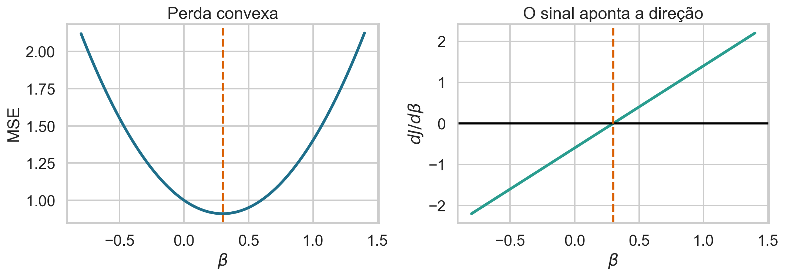
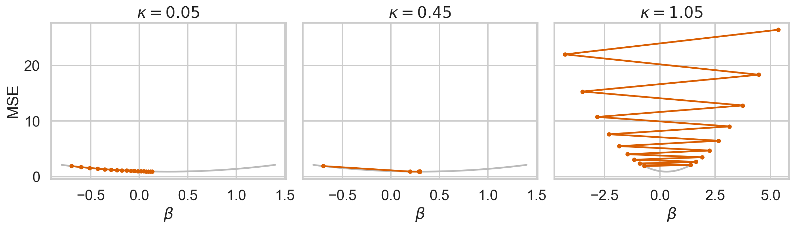
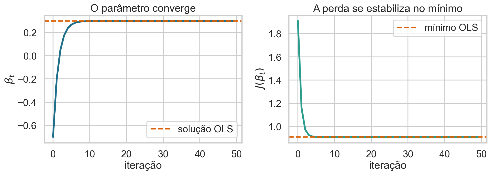
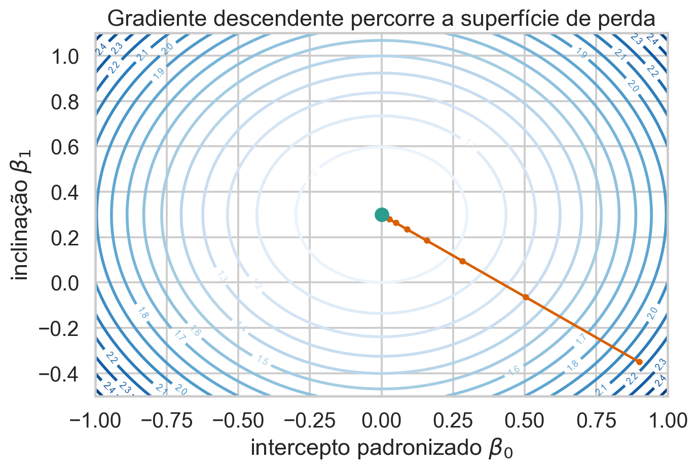
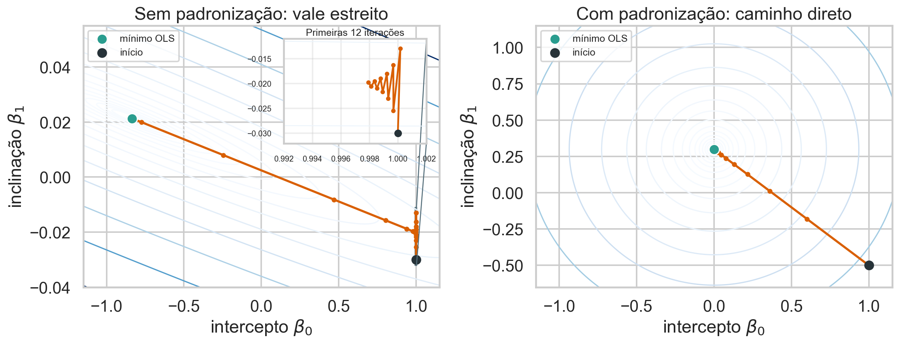
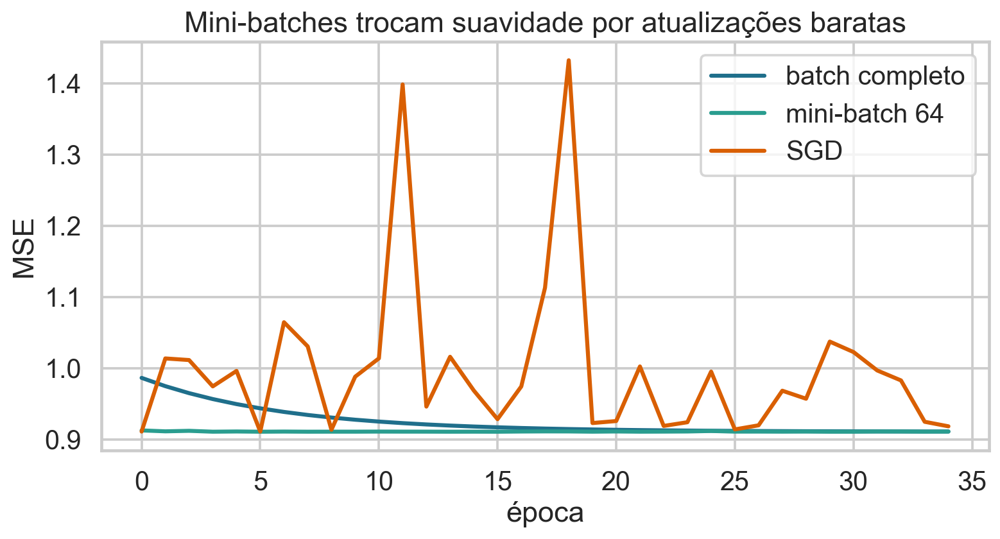
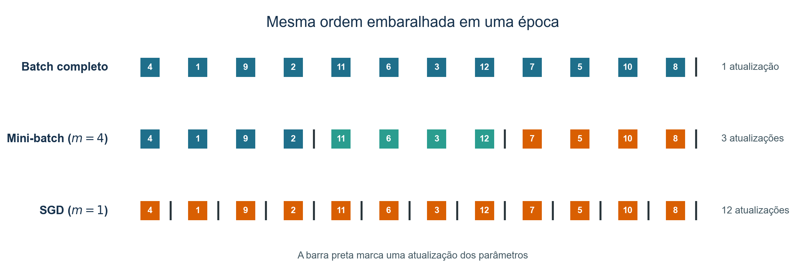
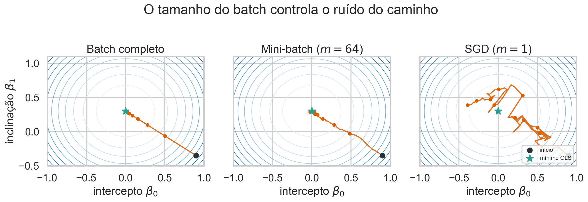
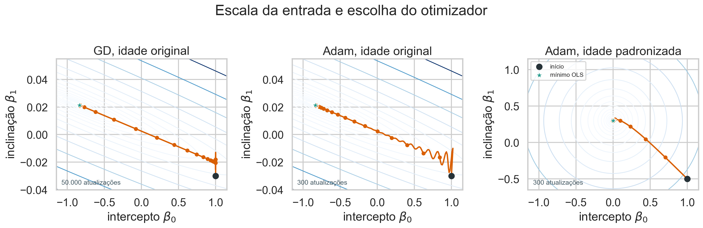

## Como um modelo aprende?

Nas aulas anteriores, encontramos parâmetros por álgebra.

Em modelos grandes, a solução fechada pode ser cara ou inexistente.

> Aprender passa a significar reduzir uma função de perda passo a passo.

## Hoje

- interpretar derivada e gradiente como direção de variação;
- construir gradiente descendente na regressão;
- compreender taxa de aprendizado e convergência;
- comparar batch, mini-batch e SGD;
- reconhecer a importância da padronização;
- compreender Adam como uma extensão adaptativa;
- verificar o resultado numérico contra a solução OLS.

## Base de dados de apoio

Continuaremos com **Medical Insurance Cost**, do Kaggle:

- resposta: despesas médicas;
- preditor: idade;
- 1.338 pessoas;
- comparação direta com OLS e MLE das Aulas 17–19.

Usaremos variáveis padronizadas para estudar o algoritmo.

## Três visões da mesma regressão

$$\widehat y_i=\beta_0+\beta_1x_i.$$

- Aula 17: minimize a soma de quadrados;
- Aula 19: maximize a verossimilhança gaussiana;
- Aula 20: percorra numericamente a perda até um mínimo.

O alvo é o mesmo; muda o caminho computacional.

## Por que não usar sempre a fórmula fechada?

- bases muito grandes tornam operações matriciais diretas mais caras;
- algumas extensões do modelo não possuem solução algébrica simples;
- dados que chegam em fluxo;
- matrizes grandes demais para operações diretas;
- mini-batches permitem atualizar o modelo sem percorrer toda a base de uma vez.

Otimização iterativa troca uma solução imediata por uma sequência de aproximações.

## Comece com regressão sem intercepto

Com dados padronizados, considere

$$\widehat y_i=\beta x_i.$$

A perda individual e o objetivo empírico são

$$
\rho_i(\beta)=(y_i-\beta x_i)^2,
\qquad
J(\beta)=\frac1n\sum_{i=1}^n\rho_i(\beta).
$$

Há apenas um parâmetro para visualizar.

## O que significa cada termo?

| símbolo | significado |
|---|---|
| $\beta$ | inclinação candidata |
| $\widehat y_i=\beta x_i$ | previsão da observação $i$ |
| $y_i-\beta x_i$ | resíduo candidato |
| $\rho_i(\beta)$ | perda quadrática da observação $i$ |
| $J(\beta)$ | objetivo empírico: perda quadrática média |
| $n$ | número de observações |

## O objetivo é uma função do parâmetro

Para cada valor candidato de $\beta$:

1. produzimos previsões;
2. calculamos resíduos;
3. elevamos ao quadrado;
4. calculamos a média.

O resultado é um ponto na curva $J(\beta)$.

## Objetivo e derivada contam a mesma história

{.wide-chart fig-alt="Perda quadrática convexa e sua derivada em função da inclinação."}

À esquerda do mínimo, a derivada é negativa; à direita, positiva.

<details class="code-fold"><summary>Código do gráfico</summary>

```python
loss = np.mean((y-beta*x)**2)
gradient = -2*np.mean(x*(y-beta*x))
```
</details>

## Derive o objetivo

$$
J(\beta)=\frac1n\sum_i(y_i-\beta x_i)^2.
$$

Pela regra da cadeia,

$$
\frac{dJ}{d\beta}
=-\frac2n\sum_i x_i(y_i-\beta x_i).
$$

O fator $x_i$ aparece porque $d(y_i-\beta x_i)/d\beta=-x_i$.

## O sinal indica para onde caminhar

- se $J'(\beta)<0$, aumentar $\beta$ reduz a perda;
- se $J'(\beta)>0$, diminuir $\beta$ reduz a perda;
- se $J'(\beta)=0$, encontramos um ponto estacionário.

Por isso caminhamos na direção **oposta** à derivada.

## A regra de atualização

$$
\beta_{t+1}=\beta_t-\eta\,J'(\beta_t).
$$

- $t$: índice da iteração;
- $\eta>0$: taxa de aprendizado;
- $J'(\beta_t)$: inclinação local da perda;
- $-J'$: direção de descida.

## Uma iteração completa

Dado $\beta_t$:

1. $\widehat y_i=\beta_tx_i$;
2. $e_i=y_i-\widehat y_i$;
3. $g_t=-2n^{-1}\sum_i x_ie_i$;
4. $\beta_{t+1}=\beta_t-\eta g_t$.

Repetimos até um critério de parada.

## O algoritmo

```text
escolha beta e eta
para t = 0, 1, 2, ...:
    previsao = beta * x
    gradiente = -2 * media(x * (y - previsao))
    beta_novo = beta - eta * gradiente
    pare se a mudança for suficientemente pequena
```

A atualização deve usar o gradiente calculado no estado atual.

## Quiz: qual é o próximo passo? {.quiz-question}

Se $J'(\beta_t)>0$, o que a atualização faz?

- [Diminui $\beta$]{.correct data-explanation="Subtrair uma quantidade positiva move o parâmetro para a esquerda."}
- [Aumenta $\beta$]{data-explanation="Isso ocorreria se o gradiente fosse negativo."}
- [Mantém $\beta$ necessariamente fixo]{data-explanation="O parâmetro só fica fixo quando o gradiente é zero ou a taxa é zero."}

## Convexidade simplifica a busca

Na regressão linear com perda quadrática,

$$
J''(\beta)=\frac2n\sum_i x_i^2\ge0.
$$

Se há variação em $x$, então $J''(\beta)>0$: a perda é estritamente convexa e possui um único mínimo.

## O mínimo coincide com OLS

Igualando o gradiente a zero:

$$
\sum_i x_i(y_i-\beta x_i)=0
$$

$$
\beta^*=\frac{\sum_i x_iy_i}{\sum_i x_i^2}.
$$

Gradiente descendente aproxima iterativamente essa solução.

## A taxa de aprendizado controla o passo

{.wide-chart fig-alt="Trajetórias para taxas de aprendizado pequena, adequada e excessiva."}

- pequena: segura, porém lenta;
- adequada: converge rapidamente;
- grande: oscila ou diverge.

<details class="code-fold"><summary>Código do gráfico</summary>

```python
for eta in [.05, .45, 1.05]:
    beta -= eta*gradient(beta)
```
</details>

## Taxa grande pode aumentar a perda

A direção $-\nabla J$ é local. Um passo muito longo pode atravessar o vale e terminar em uma região pior.

Não basta escolher a direção correta; precisamos controlar a distância percorrida.

## Critérios de parada

Podemos interromper quando:

- $\|\nabla J(\theta_t)\|<\varepsilon$;
- $|J_{t+1}-J_t|<\varepsilon$;
- $\|\theta_{t+1}-\theta_t\|<\varepsilon$;
- alcançamos o número máximo de iterações;
- a perda de validação deixa de melhorar.

## Convergência não é “perda igual a zero”

{.wide-chart fig-alt="Convergência do parâmetro para OLS e estabilização da perda."}

O algoritmo converge para a menor perda possível dentro do modelo, não para ajuste perfeito.

<details class="code-fold"><summary>Código do gráfico</summary>

```python
history.append((iteration, beta, loss))
```
</details>

## Agora inclua o intercepto

$$
J(\beta_0,\beta_1)=\frac1n\sum_i(y_i-\beta_0-\beta_1x_i)^2.
$$

O parâmetro vira um vetor

$$\theta=(\beta_0,\beta_1)^T.$$

A derivada vira um gradiente.

## O gradiente reúne derivadas parciais

$$
\nabla J(\theta)=
\begin{bmatrix}
\partial J/\partial\beta_0\\
\partial J/\partial\beta_1
\end{bmatrix}
=-\frac2n
\begin{bmatrix}
\sum_i e_i\\
\sum_i x_ie_i
\end{bmatrix}.
$$

Cada componente indica como o objetivo $J$ muda ao variar um parâmetro.

## Atualização vetorial

$$
\theta_{t+1}=\theta_t-\eta\nabla J(\theta_t).
$$

Explicitamente:

$$\beta_{0,t+1}=\beta_{0,t}+\frac{2\eta}{n}\sum_i e_i,$$

$$\beta_{1,t+1}=\beta_{1,t}+\frac{2\eta}{n}\sum_i x_ie_i.$$

## Atualize simultaneamente

```python
# 1. Calcule tudo com os parâmetros antigos
erro = y - (beta0 + beta1 * x)
grad0 = -2 * mean(erro)
grad1 = -2 * mean(x * erro)

# 2. Calcule os dois novos valores
novo_beta0 = beta0 - eta * grad0
novo_beta1 = beta1 - eta * grad1

# 3. Substitua o par simultaneamente
beta0, beta1 = novo_beta0, novo_beta1
```

Se atualizarmos $\beta_0$ antes de calcular `grad1`, o segundo gradiente usará parâmetros de duas iterações diferentes e o algoritmo dependerá da ordem das atualizações.

## A superfície de perda tem um vale

{.wide-chart fig-alt="Curvas de nível da perda e caminho do gradiente nos dois parâmetros."}

O gradiente é perpendicular às curvas de nível e aponta para o crescimento mais rápido.

<details class="code-fold"><summary>Código do gráfico</summary>

```python
theta = theta-eta*gradient(theta)
path.append(theta.copy())
```
</details>

## Padronização melhora a geometria

{.wide-chart fig-alt="Curvas de nível da perda e caminhos do gradiente antes e depois de padronizar a idade."}

A linha laranja mostra as atualizações desde o ponto inicial preto até o mínimo OLS verde. Sem padronização, o vale estreito exige uma taxa muito menor e produz um caminho longo. Com a idade padronizada, as curvas ficam quase circulares e o gradiente segue um caminho direto.

<details class="code-fold"><summary>Código do gráfico</summary>

```python
path_raw = gradient_path(x,  start=[1, -.03], eta=.0005, steps=50000)
path_std = gradient_path(xz, start=[1,  -.5], eta=.2,    steps=20)
```
</details>

## O resultado deve reproduzir OLS

Na regressão convexa, um teste básico é comparar:

$$\widehat\theta_{GD}\approx\widehat\theta_{OLS}.$$

Diferenças persistentes sugerem:

- gradiente incorreto;
- taxa inadequada;
- poucas iterações;
- padronização inconsistente;
- critério de parada prematuro.

## Custo de uma atualização batch

Calcular o gradiente com todos os $n$ pontos e $p$ parâmetros custa aproximadamente

$$O(np)$$

por iteração.

Com bases enormes, uma atualização completa pode ser cara mesmo quando cada operação é simples.

## Gradiente estocástico usa uma observação

No SGD, escolhemos $i_t$ e usamos

$$g_t=\nabla_\theta\rho_{i_t}(\theta_t),$$

$$\theta_{t+1}=\theta_t-\eta_tg_t.$$

$g_t$ é ruidoso, mas barato. Em média, pode apontar na direção do gradiente completo.

## Mini-batch é o compromisso moderno

Para um conjunto $B_t$ de tamanho $m$:

$$
g_t=\frac1m\sum_{i\in B_t}\nabla_\theta\rho_i(\theta_t).
$$

- $m=n$: batch completo;
- $m=1$: SGD;
- $1<m<n$: mini-batch.

## Batch, mini-batch e SGD

{.wide-chart fig-alt="Curvas de perda para gradiente batch, mini-batch e estocástico."}

Mini-batches aproveitam paralelismo e controlam parte do ruído.

<details class="code-fold"><summary>Código do gráfico</summary>

```python
for batch in batches:
    gradient = mean(individual_gradients[batch], axis=0)
```
</details>

## Época não é iteração

- **iteração:** uma atualização dos parâmetros;
- **batch:** observações usadas nessa atualização;
- **época:** uma passagem aproximadamente completa pelos dados.

Em uma época:

- batch completo faz **uma** atualização;
- mini-batch de tamanho $m$ faz $\lceil n/m\rceil$ atualizações;
- SGD faz $n$ atualizações.

## A ordem das amostras define as atualizações

{.wide-chart fig-alt="A mesma sequência embaralhada é processada em uma atualização no batch completo, três atualizações em mini-batches de quatro observações e doze atualizações no SGD."}

No início da próxima época, mini-batch e SGD recebem uma nova ordem embaralhada. No batch completo, a ordem não altera a média final dos gradientes.

## O que acontece em uma época? {.smaller}

:::: {.columns .concept-cards}
::: {.column width="33%"}
### Batch completo

$$g(\theta)=\frac1n\sum_{i=1}^n\nabla\rho_i(\theta)$$

Calcule os $n$ gradientes no mesmo $\theta$, obtenha a média e só então atualize. Há uma atualização por época.
:::
::: {.column width="33%"}
### Mini-batch

Embaralhe a amostra e divida-a em grupos de tamanho $m$.

Calcule a média dos gradientes de cada grupo e atualize. Uma época termina após visitar todos os grupos.
:::
::: {.column width="33%"}
### SGD

Embaralhe a amostra e apresente uma observação de cada vez.

Atualize após cada observação. Depois de $n$ atualizações, termina uma época e uma nova ordem é sorteada.
:::
::::

Os três métodos repetem épocas até atingir o critério de parada.

## Três caminhos sobre a mesma superfície

{.wide-chart fig-alt="A mesma superfície quadrática de perda com os caminhos do gradiente batch, mini-batch e SGD. O batch segue um caminho suave, o mini-batch apresenta pequenas oscilações e o SGD apresenta oscilações maiores."}

Os três caminhos partem do mesmo ponto, usam a mesma taxa e mostram 70 atualizações. O batch completo calcula a direção exata da amostra; mini-batch e SGD introduzem ruído porque estimam essa direção com menos observações.

<details class="code-fold"><summary>Código do gráfico</summary>

```python
for batch_size in [n, 64, 1]:
    path = stochastic_path(batch_size, updates=70, learning_rate=.04)
    ax.plot(path[:, 0], path[:, 1])
```
</details>

## Por que embaralhar mini-batches e SGD? {.smaller}

:::: {.columns .concept-cards}
::: {.column width="50%"}
### Ordem fixa

Se os dados estiverem ordenados por grupo, resposta ou coleta, atualizações consecutivas podem apontar sistematicamente para direções parecidas.

O algoritmo pode oscilar ou percorrer um caminho condicionado pela organização do arquivo.
:::
::: {.column width="50%"}
### Nova permutação

Uma nova permutação $\pi^{(e)}$ no início de cada época altera a composição e a sequência dos mini-batches.

Isso reduz padrões de ordem, embora não elimine o ruído dos gradientes.
:::
::::

No batch completo, permutar a soma não muda a atualização. Dados temporais ou dependentes exigem uma estratégia que preserve sua estrutura.


## Taxa variável ao longo do treinamento

Uma estratégia comum é reduzir $\eta_t$:

$$\eta_t=\frac{\eta_0}{1+kt}.$$

Passos maiores exploram no início; passos menores estabilizam perto do mínimo.

Otimizadores modernos adaptam taxas por parâmetro.

## Adam adapta direção e escala {.smaller}

**Adam** significa *Adaptive Moment Estimation*. Para o gradiente $g_t=\nabla J(\theta_t)$, ele mantém dois resumos:

:::: {.columns .concept-cards}
::: {.column width="50%"}
### Direção persistente

$$u_t=\gamma_1u_{t-1}+(1-\gamma_1)g_t$$

$u_t$ é uma média móvel dos gradientes. Ele funciona como a velocidade acumulada da bola: direções persistentes mantêm o movimento.
:::
::: {.column width="50%"}
### Escala recente

$$s_{t,j}=\gamma_2s_{t-1,j}+(1-\gamma_2)g_{t,j}^{,2}$$

$s_t$ acompanha os gradientes ao quadrado em cada coordenada $j$. Ele atua como um freio adaptativo nas direções mais íngremes.
:::
::::

**Intuição da bola rolando:** $u_t$ preserva a inércia ao longo do vale; $s_t$ impede que a bola dê passos excessivos nas direções com maior inclinação.

Usamos $u_t$ e $s_t$ para evitar colisões com o tamanho do mini-batch $m$ e com os coeficientes $\beta$ da regressão.

## O algoritmo de Adam {.smaller}

Partindo de $u_0=s_0=0$, em cada iteração:

$$
\begin{aligned}
g_t &= \nabla J(\theta_t),\\
u_{t,j} &= \gamma_1u_{t-1,j}+(1-\gamma_1)g_{t,j},\\
s_{t,j} &= \gamma_2s_{t-1,j}+(1-\gamma_2)g_{t,j}^{\,2},\\
\widehat u_{t,j} &= \frac{u_{t,j}}{1-\gamma_1^t},
\qquad
\widehat s_{t,j} = \frac{s_{t,j}}{1-\gamma_2^t},\\
\theta_{t+1,j} &= \theta_{t,j}-\eta
\frac{\widehat u_{t,j}}{\sqrt{\widehat s_{t,j}}+\varepsilon}.
\end{aligned}
$$

$j$ identifica um parâmetro. $\eta$ controla a escala global; $\gamma_1$ e $\gamma_2$ controlam a memória; $\varepsilon$ evita divisão por zero. Valores usuais são $0{,}001$, $0{,}9$, $0{,}999$ e $10^{-8}$, respectivamente.

Na literatura, $u_t,s_t,\gamma_1,\gamma_2$ costumam aparecer como $m_t,v_t,\beta_1,\beta_2$.

## A correção de viés no início

Como $u_0=s_0=0$, as primeiras médias móveis ficam artificialmente próximas de zero. Na primeira iteração:

$$
u_{1,j}=(1-\gamma_1)g_{1,j},
\qquad
s_{1,j}=(1-\gamma_2)g_{1,j}^{\,2}.
$$

As correções recuperam a escala do primeiro gradiente:

$$
\widehat u_{1,j}=\frac{u_{1,j}}{1-\gamma_1}=g_{1,j},
\qquad
\widehat s_{1,j}=\frac{s_{1,j}}{1-\gamma_2}=g_{1,j}^{\,2}.
$$

O mesmo princípio corrige as iterações iniciais seguintes. Conforme $t$ cresce, $\gamma_1^t$ e $\gamma_2^t$ se aproximam de zero e a correção perde importância.

## Adam tolera a entrada não normalizada

{.wide-chart fig-alt="Três painéis de curvas de nível. Os dois primeiros comparam gradiente descendente e Adam usando a idade original. O terceiro mostra Adam com a idade padronizada e uma geometria mais circular."}

Os dois primeiros painéis usam a **idade na escala original**. Adam adapta separadamente os passos de $\beta_0$ e $\beta_1$ e consegue ajustar esta regressão sem normalizar a entrada. O terceiro usa a mesma taxa e 300 atualizações, mas com $x$ padronizado: o vale fica mais circular e o caminho mais direto.

Isso não garante que normalização seja dispensável em qualquer problema. Ela ainda pode melhorar estabilidade e facilitar a escolha de hiperparâmetros. Para a regressão linear simples, a solução fechada continua sendo a referência.

<details class="code-fold"><summary>Código do gráfico</summary>

```python
u = gamma1*u+(1-gamma1)*gradient
s = gamma2*s+(1-gamma2)*gradient**2
theta -= eta*(u/(1-gamma1**t))/(sqrt(s/(1-gamma2**t))+epsilon)
```
</details>

## Quiz: qual alteração reduz o ruído? {.quiz-question}

- [Aumentar o tamanho do mini-batch]{.correct data-explanation="A média de mais gradientes individuais varia menos entre atualizações."}
- [Usar apenas uma observação]{data-explanation="Isso produz o gradiente mais ruidoso."}
- [Remover a função de perda]{data-explanation="O gradiente precisa de um objetivo definido."}

## Gradiente descendente e máxima verossimilhança

Como $\ell(\theta)=\log L(\theta)$, podemos minimizar a log-verossimilhança negativa:

$$J(\theta)=-\ell(\theta).$$

Assim, gradiente ascendente em $\ell$ e gradiente descendente em $-\ell$ são equivalentes.

Para erros normais, $-\ell$ contém a SSE.

## Um roteiro de implementação segura

1. derive e teste o gradiente;
2. padronize variáveis quando necessário;
3. monitore perda de treino e validação;
4. compare com solução conhecida em casos simples;
5. ajuste taxa e batch;
6. fixe sementes para depuração;
7. documente critério de parada.

## Bibliografia da aula

- Data 100, *Principles and Techniques of Data Science*, otimização e gradiente.
- James et al., *An Introduction to Statistical Learning*, otimização em modelos preditivos.
- Kingma e Ba, *Adam: A Method for Stochastic Optimization*.
- Ruder, *An Overview of Gradient Descent Optimization Algorithms*.

## Síntese

- o gradiente aponta o crescimento local da perda;
- subtraí-lo produz uma etapa de descida;
- taxa de aprendizado controla estabilidade e velocidade;
- padronização melhora a geometria;
- mini-batches viabilizam grandes bases;
- Adam adapta o passo de cada parâmetro usando médias móveis;
- a solução numérica pode ser comparada à solução analítica de mínimos quadrados.

## Próxima aula

::: {.statement}
Gradiente descendente mostrou como ajustar os coeficientes de uma regressão linear. Na próxima aula, a regressão múltipla amplia o modelo para vários preditores.
:::
