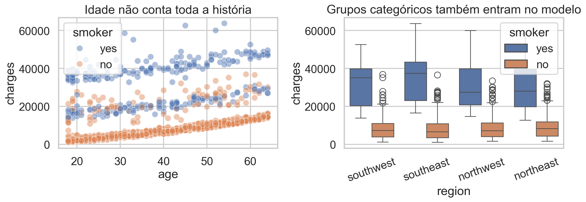
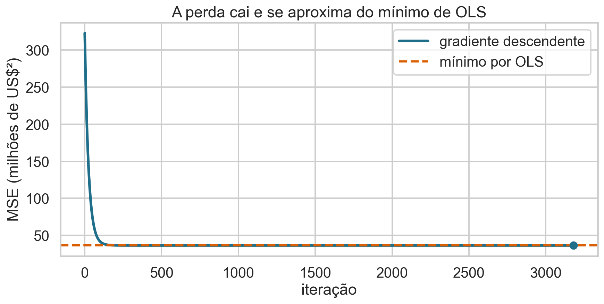
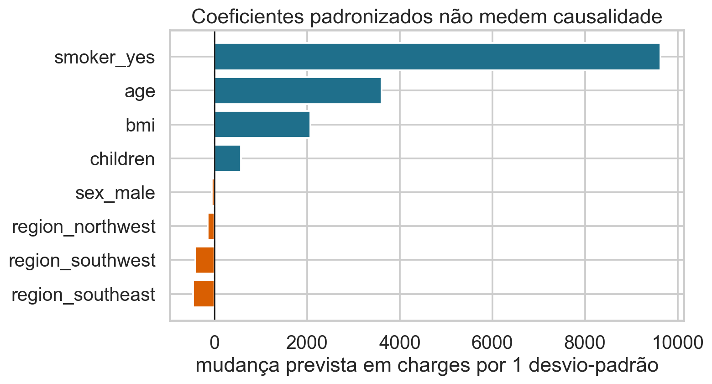
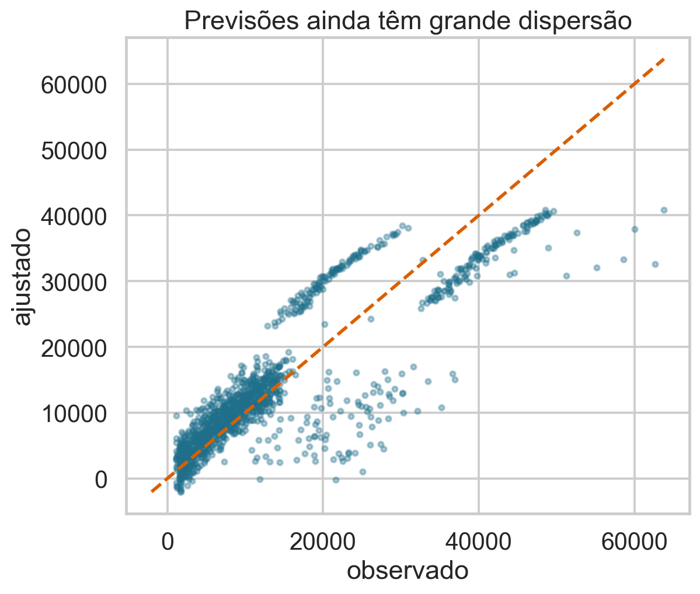
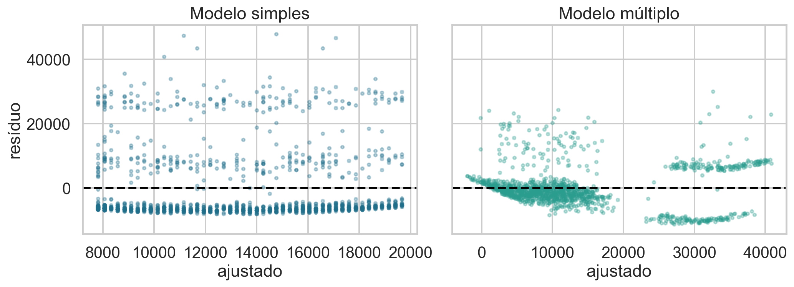
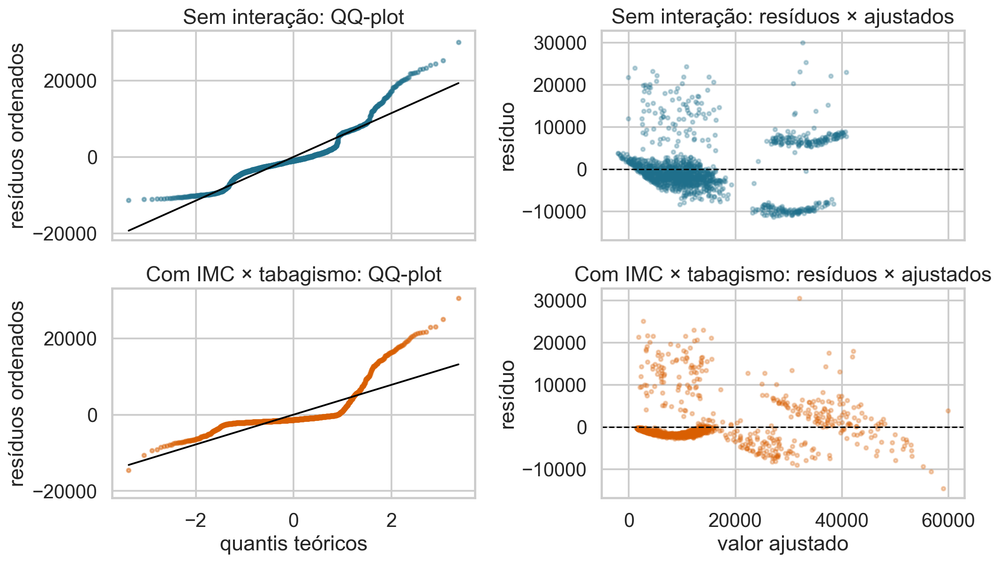
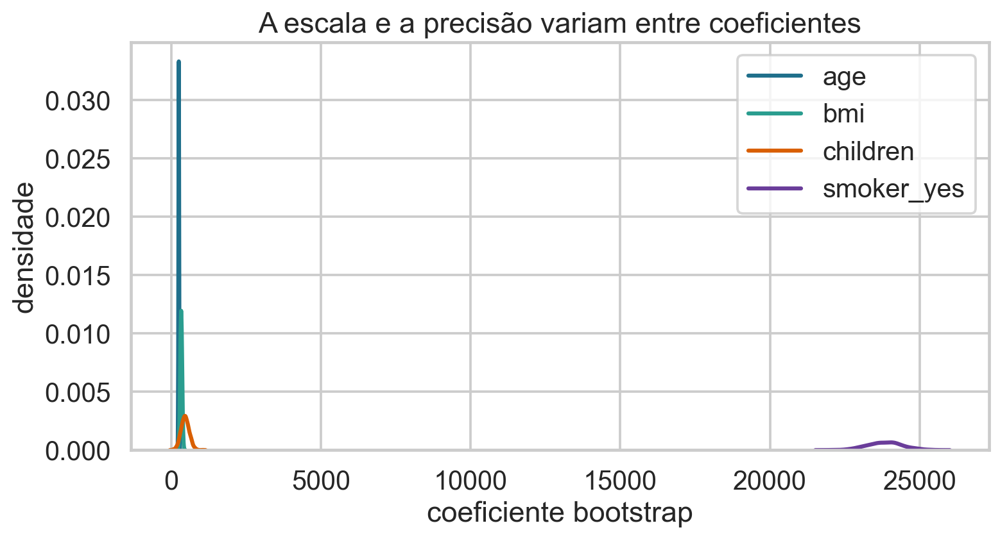

## Uma resposta, várias explicações

Idade está associada às despesas, mas não descreve toda a heterogeneidade.

> Regressão múltipla modela a média da resposta usando vários preditores simultaneamente.

## Hoje

- formular regressão múltipla em notação escalar e matricial;
- codificar preditores quantitativos e categóricos;
- interpretar coeficientes condicionais;
- derivar perda, gradiente e equações normais;
- discutir interação, colinearidade e diagnóstico;
- comparar modelos com RMSE, $R^2$ e $R^2$ ajustado.

## Base de dados de apoio

Usaremos **Medical Insurance Cost**, do Kaggle:

- 1.338 pessoas seguradas;
- resposta: `charges`;
- quantitativas: idade, IMC e número de filhos;
- categóricas: tabagismo, sexo e região;
- dados observacionais sob licença CC0.

## Antes do modelo, descreva a base

{.wide-chart fig-alt="Despesas por idade, tabagismo e região."}

Tabagismo separa patamares; região e outras características podem acrescentar informação.

<details class="code-fold"><summary>Código do gráfico</summary>

```python
sns.scatterplot(data=df, x="age", y="charges", hue="smoker")
sns.boxplot(data=df, x="region", y="charges", hue="smoker")
```
</details>

## Unidade observacional e objetivo

Cada linha representa uma pessoa.

Queremos aproximar

$$E[Y\mid X_1=x_1,\ldots,X_p=x_p].$$

O modelo descreve uma média condicional; não transforma associações observacionais em efeitos causais.

## Da reta ao hiperplano

Regressão simples:

$$E[Y\mid X=x]=\beta_0+\beta_1x.$$

Regressão múltipla:

$$E[Y\mid X=x]=\beta_0+\beta_1x_1+\cdots+\beta_px_p.$$

Com $p>2$, a superfície não pode ser visualizada diretamente, mas a álgebra permanece simples.

## O modelo estatístico

Para $i=1,\ldots,n$:

$$
Y_i=\beta_0+\sum_{j=1}^p\beta_jx_{ij}+\varepsilon_i,
\qquad E[\varepsilon_i\mid X_i]=0.
$$

$x_{ij}$ é o valor do preditor $j$ para a observação $i$.

### O que significa cada índice?

| símbolo | significado |
|---|---|
| $i$ | observação, de 1 a $n$ |
| $j$ | preditor, de 1 a $p$ |
| $x_{ij}$ | valor do preditor $j$ na observação $i$ |
| $\beta_j$ | coeficiente populacional do preditor $j$ |
| $\varepsilon_i$ | erro da observação $i$ |

## Interpretação condicional do coeficiente

$\beta_j$ é a mudança na média prevista de $Y$ associada a uma unidade adicional em $X_j$, **mantendo os demais preditores fixos**.

Essa é uma comparação definida pelo modelo. Ela pode não corresponder a uma intervenção possível ou causal.

### “Mantendo fixo” muda a pergunta

Na regressão simples, idade pode capturar diferenças associadas a outras variáveis.

Na regressão múltipla, o coeficiente de idade compara pessoas com os mesmos valores dos demais preditores incluídos.

Condicionar pode reduzir confundimento estatístico, mas não garante identificação causal.

## Preditor binário é uma diferença entre grupos

Defina

$$x_{fumante}=\begin{cases}1,&\text{fumante}\\0,&\text{não fumante.}\end{cases}$$

Então $\beta_{fumante}$ é a diferença média prevista entre fumantes e não fumantes com os demais preditores fixos.

## Categorias com mais de dois níveis

Para quatro regiões, escolhemos `northeast` como referência e criamos apenas três indicadores:

$$
D_{NW},\qquad D_{SE},\qquad D_{SW}.
$$

O modelo final contém o intercepto e esses três indicadores:

$$
\begin{aligned}
E[Y_i\mid X_i]
&=\beta_0+\beta_{NW}D_{NW,i}
+\beta_{SE}D_{SE,i}
+\beta_{SW}D_{SW,i}\\
&\quad+z_i^T\gamma,
\end{aligned}
$$

$z_i^T\gamma$ reúne os demais preditores. Para `northeast`, os três indicadores valem zero. Cada coeficiente regional representa a diferença em relação a `northeast`, mantendo os demais preditores fixos.

São **três variáveis indicadoras** e quatro coeficientes associados à codificação regional quando contamos o intercepto $\beta_0$.

### Por que não usar quatro indicadores?

Com intercepto, $1=D_{NE}+D_{NW}+D_{SE}+D_{SW}$. Usar os quatro criaria dependência linear perfeita. Remover a categoria de referência evita a **armadilha das dummies**.

## Matriz de projeto

Incluindo uma coluna de 1 para o intercepto:

$$
X=\begin{bmatrix}
1&x_{11}&\cdots&x_{1p}\\
\vdots&\vdots&\ddots&\vdots\\
1&x_{n1}&\cdots&x_{np}
\end{bmatrix}
\in\mathbb R^{n\times(p+1)}.
$$

Com $\beta\in\mathbb R^{p+1}$ e $y\in\mathbb R^n$,

$$E[y\mid X]=X\beta\in\mathbb R^n.$$

## Uma linha produz uma previsão

Para a observação $i$:

$$
\widehat y_i=x_i^T\widehat\beta
=\widehat\beta_0+\sum_{j=1}^p x_{ij}\widehat\beta_j.
$$

$x_i^T$ é a linha $i$ da matriz de projeto.

## Resíduos em forma vetorial

$$e=y-X\beta.$$

- $y$: valores observados;
- $X\beta$: valores previstos;
- $e$: vetor de resíduos candidatos.

A perda quadrática será o comprimento ao quadrado desse vetor.

## Norma euclidiana e SSE

$$
\|e\|_2^2=e^Te=\sum_{i=1}^ne_i^2.
$$

Logo,

$$
\operatorname{SSE}(\beta)=\|y-X\beta\|_2^2.
$$

Para um vetor, essa é a norma euclidiana; “norma de Frobenius” é a generalização matricial.

## O estimador OLS

$$
\widehat\beta
=\arg\min_{b\in\mathbb R^{p+1}}
\|y-Xb\|_2^2.
$$

O argumento mínimo é um vetor de $p+1$ coeficientes.

## Expanda a perda {.smaller}

**1. Transponha a primeira parcela**

$$
(y-Xb)^T=y^T-(Xb)^T=y^T-b^TX^T.
$$

**2. Aplique a distributividade**

$$
\begin{aligned}
J(b)&=(y^T-b^TX^T)(y-Xb)\\
&=y^Ty-y^TXb-b^TX^Ty+b^TX^TXb.
\end{aligned}
$$

**3. Combine os termos cruzados**

Como $y^TXb$ é escalar,

$$
y^TXb=(y^TXb)^T=b^TX^Ty.
$$

Portanto,

$$
\boxed{J(b)=y^Ty-2b^TX^Ty+b^TX^TXb}.
$$

O termo $y^Ty$ não depende de $b$.

## O gradiente matricial

Para uma matriz $A$,

$$
\nabla_b(b^TAb)=(A+A^T)b.
$$

O vetor $b$ aparece duas vezes:

- derivar o $b^T$ da esquerda contribui com $Ab$;
- derivar o $b$ da direita contribui com $A^Tb$.

O gradiente soma as duas contribuições.

Aqui, $A=X^TX$ e $(X^TX)^T=X^TX$. Logo,

$$
\nabla_b(b^TX^TXb)=2X^TXb.
$$

Somando a derivada do termo linear:

$$
\nabla_bJ(b)=-2X^Ty+2X^TXb
=-2X^T(y-Xb).
$$

O gradiente possui dimensão $(p+1)\times1$, igual ao vetor de parâmetros.

## Jacobiana: derivada de uma função vetorial

Considere uma função com $m$ entradas e $n$ saídas:

$$
h:\mathbb R^m\to\mathbb R^n,
\qquad
h(u)=
\begin{bmatrix}
h_1(u)\\ \vdots\\ h_n(u)
\end{bmatrix}.
$$

A **Jacobiana** reúne todas as derivadas parciais:

$$
Dh(u)=
\left[\frac{\partial h_i(u)}{\partial u_j}\right]_{i,j}
\in\mathbb R^{n\times m}.
$$

- a linha $i$ descreve como a saída $h_i$ responde às entradas;
- a coluna $j$ descreve como todas as saídas respondem à entrada $u_j$.

Para uma pequena variação $\Delta u$,

$$h(u+\Delta u)\approx h(u)+Dh(u)\Delta u.$$

::: {.callout-note title="Notação"}
$D$ é o operador de derivação. Portanto, $Dh(u)$ significa “Jacobiana da função $h$ no ponto $u$”.
:::

## Jacobianas da previsão e dos resíduos

A previsão conjunta é a função vetorial

$$g(b)=Xb\in\mathbb R^n.$$

Sua Jacobiana em relação a $b\in\mathbb R^{p+1}$ é

$$
Dg(b)=
\left[\frac{\partial g_i(b)}{\partial b_j}\right]_{i,j}
=X.
$$

Como $e(b)=y-g(b)$, temos $De(b)=-X$. Pela regra da cadeia,

$$\nabla J(b)=2\,De(b)^Te(b)=-2X^T(y-Xb).$$

::: {.callout-note title="Notação"}
$Dg(b)$ é a Jacobiana da função de previsão $g$ no ponto $b$. $De(b)$ é a Jacobiana da função de resíduos $e$ no mesmo ponto. Já $J$ é a função objetivo escalar e $\nabla J$ é seu gradiente.
:::

## Cada componente tem interpretação conhecida

Para $j=0,\ldots,p$:

$$
\frac{\partial J}{\partial b_j}
=-2\sum_{i=1}^n x_{ij}(y_i-\widehat y_i).
$$

Cada derivada soma resíduos ponderados pela coluna $j$ de $X$.

### O intercepto cabe na mesma fórmula

Na coluna $j=0$, $x_{i0}=1$. Portanto,

$$
\frac{\partial J}{\partial b_0}=-2\sum_ie_i.
$$

No ótimo com intercepto, $\sum_i e_i=0$.

## Gradiente descendente vetorizado

$$
b_{t+1}=b_t-\eta\nabla J(b_t)
=b_t+2\eta X^T(y-Xb_t).
$$

Se usarmos MSE em vez de SSE, aparece também o fator $1/n$.

A escolha apenas reescala a taxa de aprendizado.

## Quiz: qual dimensão do gradiente? {.quiz-question}

Se $X$ tem dimensão $n\times(p+1)$, qual é a dimensão de $X^T(y-Xb)$?

- [$(p+1)\times1$]{.correct data-explanation="X transposta tem dimensão (p+1)×n e multiplica um vetor n×1."}
- [$n\times1$]{data-explanation="Essa é a dimensão do vetor de resíduos antes da multiplicação por X transposta."}
- [$n\times(p+1)$]{data-explanation="Essa é a dimensão de X, não do gradiente."}

## Equações normais

No mínimo,

$$X^T(y-X\widehat\beta)=0,$$

portanto

$$X^TX\widehat\beta=X^Ty.$$

Se $X^TX$ é invertível,

$$\widehat\beta=(X^TX)^{-1}X^Ty.$$

### Na prática, evite formar a inversa

Resolver diretamente o sistema linear ou usar decomposições numéricas é mais estável que calcular $(X^TX)^{-1}$ explicitamente.

Em Python:

```python
beta = np.linalg.lstsq(X, y, rcond=None)[0]
```

## Gradiente descendente para regressão múltipla {.smaller}

```python
def regressao_gd(X, y, eta=0.01,
                 max_iter=50_000, tol=1e-6):
    X = np.asarray(X, dtype=float)
    y = np.asarray(y, dtype=float)
    n, p = X.shape

    beta = np.zeros(p)
    historico = []

    for _ in range(max_iter):
        prediction = X @ beta
        residual = y - prediction
        historico.append(np.mean(residual**2))

        gradient = -(2/n) * X.T @ residual
        if np.linalg.norm(gradient) < tol:
            break

        beta = beta - eta * gradient

    return beta, np.asarray(historico)
```

A função minimiza o MSE, que possui o mesmo mínimo da SSE. A matriz $X$ já deve conter o intercepto; padronize os preditores antes do ajuste.

## Convergência da função de perda

{.wide-chart fig-alt="Erro quadrático médio ao longo das iterações do gradiente descendente, aproximando-se do mínimo obtido por OLS."}

No exemplo da aula, o MSE diminui rapidamente no início e depois se estabiliza próximo ao mínimo obtido pelas equações normais.

<details class="code-fold"><summary>Código do gráfico</summary>

```python
plt.plot(historico_gd / 1e6, label="gradiente descendente")
plt.axhline(mse_ols / 1e6, linestyle="--", label="mínimo por OLS")
plt.xlabel("iteração")
plt.ylabel("MSE (milhões de US$²)")
plt.legend()
```

</details>

## O modelo ajustado

Com idade, IMC, filhos, tabagismo, sexo e região:

| termo | coeficiente aproximado |
|---|---:|
| idade | +256,86 US$/ano |
| IMC | +339,19 US$/unidade |
| filhos | +475,50 US$/filho |
| fumante | +23.848,54 US$ |

Todos são interpretações condicionais ao modelo.

## Coeficientes categóricos dependem da referência

Com `northeast` como referência:

- `northwest`: −352,96 US$;
- `southeast`: −1.035,02 US$;
- `southwest`: −960,05 US$.

Mudar a referência muda os coeficientes, mas não as previsões do modelo.

## Escalas diferentes dificultam comparação

{.wide-chart fig-alt="Coeficientes de uma regressão com preditores padronizados."}

Mesmo padronizados, coeficientes não são medidas automáticas de importância causal.

<details class="code-fold"><summary>Código do gráfico</summary>

```python
Xs = (X-X.mean())/X.std()
beta_std = np.linalg.lstsq(Xs, y, rcond=None)[0]
```
</details>

## Ajuste múltiplo melhora, mas não resolve tudo

{.wide-chart fig-alt="Valores observados contra valores ajustados pelo modelo múltiplo."}

Pontos sobre a diagonal seriam previsões perfeitas; ainda há grande dispersão.

<details class="code-fold"><summary>Código do gráfico</summary>

```python
prediction = X @ beta
plt.scatter(y, prediction)
```
</details>

## Compare os resíduos

{.wide-chart fig-alt="Resíduos do modelo simples e do modelo múltiplo."}

Incluir preditores reduz estrutura, mas a variância ainda não parece constante.

<details class="code-fold"><summary>Código do gráfico</summary>

```python
residual_simple = y-X_simple@beta_simple
residual_multiple = y-X@beta
```
</details>

## Interações permitem efeitos diferentes

Centralize o IMC em 30:

$$bmi_c=bmi-30.$$

Considere então

$$
\begin{aligned}
E[Y\mid X]
&=\beta_0+\beta_1bmi_c+\beta_2smoker\\
&\quad+\beta_3(bmi_c\times smoker)+z^T\gamma.
\end{aligned}
$$

$z^T\gamma$ reúne os demais preditores. O coeficiente $\beta_3$ permite que a inclinação do IMC seja diferente entre os grupos.

Sem a interação, o modelo impõe a mesma inclinação do IMC aos dois grupos. Com a interação, estima uma inclinação para cada grupo.

## Resultado do modelo com interação {.smaller}

::: {.columns}
::: {.column width="43%"}
| termo | estimativa |
|---|---:|
| `bmi_c` | 23,53 |
| `smoker` | 22.877,28 |
| `bmi_c × smoker` | 1.443,10 |

Como $bmi_c=0$ corresponde a BMI = 30, `smoker` compara os grupos nesse valor.
:::

::: {.column width="57%"}
**Não fumantes:** $smoker=0$

$$
\widehat E[Y]=\cdots+23{,}53\,bmi_c.
$$

**Fumantes:** $smoker=1$

$$
\begin{aligned}
\widehat E[Y]
&=\cdots+(23{,}53+1.443{,}10)bmi_c\\
&=\cdots+1.466{,}63\,bmi_c.
\end{aligned}
$$
:::
:::

O RMSE cai de **6.041,68** para **4.828,28**, e o $R^2$ ajustado sobe de **0,749** para **0,840**.

## A interação melhora o ajuste, mas não resolve tudo

{.wide-chart fig-alt="QQ-plots e gráficos de resíduos versus valores ajustados para os modelos sem interação e com interação entre IMC e tabagismo."}

A separação entre os grupos diminui e o RMSE melhora. Ainda observamos curvatura, dispersão desigual e afastamento da reta no QQ-plot.

<details class="code-fold"><summary>Código do gráfico</summary>

```python
from statistics import NormalDist

p = (np.arange(1, len(y)+1) - 0.5) / len(y)
q = np.array([NormalDist().inv_cdf(float(pi)) for pi in p])

for fitted, error in [(prediction, residual),
                      (prediction_inter, residual_inter)]:
    plt.scatter(q, np.sort(error))       # QQ-plot
    plt.scatter(fitted, error)           # resíduos × ajustados
```

</details>

## Não remova termos principais mecanicamente {.smaller}

Se o modelo contém $X_1X_2$, normalmente preservamos $X_1$ e $X_2$.

::: {.callout-warning title="Exemplo: retirar o termo `smoker`"}
O modelo ficaria

$$
E[Y\mid X]
=\beta_0+\beta_1bmi_c
+\beta_3(bmi_c\times smoker)+z^T\gamma.
$$

Quando BMI = 30, temos $bmi_c=0$. Os dois termos que envolvem IMC desaparecem e o modelo impõe

$$
E[Y\mid smoker=0,\,bmi=30]
=E[Y\mid smoker=1,\,bmi=30].
$$
:::

Essa igualdade seria uma restrição criada pela remoção de `smoker`, e não uma conclusão aprendida com os dados.

## Preditores quase redundantes já causam instabilidade {.smaller}

::: {.columns}
::: {.column width="49%"}
::: {.callout-important title="Colinearidade perfeita"}
Se $x_2=2x_1$,

$$
\widehat y
=\beta_0+(\beta_1+2\beta_2)x_1.
$$

Os dados identificam apenas $\beta_1+2\beta_2$. Existem infinitos pares de coeficientes com a mesma previsão, e $X^TX$ não é invertível.
:::
:::

::: {.column width="51%"}
::: {.callout-warning title="Colinearidade forte"}
Se $x_2\approx2x_1$, $X^TX$ ainda pode ser invertível.

Entretanto, pequenas mudanças nos dados podem fazer $\widehat\beta_1$ aumentar e $\widehat\beta_2$ diminuir. Os coeficientes compensam um ao outro.

As previsões podem permanecer semelhantes enquanto sinais e magnitudes dos coeficientes variam.
:::
:::
:::

Colinearidade é uma questão de grau; não começa apenas quando aparece redundância perfeita.

## Bootstrap do vetor de coeficientes

Reamostramos linhas completas $(x_i,y_i)$ e ajustamos o modelo em cada réplica:

$$\widehat\beta^{*(1)},\ldots,\widehat\beta^{*(B)}.$$

Cada distribuição marginal descreve a incerteza de um coeficiente sob a mesma especificação.

## As precisões não são iguais

{.wide-chart fig-alt="Distribuições bootstrap de quatro coeficientes."}

Comparar larguras exige lembrar as unidades de cada coeficiente.

<details class="code-fold"><summary>Código do gráfico</summary>

```python
indices = rng.integers(0, n, n)
beta_boot = np.linalg.lstsq(X[indices], y[indices], rcond=None)[0]
```
</details>

## Mais preditores não garantem melhor generalização

Adicionar colunas nunca aumenta a SSE de treinamento.

Mas pode:

- aumentar variância dos coeficientes;
- capturar ruído;
- piorar previsão fora da amostra;
- dificultar interpretação.

Avaliação deve usar validação ou dados de teste.

## $R^2$ sempre aumenta, mas o ajustado pode diminuir {.smaller}

Como a SSE de treino não cresce ao adicionar preditores,

$$R^2=1-\frac{SSE}{SST}$$

não diminui. O **$R^2$ ajustado** compara as variâncias residual e total depois de corrigir seus graus de liberdade:

$$
R^2_{\mathrm{aj}}
=1-\frac{SSE/(n-p-1)}{SST/(n-1)}
=1-(1-R^2)\frac{n-1}{n-p-1}.
$$

- $n$: número de observações;
- $p$: número de preditores, sem contar o intercepto.

Ao incluir um preditor, $R^2_{\mathrm{aj}}$ só aumenta se a redução da SSE compensar a perda de um grau de liberdade. Caso contrário, diminui.

::: {.callout-note title="Importante"}
O ajuste por complexidade não substitui validação ou dados de teste para avaliar desempenho fora da amostra.
:::

## Quiz: o que significa “controlar”? {.quiz-question}

Em uma regressão observacional, incluir uma variável como preditor:

- [Define uma comparação condicional no modelo]{.correct data-explanation="O coeficiente compara unidades com os demais preditores fixos, sob a forma funcional escolhida."}
- [Garante que eliminamos todo confundimento]{data-explanation="Confundidores não medidos e especificações inadequadas continuam possíveis."}
- [Transforma automaticamente associação em causalidade]{data-explanation="Identificação causal exige hipóteses e desenho adicionais."}

## Bibliografia da aula

- James et al., *An Introduction to Statistical Learning*, capítulo 3.
- Faraway, *Linear Models with R*, regressão múltipla.
- Gelman, Hill e Vehtari, *Regression and Other Stories*, regressão com múltiplos preditores.
- Fox, *Applied Regression Analysis and Generalized Linear Models*, regressão múltipla.

## Síntese

- regressão múltipla modela médias condicionais com vários preditores;
- $X\beta$ reúne todas as previsões;
- OLS minimiza $\|y-X\beta\|^2$;
- o gradiente é $-2X^T(y-X\beta)$;
- indicadores, interações e colinearidade exigem interpretação cuidadosa;
- $R^2$ ajustado corrige a comparação pelos graus de liberdade.

## Próxima aula

::: {.statement}
Na regressão logística, modelaremos probabilidades quando a resposta possui duas categorias.
:::
