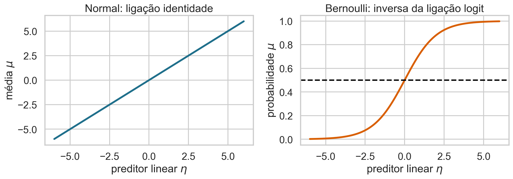
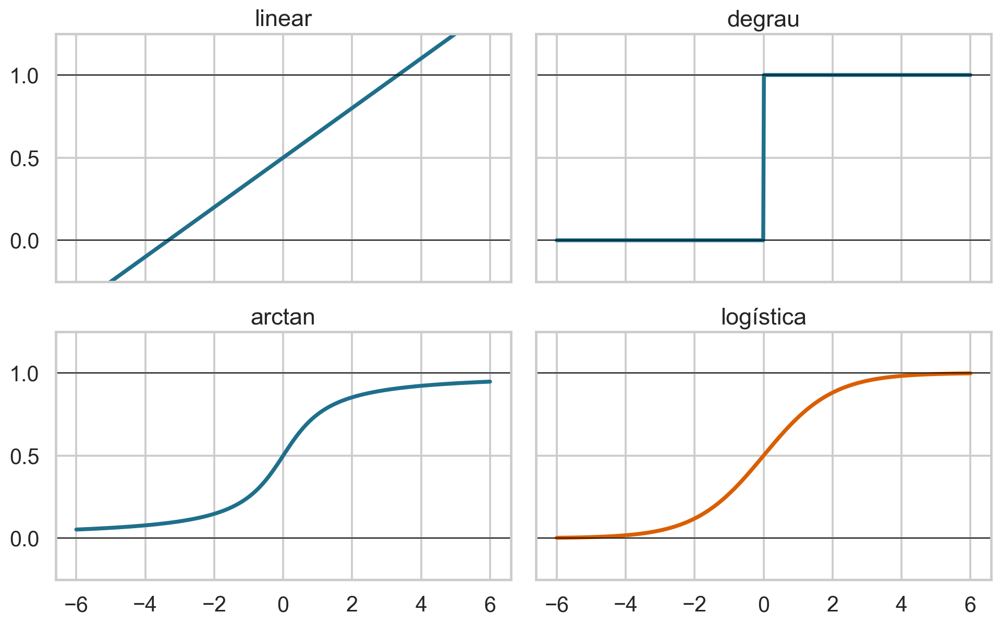
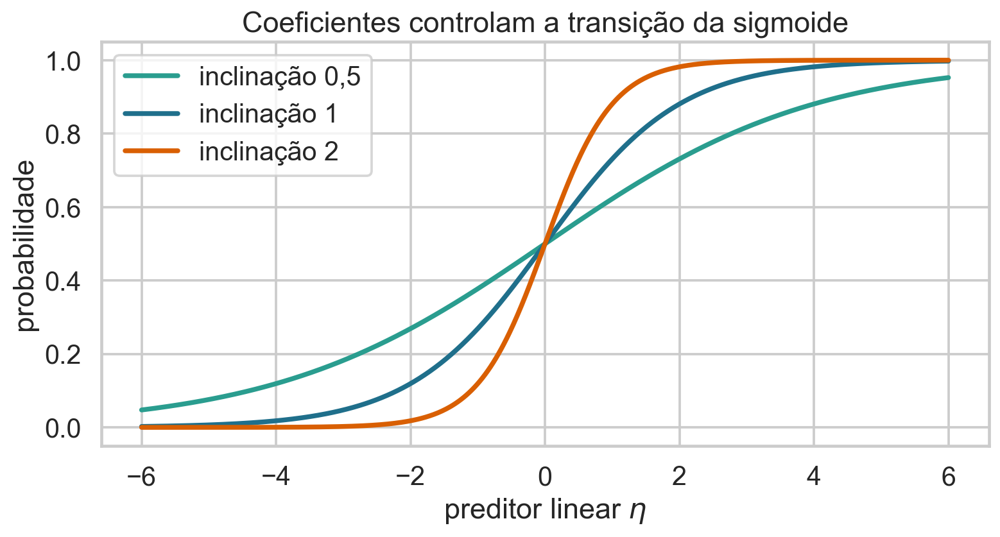
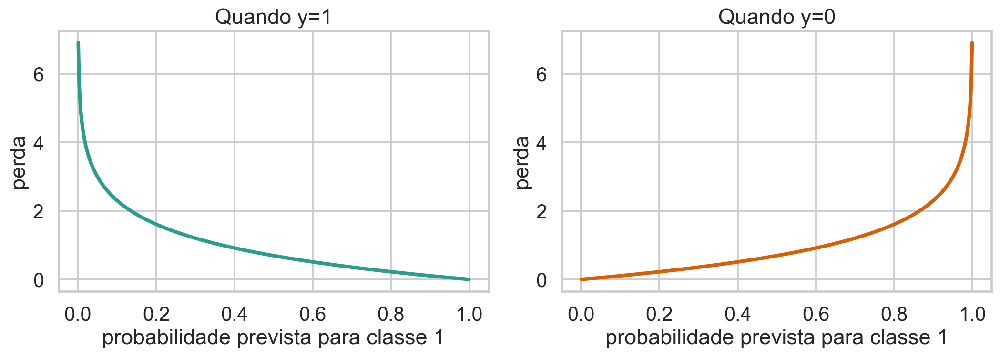
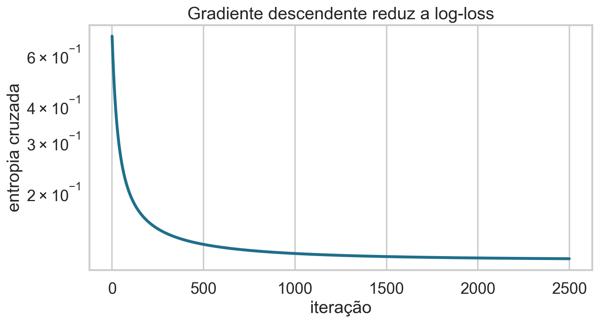
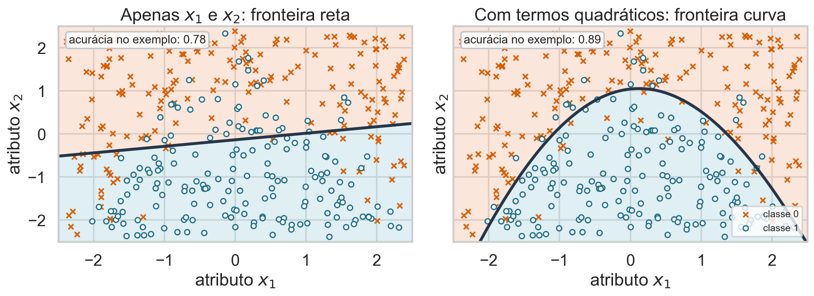
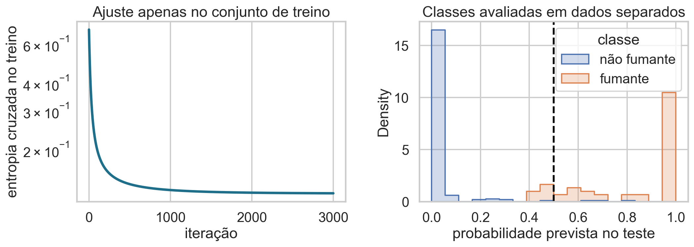
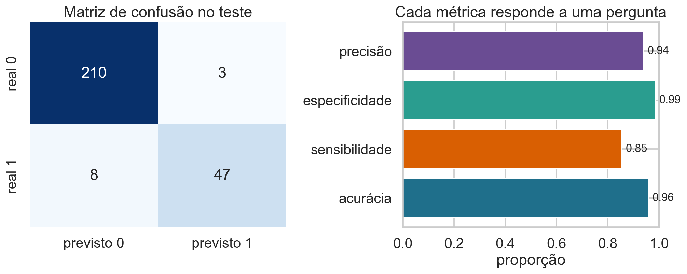
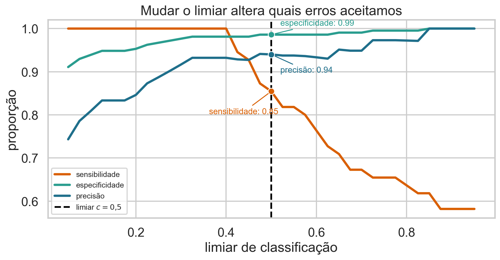
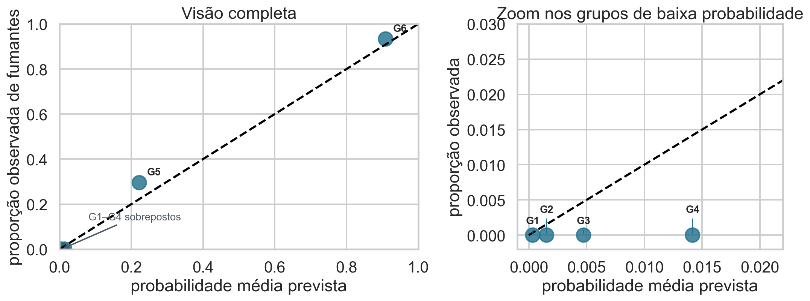

## Quando a resposta é uma classe

Queremos prever um resultado binário e quantificar a incerteza dessa previsão.

> A regressão logística modela uma probabilidade condicional usando um preditor linear.

## Roteiro da aula

- construir a regressão logística como um GLM Bernoulli;
- relacionar logit, função logística e odds;
- obter a entropia cruzada a partir da verossimilhança;
- ajustar os coeficientes por gradiente descendente;
- separar probabilidade prevista, limiar e classe;
- concluir com um exemplo completo usando treino e teste.

## Base de dados de apoio

Usaremos **Medical Insurance Cost**, do Kaggle:

- cada linha representa uma pessoa segurada;
- resposta $Y$: fumante (`smoker=yes`);
- preditores: idade, IMC e despesas;
- 1.338 pessoas, das quais 274 fumantes;
- exemplo didático e descritivo, não um sistema para inferir comportamento pessoal.

## Resposta binária e probabilidade condicional

Codificamos

$$
Y_i=\begin{cases}
1,&\text{fumante},\\
0,&\text{não fumante}.
\end{cases}
$$

Para os atributos $X_i=x_i$, queremos estimar

$$
\pi_i=P(Y_i=1\mid X_i=x_i).
$$

$i$ identifica a pessoa e $\pi_i$ é sua probabilidade condicional de pertencer à classe 1.

## Probabilidade antes da classe

O modelo produz uma probabilidade $\widehat\pi_i\in[0,1]$.

Uma regra posterior pode declarar

$$
\widehat y_i=\mathbb 1(\widehat\pi_i\ge c),
$$

em que $c$ é o limiar e $\mathbb 1(\cdot)$ vale 1 quando a condição é verdadeira.

Mudar $c$ altera a decisão, mas não reestima o modelo.

## Por que a regressão linear falha?

Se usarmos

$$
\widehat\pi_i=x_i^T\beta,
$$

podemos obter valores menores que 0 ou maiores que 1. Além disso, para uma resposta Bernoulli,

$$
\operatorname{Var}(Y_i\mid X_i)=\pi_i(1-\pi_i),
$$

portanto a variância depende da própria média.

## Componentes de um GLM

::: {.columns .concept-cards}
::: {.column width="33%"}
### Componente aleatório

Distribuição de $Y_i\mid X_i$ na família exponencial.
:::

::: {.column width="33%"}
### Componente sistemático

Preditor linear

$$\eta_i=x_i^T\beta.$$
:::

::: {.column width="33%"}
### Função de ligação

$$g(\mu_i)=\eta_i,$$

com $\mu_i=E[Y_i\mid X_i]$.
:::
:::

::: {.callout-note title="Por que a família exponencial?"}
O nome descreve uma **forma matemática**, não apenas a distribuição exponencial. Essa família inclui Normal, Bernoulli, Binomial, Poisson e Gamma. Nela, média, variância e verossimilhança têm uma estrutura comum, permitindo mudar o tipo de resposta sem abandonar o mesmo arcabouço de estimação dos GLMs.
:::

## Normal e Bernoulli no mesmo quadro

::: {.columns .concept-cards}
::: {.column width="50%"}
### Regressão linear

$$Y_i\mid X_i\sim N(\mu_i,\sigma^2)$$

$$g(\mu_i)=\mu_i=\eta_i=x_i^T\beta$$

A ligação identidade mantém a média em $\mathbb R$.
:::

::: {.column width="50%"}
### Regressão logística

$$Y_i\mid X_i\sim\operatorname{Bernoulli}(\pi_i)$$

$$
\begin{aligned}
g(\pi_i)&=\log\!\left(\frac{\pi_i}{1-\pi_i}\right)\\
&=\eta_i=x_i^T\beta
\end{aligned}
$$

A ligação conecta $(0,1)$ a $\mathbb R$.
:::
:::

## A função de ligação adapta a escala

{.wide-chart fig-alt="Ligação identidade da regressão normal e inversa da ligação logit para uma resposta Bernoulli."}

A distribuição define os valores possíveis para a média. A ligação permite usar o mesmo preditor linear em respostas com domínios diferentes.

<details class="code-fold"><summary>Código do gráfico</summary>

```python
identity = eta
inverse_logit = 1 / (1 + np.exp(-eta))
```
</details>

## Funções candidatas para uma probabilidade

{.wide-chart .aula22-chart-compact fig-alt="Funções linear, degrau, arctan e logística usadas como mapas de números reais para probabilidades."}

A função linear viola os limites, e o degrau não produz probabilidades graduais. CDFs contínuas respeitam os limites; a logística também oferece uma interpretação em odds.

<details class="code-fold"><summary>Código do gráfico</summary>

```python
linear = .5 + .15 * eta
step = eta >= 0
arctan_link = .5 + np.arctan(eta) / np.pi
logistic = 1 / (1 + np.exp(-eta))
```
</details>

## A função logística

$$
\sigma(\eta)=\frac{1}{1+e^{-\eta}}.
$$

{.wide-chart .aula22-chart-compact fig-alt="Curvas logísticas com diferentes inclinações."}

$\sigma(0)=0{,}5$. A magnitude dos coeficientes controla a rapidez da transição na escala dos atributos.

<details class="code-fold"><summary>Código do gráfico</summary>

```python
for beta in [.5, 1, 2]:
    plt.plot(eta, 1 / (1 + np.exp(-beta * eta)))
```
</details>

## Odds e log-odds

Para $0<\pi<1$,

$$
\operatorname{odds}=\frac{\pi}{1-\pi},
\qquad
\operatorname{logit}(\pi)=\log\left(\frac{\pi}{1-\pi}\right).
$$

| $\pi$ | odds | interpretação |
|---:|---:|---|
| 0,20 | 0,25 | um sucesso para quatro fracassos |
| 0,50 | 1 | chances iguais |
| 0,80 | 4 | quatro sucessos para um fracasso |

O logit transforma odds positivas em qualquer número real.

## A logística é a inversa do logit

Partimos de $\eta=\operatorname{logit}(\pi)$ e isolamos $\pi$:

$$
\begin{aligned}
\eta&=\log\left(\frac{\pi}{1-\pi}\right)\\
e^\eta&=\frac{\pi}{1-\pi}\\
e^\eta(1-\pi)&=\pi\\
e^\eta&=\pi(1+e^\eta)\\
\pi&=\frac{e^\eta}{1+e^\eta}
=\frac{1}{1+e^{-\eta}}
=\sigma(\eta).
\end{aligned}
$$

Assim, $\operatorname{logit}:(0,1)\to\mathbb R$ e $\sigma:\mathbb R\to(0,1)$ desfazem uma à outra.

## O modelo logístico

$$
Y_i\mid X_i=x_i\sim\operatorname{Bernoulli}(\pi_i),
$$

$$
\eta_i=x_i^T\beta,
\qquad
\pi_i=\sigma(\eta_i)=\frac{1}{1+e^{-\eta_i}}.
$$

$x_i$ contém os atributos da pessoa, $\beta$ contém os coeficientes e $\pi_i$ é a probabilidade condicional de $Y_i=1$.

## Quiz: por que não usar um degrau? {.quiz-question}

- [Porque ele não produz probabilidades graduais e dificulta a otimização por gradientes]{.correct data-explanation="O degrau é descontínuo e sua derivada é zero quase sempre."}
- [Porque ele pode produzir valores maiores que 1]{data-explanation="O degrau retorna somente 0 ou 1."}
- [Porque classificadores nunca usam limiares]{data-explanation="O limiar pode ser aplicado depois que o modelo estima a probabilidade."}

## Verossimilhança Bernoulli

Para $y_i\in\{0,1\}$, uma única expressão cobre os dois resultados:

$$
P(Y_i=y_i\mid x_i)
=\pi_i^{y_i}(1-\pi_i)^{1-y_i}.
$$

Sob independência condicional,

$$
L(\beta)=\prod_{i=1}^n
\pi_i^{y_i}(1-\pi_i)^{1-y_i},
\qquad
\pi_i=\sigma(x_i^T\beta).
$$

$L(\beta)$ mede a compatibilidade dos coeficientes com todos os rótulos observados.

## Log-verossimilhança e entropia cruzada

Tomar o log transforma o produto em soma:

$$
\ell(\beta)=\sum_{i=1}^n
\left[y_i\log\pi_i+(1-y_i)\log(1-\pi_i)\right].
$$

Minimizamos a log-verossimilhança negativa média:

$$
J(\beta)=-\frac{1}{n}\ell(\beta).
$$

$J$ também recebe os nomes **entropia cruzada binária** e **log-loss**.

## A perda depende da classe observada

{.wide-chart fig-alt="Log-loss para observações das classes 1 e 0."}

Previsões confiantes e corretas têm perda pequena. Previsões confiantes e erradas recebem penalidade muito grande.

<details class="code-fold"><summary>Código do gráfico</summary>

```python
loss_y1 = -np.log(p)
loss_y0 = -np.log(1 - p)
```
</details>

## Derivada da função logística

Para $\pi=\sigma(\eta)=(1+e^{-\eta})^{-1}$,

$$
\begin{aligned}
\frac{d\pi}{d\eta}
&=-(1+e^{-\eta})^{-2}(-e^{-\eta})\\
&=\frac{e^{-\eta}}{(1+e^{-\eta})^2}\\
&=\underbrace{\frac{1}{1+e^{-\eta}}}_{\pi}
\underbrace{\frac{e^{-\eta}}{1+e^{-\eta}}}_{1-\pi}
=\pi(1-\pi).
\end{aligned}
$$

A derivada é maior perto de $\pi=0{,}5$ e diminui quando a probabilidade se aproxima de 0 ou 1.

## Regra da cadeia na log-loss {.smaller}

$$
\frac{\partial j_i}{\partial\beta_j}
=
\frac{\partial j_i}{\partial\pi_i}
\frac{\partial\pi_i}{\partial\eta_i}
\frac{\partial\eta_i}{\partial\beta_j}.
$$

::: {.columns}
::: {.column width="57%"}
### Perda e função logística

$$
j_i=-\left[y_i\log\pi_i+(1-y_i)\log(1-\pi_i)\right].
$$

$$
\begin{aligned}
\frac{\partial j_i}{\partial\pi_i}
&=-\left[\frac{y_i}{\pi_i}
-\frac{1-y_i}{1-\pi_i}\right]\\
&=-\frac{y_i}{\pi_i}+\frac{1-y_i}{1-\pi_i},\\[4pt]
\frac{\partial\pi_i}{\partial\eta_i}
&=\pi_i(1-\pi_i).
\end{aligned}
$$
:::

::: {.column width="43%"}
### Preditor linear

$$
\eta_i=\beta_0+\sum_{k=1}^p\beta_kx_{ik}.
$$

O único termo que depende de $\beta_j$ é $\beta_jx_{ij}$. Portanto,

$$
\frac{\partial\eta_i}{\partial\beta_j}
=x_{ij}.
$$
:::
:::

## Gradiente da log-loss

Substituindo os três fatores,

$$
\begin{aligned}
\frac{\partial j_i}{\partial\beta_j}
&=\left[-\frac{y_i}{\pi_i}+\frac{1-y_i}{1-\pi_i}\right]
\pi_i(1-\pi_i)x_{ij}\\
&=\left[-y_i(1-\pi_i)+(1-y_i)\pi_i\right]x_{ij}\\
&=x_{ij}(\pi_i-y_i).
\end{aligned}
$$

Como $J(\beta)=n^{-1}\sum_i j_i(\beta)$,

$$
\frac{\partial J}{\partial\beta_j}
=\frac1n\sum_{i=1}^n x_{ij}(\pi_i-y_i),
\qquad
\nabla J(\beta)=\frac1nX^T(\pi-y).
$$

## Ajuste por gradiente descendente

$$
\beta_{t+1}
=\beta_t-\kappa\nabla J(\beta_t)
=\beta_t-\kappa\frac{1}{n}X^T(\pi_t-y),
\qquad
\pi_t=\sigma(X\beta_t).
$$

O gradiente aponta para o crescimento mais rápido de $J$; o sinal de subtração produz a **descida do gradiente**. Aqui, $\kappa>0$ é a taxa de aprendizado, enquanto $\eta_i=x_i^T\beta$ fica reservado ao preditor linear do GLM.

{.wide-chart .aula22-chart-compact fig-alt="Entropia cruzada ao longo das iterações do gradiente descendente."}

Na formulação sem regularização, a log-loss é convexa em $\beta$. Não existe solução fechada análoga às equações normais.

<details class="code-fold"><summary>Código do gráfico</summary>

```python
probability = sigmoid(X @ beta)
gradient = X.T @ (probability - y) / n
beta = beta - learning_rate * gradient
```
</details>

## Quiz: coeficiente positivo implica o quê? {.quiz-question}

- [As odds aumentam, mantendo os outros preditores fixos]{.correct data-explanation="A razão de odds por unidade é exp(beta), maior que 1 quando beta é positivo."}
- [A probabilidade aumenta sempre pela mesma quantidade]{data-explanation="O efeito em probabilidade depende do ponto da sigmoide."}
- [O efeito é necessariamente causal]{data-explanation="A interpretação é condicional e associativa sem hipóteses causais adicionais."}

## Limitações antes da aplicação

::: {.columns .concept-cards}
::: {.column width="33%"}
### Separação

Classes perfeitamente separadas podem levar os coeficientes a magnitudes crescentes sem MLE finito.
:::

::: {.column width="33%"}
### Forma funcional

O preditor é linear nos coeficientes. Curvaturas exigem atributos transformados.
:::

::: {.column width="33%"}
### Mais de duas classes

Respostas multiclasse podem usar decomposições binárias ou regressão multinomial com *softmax*.
:::
:::

## Inserindo não linearidade {.nonlinear-logit}

A função logística não muda; transformamos os atributos do preditor.

{.wide-chart .aula22-nonlinear-chart fig-alt="A mesma base classificada por uma regressão logística com fronteira linear e por outra com termos quadráticos e fronteira curva."}

::: {.columns .concept-cards}
::: {.column width="40%"}
### Entrada original

$\phi_L(x)=(1,x_1,x_2)$ e $\eta=\beta^T\phi_L(x)$.

A fronteira $\eta=0$ é uma reta.
:::

::: {.column width="60%"}
### Atributos transformados

$\phi_Q(x)=(1,x_1,x_2,x_1^2,x_1x_2,x_2^2)$ e
$\eta=\beta^T\phi_Q(x)$.

A fronteira é curva no espaço original $(x_1,x_2)$.
:::
:::

**Ideia-chave:** $\beta$ permanece linear; $\phi(x)$ cria a curvatura.

<details class="code-fold"><summary>Código do gráfico</summary>

```python
Phi_linear = np.column_stack([np.ones(n), x1, x2])
Phi_quadratic = np.column_stack([
    np.ones(n), x1, x2, x1**2, x1*x2, x2**2
])

beta_linear = fit_logistic(Phi_linear, y)
beta_quadratic = fit_logistic(Phi_quadratic, y)
```
</details>

## Multiclasse por decomposição binária {.multiclass-overview}

Para $K>2$, podemos reutilizar o classificador logístico binário de duas maneiras.

| Critério | One-vs-all | One-vs-one |
|---|---|---|
| **Construção** | classe $k$ contra a união das demais | um classificador para cada par de classes |
| **Decisão** | maior escore ou probabilidade | classe com mais votos |
| **Número de modelos** | $K$ | $\binom{K}{2}=K(K-1)/2$ |
| **Treinamento** | geralmente mais rápido | tende a ficar mais lento quando $K$ cresce |
| **Classes desbalanceadas** | mais exposto: “todos” pode dominar a classe positiva | em geral menos exposto por comparar apenas duas classes; ainda pode exigir pesos ou reamostragem |

Com $K=4$: **4 modelos** no one-vs-all e **6 modelos** no one-vs-one. O *softmax* é uma alternativa direta.

## Exemplo completo: pergunta e protocolo

**Pergunta didática:** idade, IMC e despesas distinguem registros de fumantes e não fumantes?

::: {.columns .concept-cards}
::: {.column width="50%"}
### Treino: 80%

**1.070 pessoas.**

Serve para estimar padronização e coeficientes.
:::

::: {.column width="50%"}
### Teste: 20%

**268 pessoas**, incluindo 55 fumantes.

Serve apenas para a avaliação final do exemplo.
:::
:::

Não usaremos validação cruzada nesta aula.

## Etapa 1: divisão 80/20 e preparação

A divisão preserva aproximadamente a proporção das classes. Média e desvio padrão vêm somente do treino.

```python
train_ids, test_ids = stratified_split(y, test_size=.20, seed=20261111)

mean = X_raw[train_ids].mean(axis=0)
sd = X_raw[train_ids].std(axis=0)

X_train = (X_raw[train_ids] - mean) / sd
X_test = (X_raw[test_ids] - mean) / sd
```

Usar informações do teste na padronização contaminaria a avaliação.

## Etapa 2: ajuste somente no treino

```python
beta = np.zeros(X_train.shape[1])

for iteration in range(3000):
    p_train = sigmoid(X_train @ beta)
    gradient = X_train.T @ (p_train - y_train) / len(y_train)
    beta = beta - .15 * gradient
```

O algoritmo nunca consulta $y_{test}$ durante o ajuste. Ao final, preservamos $\widehat\beta$ e aplicamos a mesma padronização aos dados de teste.

## Etapa 3: probabilidades no teste

{.wide-chart fig-alt="Entropia cruzada no conjunto de treino e distribuições das probabilidades previstas no conjunto de teste para fumantes e não fumantes."}

A perda do treino se estabiliza. No teste, as probabilidades separam bem a maioria das classes, mas ainda existe sobreposição perto do limiar 0,5.

<details class="code-fold"><summary>Código do gráfico</summary>

```python
p_test = sigmoid(X_test @ beta)
plt.semilogy(history)
sns.histplot(x=p_test, hue=y_test, element="step")
```
</details>

## Etapa 4: limiar e matriz de confusão

Com $c=0{,}5$,

$$
\widehat y_i=\mathbb 1(\widehat\pi_i\ge0{,}5).
$$

{.wide-chart .aula22-chart-small fig-alt="Matriz de confusão e métricas do modelo logístico no conjunto de teste."}

O modelo acerta a maioria dos registros, mas os 8 falsos negativos mostram que acurácia sozinha não descreve todos os erros.

<details class="code-fold"><summary>Código do gráfico</summary>

```python
prediction = p_test >= .5
tn, fp, fn, tp = confusion_counts(y_test, prediction)
```
</details>

## Etapa 5: métricas no conjunto de teste

::: {.columns .concept-cards}
::: {.column width="50%"}
### Acurácia

$$\frac{TP+TN}{n}=0{,}959$$
:::

::: {.column width="50%"}
### Sensibilidade (revocação) {.metric-title-compact}

$$\frac{TP}{TP+FN}=0{,}855$$
:::
:::

::: {.columns .concept-cards}
::: {.column width="50%"}
### Especificidade

$$\frac{TN}{TN+FP}=0{,}986$$
:::

::: {.column width="50%"}
### Precisão

$$\frac{TP}{TP+FP}=0{,}940$$
:::
:::

## Etapa 6: o limiar redistribui os erros {.threshold-analysis}

{.wide-chart .aula22-threshold-chart fig-alt="Sensibilidade, especificidade e precisão para diferentes limiares, com destaque para o limiar 0,5."}

::: {.columns .concept-cards}
::: {.column width="50%"}
### Reduzir $c$

Mais pessoas são classificadas como fumantes: a **sensibilidade aumenta**, mas surgem mais falsos positivos.
:::

::: {.column width="50%"}
### Aumentar $c$

Exigimos evidência maior para prever fumante: a **especificidade aumenta**, mas surgem mais falsos negativos.
:::
:::

<details class="code-fold"><summary>Código do gráfico</summary>

```python
for threshold in thresholds:
    prediction = p_test >= threshold
    sensitivity, specificity, precision = metrics(y_test, prediction)
```
</details>

## Etapa 7: calibração das probabilidades {.calibration-analysis}

{.wide-chart .aula22-calibration-chart fig-alt="Gráfico de calibração em seis grupos, acompanhado de uma ampliação dos quatro grupos com probabilidades muito baixas."}

Cada círculo resume cerca de 45 pessoas: $x$ é a probabilidade média prevista e $y$ é a proporção observada de fumantes.

**Brier:** $n_{test}^{-1}\sum_i(\widehat\pi_i-y_i)^2=0{,}025$. G1–G4 se sobrepõem na visão completa porque estão próximos de $(0,0)$; o painel ampliado os separa.

<details class="code-fold"><summary>Código do gráfico</summary>

```python
calibration_data["faixa"] = pd.qcut(
    calibration_data["p"].rank(method="first"), 6
)
calibration = calibration_data.groupby("faixa").agg(
    probabilidade_média=("p", "mean"),
    proporção_observada=("y", "mean"),
    n=("y", "size"),
)
```
</details>

## Etapa 8: leitura dos erros

::: {.columns .concept-cards}
::: {.column width="50%"}
### Falsos negativos: 8

O modelo atribuiu probabilidade abaixo de 0,5 a oito fumantes.

Se deixar de identificar a classe 1 for caro, o limiar 0,5 pode ser alto demais.
:::

::: {.column width="50%"}
### Falsos positivos: 3

Três não fumantes receberam probabilidade acima de 0,5.

Reduzir falsos negativos geralmente aumenta esse número.
:::
:::

O diagnóstico deve ligar cada tipo de erro à consequência concreta da decisão.

## O que o estudo de caso autoriza concluir?

- o modelo separou bem as classes nesta divisão 80/20;
- o desempenho depende do limiar e da métrica escolhida;
- `charges` carrega forte informação sobre tabagismo após as despesas existirem;
- o resultado não demonstra causalidade;
- usar despesas para inferir comportamento em uma aplicação real exigiria justificativa temporal, ética e legal.

O exemplo ensina o fluxo de classificação. Ele não propõe um sistema de decisão sobre pessoas.

## Bibliografia da aula

- James et al., *An Introduction to Statistical Learning*, capítulo 4: classificação e regressão logística.
- Gelman, Hill e Vehtari, *Regression and Other Stories*: interpretação e modelagem de respostas binárias.
- Fox, *Applied Regression Analysis and Generalized Linear Models*: estrutura de GLMs.
- McCullagh e Nelder, *Generalized Linear Models*: formulação clássica.
- Data 100: classificação, limiares e avaliação probabilística.

## Síntese e próxima aula

- a Bernoulli define a resposta e sua média $\pi$;
- o logit conecta a probabilidade ao preditor linear;
- a verossimilhança produz a entropia cruzada;
- o gradiente ajusta todos os coeficientes;
- o modelo produz probabilidades, e o limiar produz classes;
- treino e teste separam ajuste e avaliação.

::: {.statement}
**Próxima aula:** regularização para controlar a complexidade e estabilizar os coeficientes.
:::
