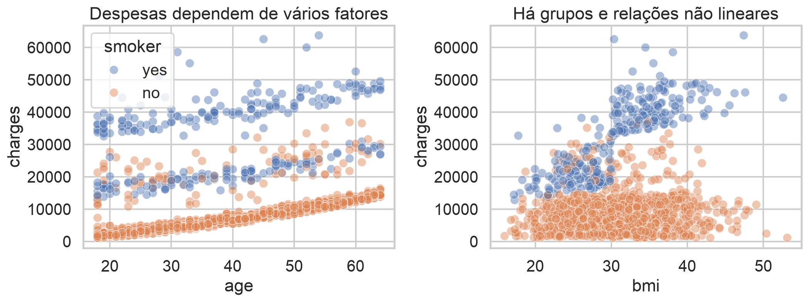
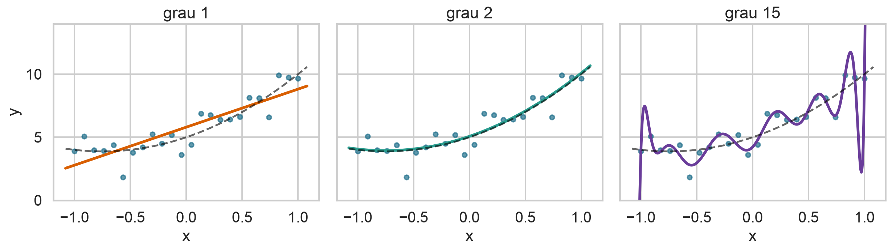
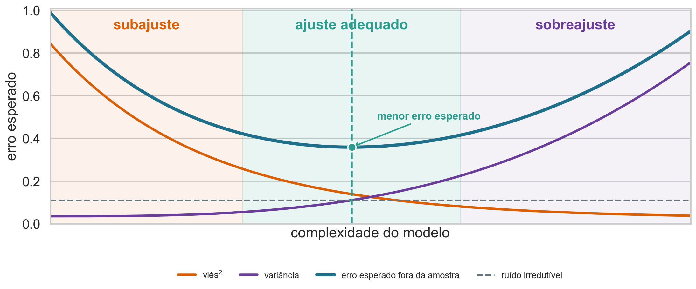
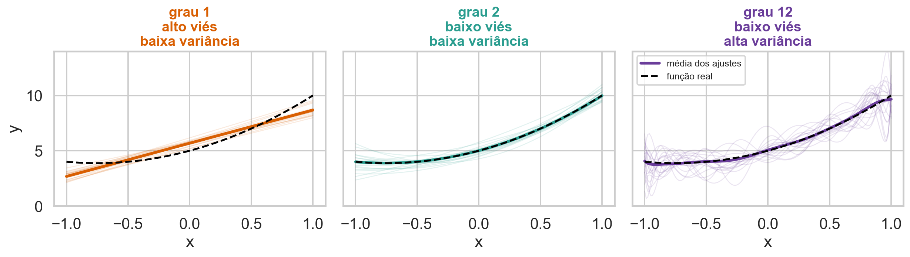
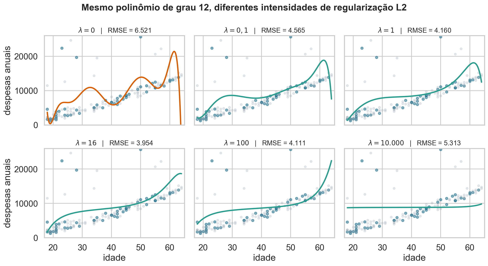
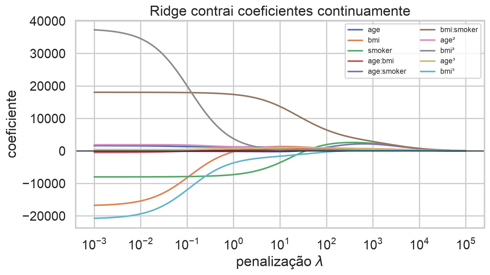
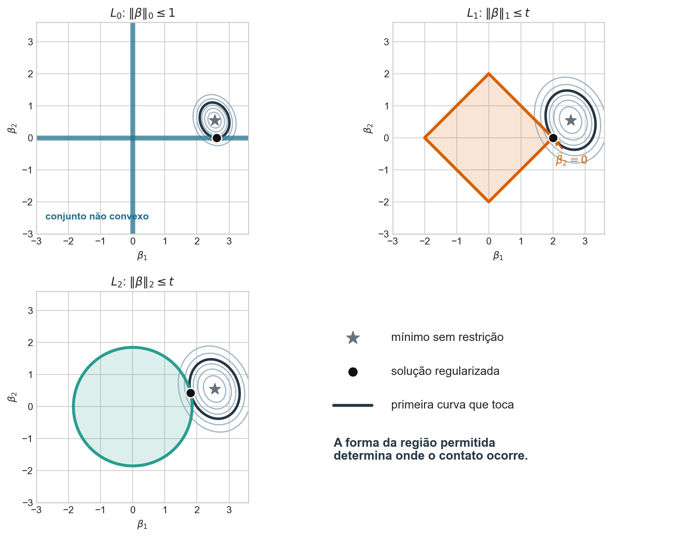
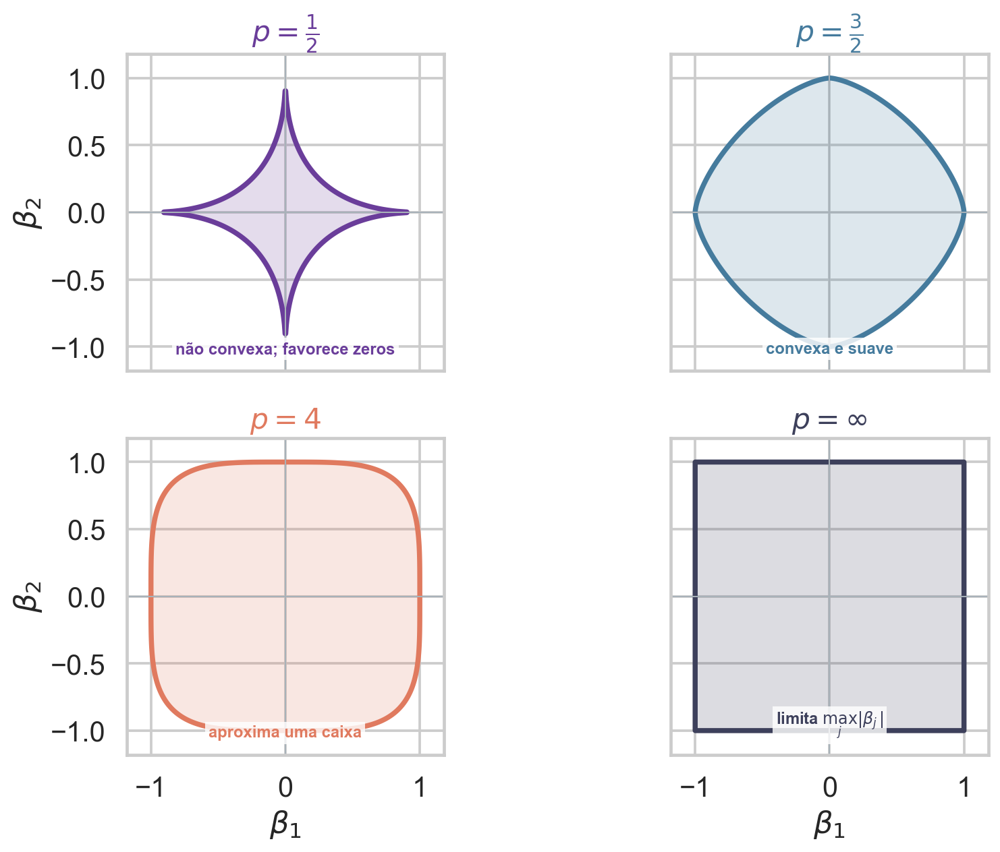
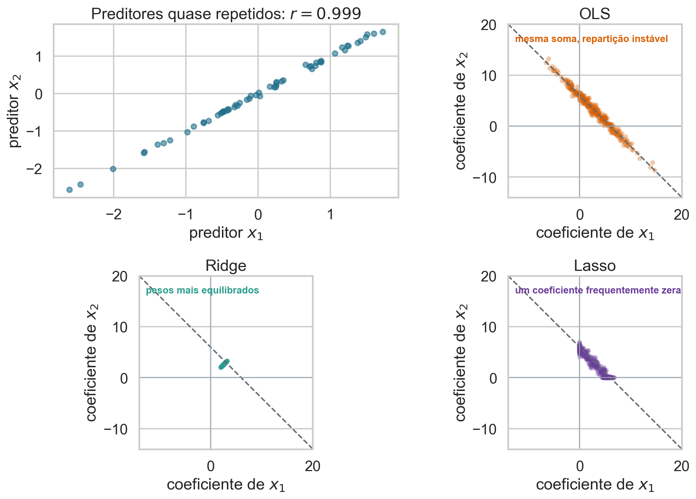
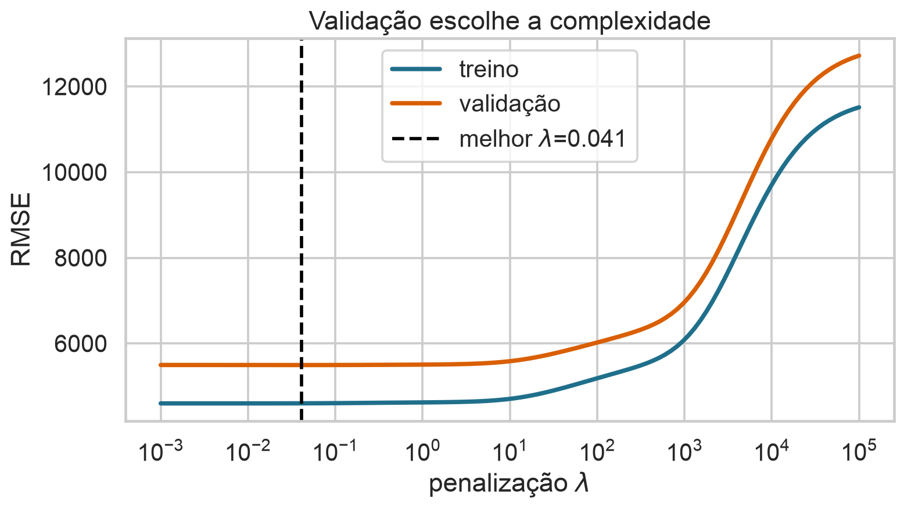

## Ajustar bem não basta

Um modelo pode explicar quase perfeitamente os dados de treinamento e falhar em novas observações.

> Regularização aceita algum viés para reduzir variância e melhorar generalização.

## Hoje

- decompor erro em ruído, viés e variância;
- distinguir erro de treino e erro de generalização;
- formular regularização como penalização ou restrição;
- comparar $L_0$, Ridge, Lasso e Elastic Net;
- escolher a intensidade da penalização por validação;
- entender por que escala, intercepto e vazamento importam.

## Base de dados de apoio

Continuaremos com **Medical Insurance Cost**, do Kaggle:

- 1.338 pessoas seguradas;
- resposta: despesas médicas (`charges`);
- atributos: idade, IMC, tabagismo, sexo, filhos e região;
- criaremos polinômios e interações para estudar complexidade.

## A base combina grupos e não linearidade

{.wide-chart fig-alt="Despesas médicas contra idade e IMC, separadas por tabagismo."}

Tabagismo separa patamares; idade e IMC ainda apresentam variação dentro dos grupos.

<details class="code-fold"><summary>Código do gráfico</summary>
```python
sns.scatterplot(data=df, x="age", y="charges", hue="smoker")
sns.scatterplot(data=df, x="bmi", y="charges", hue="smoker")
```
</details>

## Complexidade aumenta a flexibilidade

Partindo de $x$, podemos construir

$$x, x^2,\ldots,x^d.$$

O modelo polinomial é linear nos parâmetros:

$$f_d(x)=\beta_0+\beta_1x+\cdots+\beta_dx^d.$$

$d$ é o grau; $\beta_j$ é o coeficiente do termo $x^j$.

## Mais flexível não significa melhor {.complexity-comparison-slide}

{.wide-chart .aula23-complexity-large fig-alt="Ajustes polinomiais de graus 1, 2 e 15 aos mesmos dados."}

O grau 15 acompanha oscilações da amostra que não pertencem à relação subjacente.

<details class="code-fold"><summary>Código do gráfico</summary>
```python
for degree in [1, 2, 15]:
    coef = np.polyfit(x, y, degree)
    plt.plot(grid, np.polyval(coef, grid))
```
</details>

## Erro de treino favorece complexidade

Se modelos estão aninhados,

$$\operatorname{SSE}_{d+1,\,treino}\leq \operatorname{SSE}_{d,\,treino}.$$

O modelo de grau $d+1$ pode reproduzir o de grau $d$ usando $\beta_{d+1}=0$.

Logo, minimizar apenas erro de treino não escolhe a complexidade adequada.

## O alvo é o risco de generalização

Para uma nova observação $(X,Y)$ da mesma população,

$$R(f)=E\left[(Y-f(X))^2\right].$$

- $f$ é a regra ajustada;
- a esperança inclui novas amostras de treino e novos pontos;
- validação estima esse risco fora da amostra.

## Decomposição viés–variância

Em um ponto $x$, suponha $Y=f(x)+\varepsilon$, com $E[\varepsilon]=0$ e $\operatorname{Var}(\varepsilon)=\sigma^2$:

$$E[(Y-\widehat f(x))^2]=\sigma^2+\operatorname{Bias}[\widehat f(x)]^2+\operatorname{Var}[\widehat f(x)].$$

O ruído $\sigma^2$ é irredutível; os outros termos dependem do procedimento de ajuste.

## Subajuste, ajuste adequado e sobreajuste

{.wide-chart .aula23-fit-regimes-large fig-alt="Curvas de viés ao quadrado, variância e erro esperado fora da amostra ao longo da complexidade, com as regiões de subajuste, ajuste adequado e sobreajuste."}

::: {.columns .concept-cards .fit-regime-cards}
::: {.column width="33%"}
### Subajuste

O modelo é rígido demais. O viés domina e até o erro de treino permanece alto.
:::

::: {.column width="33%"}
### Ajuste adequado

A complexidade equilibra viés e variância, reduzindo o erro fora da amostra.
:::

::: {.column width="33%"}
### Sobreajuste

O treino melhora, mas o modelo passa a seguir ruído. A variância domina.
:::
:::

## Viés e variância em modelos concretos

{.wide-chart .aula23-bias-variance-large fig-alt="Vários ajustes polinomiais mostram viés alto, equilíbrio e variância alta."}

As curvas claras representam ajustes em amostras diferentes. O grau 1 é estável, mas erra sistematicamente. O grau 2 acompanha a função real. O grau 12 muda muito entre amostras.

<details class="code-fold"><summary>Código do gráfico</summary>
```python
for repeticao in range(70):
    y = f(x) + rng.normal(0, sigma, len(x))
    previsoes.append(ajuste_polinomial(x, y, grau))
```
</details>

## Quiz: qual modelo generaliza? {.quiz-question}

- [O que equilibra erro de validação e estabilidade]{.correct data-explanation="Treino quase perfeito pode indicar alta variância; validação avalia generalização."}
- [Sempre o de menor erro de treino]{data-explanation="O erro de treino tende a favorecer modelos mais flexíveis."}
- [Sempre o de menor número de parâmetros]{data-explanation="Simplicidade excessiva pode produzir alto viés."}

## O problema que motiva a regularização {.regularization-motivation}

::: {.columns}
::: {.column width="58%"}
### Até aqui

- Modelos são aproximações: simplificam deliberadamente a realidade.
- Maior flexibilidade reduz o erro de treino, mas pode aumentar a sensibilidade à amostra.
- Queremos preservar o sinal e generalizar para novos dados.
:::

::: {.column width="42%"}
::: {.regularization-quote}
“Todos os modelos estão errados, mas alguns são úteis.”

<span>George E. P. Box</span>
:::
:::
:::

::: {.callout-note title="A pergunta desta aula"}
Como controlar a complexidade durante o ajuste? **Regularização adiciona ao objetivo um custo para modelos excessivamente flexíveis.**
:::

## Regularizar muda o objetivo

Mínimos quadrados resolve

$$\widehat\beta=\arg\min_\beta \|y-X\beta\|_2^2.$$

Regularização resolve

$$\widehat\beta_\lambda=\arg\min_\beta\left\{\frac1n\|y-X\beta\|_2^2+\lambda P(\beta)\right\}.$$

$P(\beta)$ mede complexidade; $\lambda\ge0$ controla quanto ela custa.

## O parâmetro $\lambda$ governa o compromisso

- $\lambda=0$: recupera o ajuste não regularizado;
- $\lambda$ pequeno: contração leve;
- $\lambda$ grande: coeficientes fortemente reduzidos;
- $\lambda\to\infty$: as inclinações tendem a zero.

Não há um $\lambda$ universal: ele é um hiperparâmetro escolhido com dados de validação.

## O efeito de $\lambda$ sobre a flexibilidade {.lambda-flexibility-slide}

{.wide-chart .aula23-lambda-grid fig-alt="Seis regressões polinomiais de grau 12 na base Insurance, com penalização L2 crescente. A curva passa de muito oscilante para excessivamente rígida."}

**$\lambda=0$ favorece sobreajuste. Valores intermediários melhoram a validação. Valores muito grandes produzem subajuste.**

## $L_0$ controla quantos termos permanecem {.lzero-selection-slide}

Na base Insurance, podemos começar com atributos originais, potências e interações:

$$\phi(x)=(\text{age},\text{bmi},\text{smoker},\text{age}^2,
\text{bmi}^2,\text{age}\times\text{smoker},\ldots).$$

::: {.columns .concept-cards .lzero-selection-cards}
::: {.column width="48%"}
### Contagem de termos

$$\|\beta\|_0=\sum_{j=1}^{p}\mathbb 1(\beta_j\neq0)$$

$\|\beta\|_0$ conta quantos coeficientes são diferentes de zero.
:::

::: {.column width="48%"}
### Otimização com orçamento

$$\min_\beta\operatorname{MSE}(\beta)
\quad\text{sujeito a}\quad \|\beta\|_0\le k$$

No máximo $k$ termos permanecem; os demais coeficientes são zerados.
:::
:::

**A formulação é direta, mas comparar os subconjuntos possíveis torna a busca combinatória.**

## Ridge usa a penalização $L_2$

$$\widehat\beta^{ridge}_\lambda=
\arg\min_\beta\left\{\frac1n\|y-X\beta\|_2^2+\lambda\sum_{j=1}^p\beta_j^2\right\}.$$

Ridge contrai coeficientes de forma contínua e estabiliza soluções com preditores correlacionados.

## O intercepto não deve ser penalizado

Se $X$ contém uma coluna de 1, usamos

$$P(\beta)=\sum_{j=1}^{p}\beta_j^2,$$

excluindo $\beta_0$.

Penalizar o intercepto faria a média prevista depender artificialmente da origem escolhida para $Y$.

## Ridge altera o gradiente

Se a primeira coluna de $X$ representa o intercepto, defina

$$D=\operatorname{diag}(0,1,\ldots,1).$$

Então

$$J(\beta)=\frac1n\|y-X\beta\|_2^2+\lambda\|D\beta\|_2^2,$$

$$\nabla J(\beta)=\frac2nX^T(X\beta-y)+2\lambda D\beta.$$

O termo $2\lambda D\beta$ contrai as inclinações, mas preserva o intercepto.

## Gradiente descendente com Ridge {.ridge-gd-code-slide}

```python
def ridge_gd(X, y, lambda_, learning_rate=0.01,
             max_iter=50_000, tol=1e-6):
    n, p = X.shape
    beta = np.zeros(p)
    penaliza = np.ones(p)
    penaliza[0] = 0  # preserva o intercepto

    for _ in range(max_iter):
        erro = X @ beta - y
        gradiente = (2 / n) * X.T @ erro
        gradiente += 2 * lambda_ * penaliza * beta

        if np.linalg.norm(gradiente) < tol:
            break
        beta = beta - learning_rate * gradiente

    return beta
```

O segundo termo de `gradiente` é a parcela nova. O material de apoio também registra o histórico da perda.

## O caminho Ridge mostra contração

{.wide-chart fig-alt="Coeficientes Ridge em função da intensidade da penalização."}

Os coeficientes se aproximam suavemente de zero conforme $\lambda$ aumenta.

<details class="code-fold"><summary>Código do gráfico</summary>
```python
for alpha in alphas:
    beta = np.linalg.solve(X.T@X + alpha*np.eye(p), X.T@y)
```
</details>

## Lasso usa a penalização $L_1$

$$\widehat\beta^{lasso}_\lambda=
\arg\min_\beta\left\{\frac1n\|y-X\beta\|_2^2+\lambda\sum_{j=1}^p|\beta_j|\right\}.$$

Lasso pode produzir coeficientes exatamente iguais a zero: regulariza e seleciona atributos simultaneamente.

## Geometria das restrições $L_0$, $L_1$ e $L_2$ {.penalty-geometry-slide}

A solução é o ponto em que a menor curva de nível possível toca a região permitida.

{.aula23-penalty-geometry .nostretch fig-alt="As mesmas curvas de nível da perda encontram três regiões de restrição. No painel Lasso, a primeira curva toca exatamente o vértice direito do losango, produzindo beta 2 igual a zero. No painel Ridge, o contato ocorre fora dos eixos e ambos os coeficientes permanecem diferentes de zero."}

**Neste exemplo, a curva toca um vértice de $L_1$: $\widehat\beta_2=0$. A borda suave de $L_2$ contrai os dois coeficientes, sem zerá-los.**

<details class="code-fold"><summary>Código do gráfico</summary>
```python
loss = quadratic_loss(beta1, beta2)
plt.contour(beta1, beta2, loss)
plt.plot(l0_axes); plt.plot(l1_ball); plt.plot(l2_ball)
```
</details>

## Outros valores de $p$ {.lp-family-slide}

Para $p\ge1$, $\|\beta\|_p=(\sum_j|\beta_j|^p)^{1/p}$ é uma norma convexa. Para $0<p<1$, é uma **quase-norma não convexa**: favorece esparsidade, mas dificulta a otimização.

{.aula23-lp-family .nostretch fig-alt="Quatro regiões unitárias para p igual a um meio, três meios, quatro e infinito. A região p igual a um meio é não convexa e pontiaguda nos eixos; as demais são convexas e se tornam progressivamente mais quadradas."}

<details class="code-fold"><summary>Código do gráfico</summary>
```python
lp = (np.abs(beta1)**p + np.abs(beta2)**p)**(1/p)
plt.contour(beta1, beta2, lp, levels=[1])
```
</details>

## $L_1$ não é diferenciável em zero

Para $\beta_j\neq0$,

$$\frac{d}{d\beta_j}|\beta_j|=\operatorname{sign}(\beta_j).$$

Em zero usamos subgradientes em $[-1,1]$. Algoritmos como descida coordenada e métodos proximais tratam esse ponto explicitamente.

## Colinearidade: OLS, Ridge e Lasso {.correlated-regularization-slide}

Em 300 amostras de 60 observações, simulamos $x_1\approx x_2$, com $r\approx0{,}999$. Cada ponto representa um novo ajuste.

{.aula23-correlated-comparison fig-alt="Exemplo sintético com preditores quase perfeitamente correlacionados. Os coeficientes de mínimos quadrados variam ao longo de uma diagonal, Ridge os concentra em valores equilibrados e Lasso frequentemente leva um deles a zero."}

**OLS troca peso entre os coeficientes; Ridge estabiliza; Lasso frequentemente zera um deles.**

## Ridge e Lasso respondem de modos distintos {.ridge-lasso-table-slide}

| propriedade | Ridge ($L_2$) | Lasso ($L_1$) |
|---|---|---|
| contração | contínua, sem zeros exatos em geral | contínua, com zeros exatos |
| correlacionados | reparte o efeito entre eles | pode escolher apenas um deles |
| repetição da amostra | coeficientes mais estáveis | a variável escolhida pode mudar |
| objetivo prático | estabilidade preditiva | seleção e parcimônia |

## Elastic Net combina $L_1$ e $L_2$

$$P(\beta)=\alpha\|\beta\|_1+(1-\alpha)\left(\frac12\|\beta\|_2^2\right),
\qquad 0\le\alpha\le1.$$

- $\alpha=0$: Ridge;
- $\alpha=1$: Lasso;
- valores intermediários combinam seleção e estabilidade.

Agora há dois hiperparâmetros: intensidade $\lambda$ e mistura $\alpha$.

## Quiz: preditores muito correlacionados {.quiz-question}

- [Ridge tende a repartir o peso; Lasso pode selecionar apenas um]{.correct data-explanation="A geometria L2 favorece pesos distribuídos; L1 favorece soluções esparsas."}
- [Ridge sempre zera um deles]{data-explanation="Ridge normalmente contrai, mas não produz zeros exatos."}
- [Lasso sempre atribui coeficientes iguais aos dois]{data-explanation="Com correlação forte, a seleção do Lasso pode ser instável."}

## Padronizar é parte do modelo

Se um atributo está em reais e outro em milhares de reais, a mesma penalização sobre seus coeficientes não representa a mesma mudança preditiva.

Use, no conjunto de treino,

$$z_{ij}=\frac{x_{ij}-\bar x_{j,treino}}{s_{j,treino}}.$$

As mesmas médias e escalas transformam validação e teste.

## Ajustar a escala antes da divisão vaza informação

Médias, desvios, imputações e seleção de atributos devem ser aprendidos apenas no treino de cada partição.

Uma pipeline garante a ordem:

$$\text{treino}\rightarrow\text{transformação}\rightarrow\text{modelo}\rightarrow\text{validação}.$$

Usar toda a base para padronizar torna a validação ligeiramente otimista.

## Validação escolhe $\lambda$

{.wide-chart fig-alt="RMSE de treino e validação em função da penalização Ridge."}

Erro de treino cresce com a restrição; validação pode melhorar antes de piorar.

<details class="code-fold"><summary>Código do gráfico</summary>
```python
for alpha in alphas:
    beta = ridge(X_train, y_train, alpha)
    rmse_valid.append(rmse(y_valid, X_valid @ beta))
```
</details>

## Regularização logística segue a mesma lógica

Para resposta binária,

$$\widehat\beta_\lambda=\arg\min_\beta
\left\{-\frac1n\ell(\beta)+\lambda P(\beta)\right\},$$

em que $\ell(\beta)$ é a log-verossimilhança Bernoulli. Penalização L2 ajuda especialmente em separação e colinearidade.

## Penalizar não corrige especificação ruim

Regularização não resolve automaticamente:

- variáveis omitidas importantes;
- vazamento ou mudança de distribuição;
- rótulos enviesados;
- relação funcional inadequada;
- interpretação causal injustificada.

Ela controla complexidade dentro do conjunto de atributos e do modelo escolhidos.

## Coeficientes regularizados mudam de interpretação

A estimativa é deliberadamente viesada em direção a zero. Intervalos e testes clássicos de mínimos quadrados não podem ser reutilizados ingenuamente após seleção ou penalização.

::: {.columns .concept-cards}
::: {.column width="48%"}
### Previsão

Escolha a pipeline por validação e reporte o desempenho em dados de teste.
:::
::: {.column width="48%"}
### Inferência

Separe seleção e teste ou use inferência pós-seleção. Reajustar OLS nos mesmos dados não restaura valores-$p$ válidos.
:::
:::

## Quiz: onde escolher $\lambda$? {.quiz-question}

- [No conjunto de validação, preservando o teste final]{.correct data-explanation="O teste deve estimar o desempenho após todas as escolhas."}
- [No conjunto de teste, pois ele é mais realista]{data-explanation="Escolher pelo teste transforma-o em validação e contamina a avaliação final."}
- [Pelo menor erro de treinamento]{data-explanation="Isso tende a escolher penalização insuficiente."}

## Um fluxo seguro

1. defina treino e teste;
2. construa a pipeline de transformação;
3. compare valores de $\lambda$ no conjunto de validação;
4. reajuste a pipeline no treino completo;
5. avalie uma única vez no teste;
6. reporte métrica, incerteza e escolhas realizadas.

## O que levamos desta aula

- complexidade reduz viés, mas pode elevar variância;
- $L_2$ estabiliza e distribui peso;
- $L_1$ pode produzir soluções esparsas;
- Elastic Net combina os dois comportamentos;
- escala e validação fazem parte do procedimento;
- regularização ajuda a generalizar, não transforma associação em causalidade.

## Próxima aula

**Engenharia de atributos**

Como transformar dados brutos em representações úteis sem introduzir vazamento — e como essas escolhas interagem com a regularização.

## Bibliografia

- James et al., *An Introduction to Statistical Learning*, cap. 6.
- Hastie, Tibshirani e Friedman, *The Elements of Statistical Learning*, caps. 3 e 7.
- Deisenroth, Faisal e Ong, *Mathematics for Machine Learning*, cap. 9.
- Data 100, capítulos sobre feature engineering e regularização.
- Box, “Science and Statistics”, *Journal of the American Statistical Association*, 1976.
