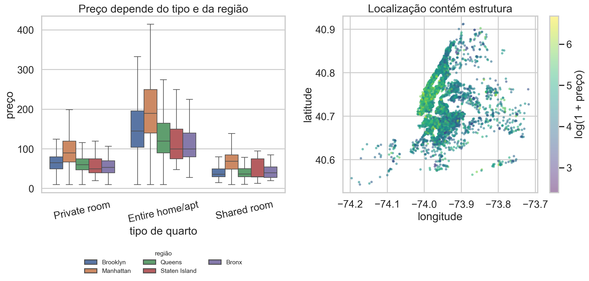
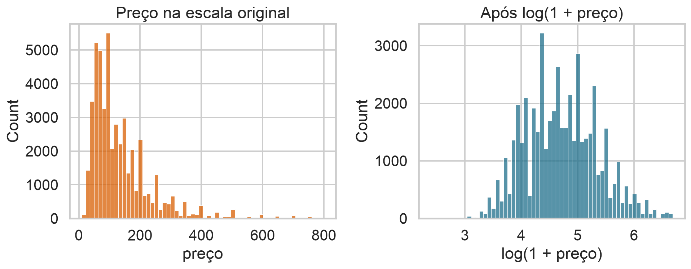
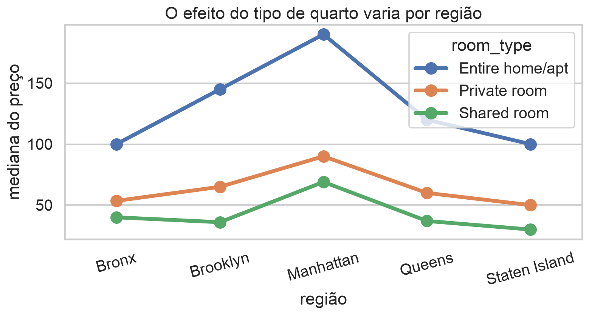
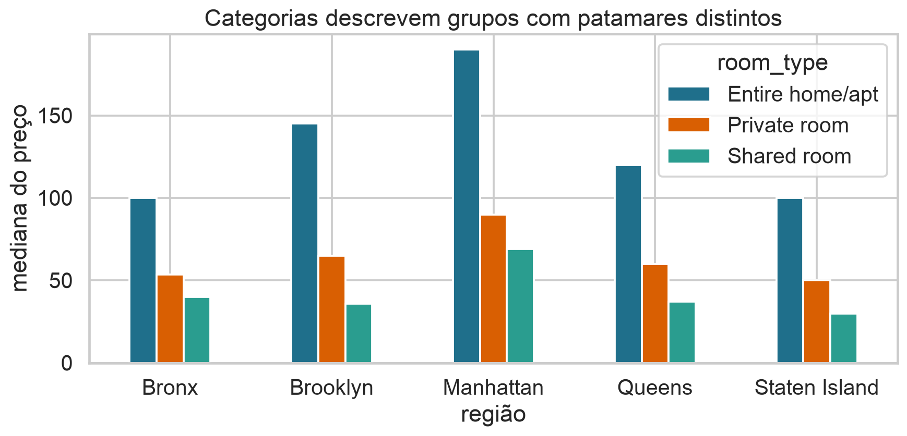
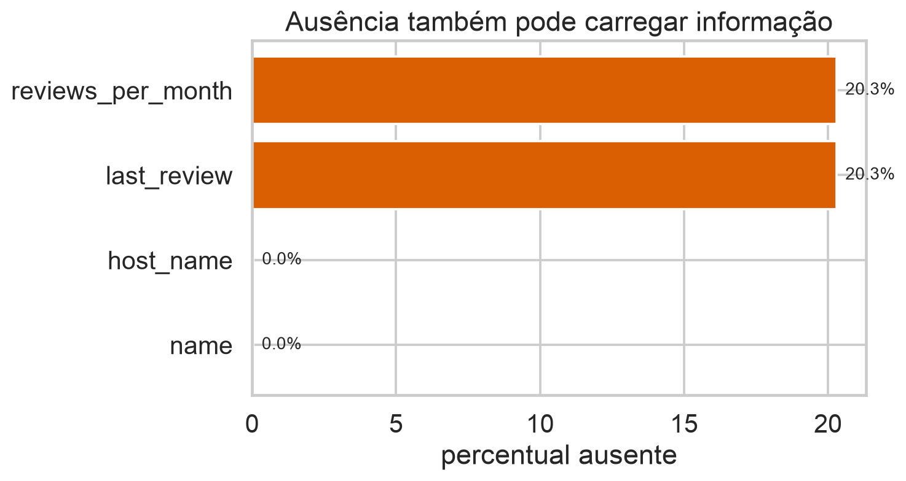
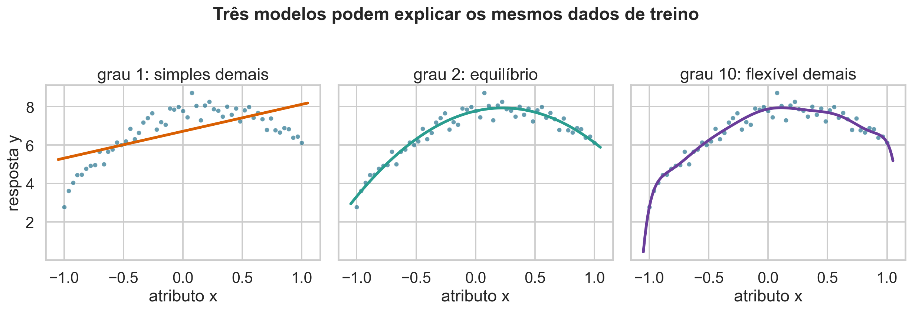
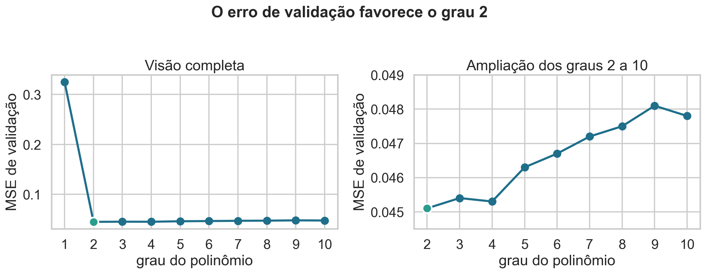
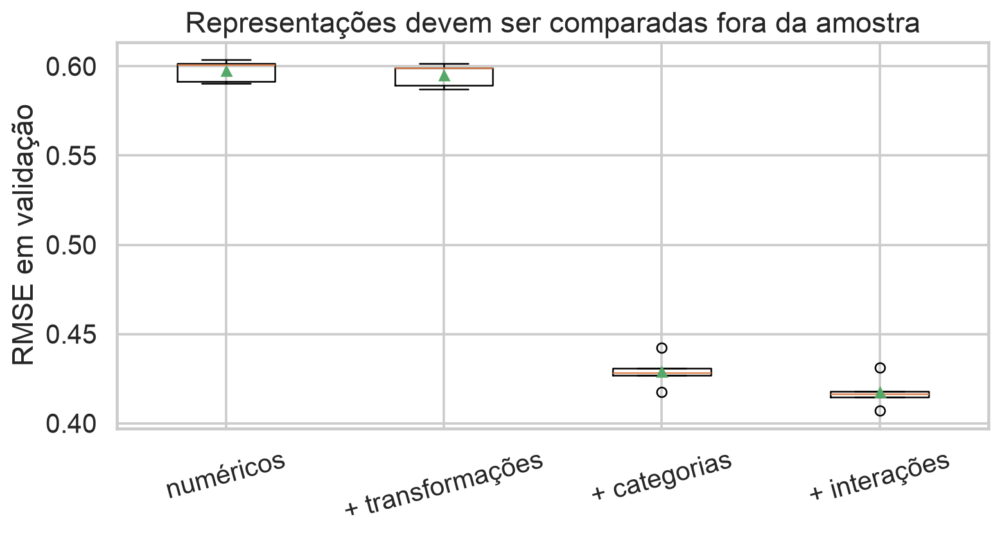

## Dados brutos raramente são a representação final

Modelos recebem números, mas tabelas reais contêm categorias, ausências, datas, textos, escalas inadequadas e relações não lineares.

> Engenharia de atributos transforma conhecimento sobre o problema em uma matriz que o modelo consegue explorar.

## Hoje

- formalizar transformações por uma função $\phi$;
- construir atributos numéricos, categóricos, temporais e textuais;
- tratar valores ausentes sem criar vazamento;
- organizar transformações em pipelines;
- separar treino, validação e teste;
- usar validação cruzada para comparar representações.

## Base de dados de apoio

Usaremos **New York City Airbnb Open Data**, do Kaggle:

- aproximadamente 49 mil anúncios de 2019;
- resposta: preço diário;
- localização, tipo de quarto, disponibilidade e avaliações;
- nomes de anúncios e datas permitem discutir texto e tempo.

## O que é cada linha?

Cada observação representa um anúncio. Colunas importantes:

| coluna | significado |
|---|---|
| `price` | preço diário anunciado |
| `room_type` | tipo de acomodação |
| `neighbourhood_group` | grande região de Nova York |
| `latitude`, `longitude` | localização |
| `reviews_per_month` | frequência de avaliações |
| `name` | título livre do anúncio |

## Preço depende de representação e contexto

{.aula24-base-large fig-alt="Preço por tipo de quarto e região, e mapa de anúncios colorido pelo log do preço."}

Tipo de quarto, região e posição espacial carregam informações complementares.

<details class="code-fold"><summary>Código do gráfico</summary>
```python
fig, axes = plt.subplots(1, 2)
sns.boxplot(data=df, x="room_type", y="price", hue="neighbourhood_group", ax=axes[0])
sns.move_legend(axes[0], "upper center", bbox_to_anchor=(0.5, -0.30), ncol=3)
axes[1].scatter(df.longitude, df.latitude, c=np.log1p(df.price))
```
</details>

## Da tabela à matriz de atributos {.feature-transform-slide}

```{=html}
<div class="feature-transform-diagram" role="img" aria-label="Três anúncios na tabela original são transformados em uma matriz numérica com indicadores, logaritmo e indicador de ausência.">
  <div class="feature-table feature-table-raw">
    <h3>Tabela original <em>X</em></h3>
    <table>
      <thead>
        <tr><th>tipo</th><th>região</th><th>mín. noites</th><th>avaliações/mês</th></tr>
      </thead>
      <tbody>
        <tr><td>apartamento</td><td>Manhattan</td><td>3</td><td>1,2</td></tr>
        <tr><td>quarto privado</td><td>Brooklyn</td><td>1</td><td>ausente</td></tr>
        <tr><td>quarto compartilhado</td><td>Queens</td><td>7</td><td>0,4</td></tr>
      </tbody>
    </table>
  </div>

  <div class="feature-transform-operator" aria-hidden="true">
    <span class="feature-transform-phi">φ</span>
    <span class="feature-transform-arrow">⟶</span>
    <span>one-hot encoding<br>log(1 + noites)<br>indicador de ausência</span>
  </div>

  <div class="feature-table feature-table-model">
    <h3>Matriz de atributos <em>Φ(X)</em></h3>
    <table>
      <thead>
        <tr><th>privado</th><th>compart.</th><th>Manhattan</th><th>log(1+n)</th><th>aval. ausente</th></tr>
      </thead>
      <tbody>
        <tr><td>0</td><td>0</td><td>1</td><td>1,39</td><td>0</td></tr>
        <tr><td>1</td><td>0</td><td>0</td><td>0,69</td><td>1</td></tr>
        <tr><td>0</td><td>1</td><td>0</td><td>2,08</td><td>0</td></tr>
      </tbody>
    </table>
  </div>
</div>
```

> Cada linha continua representando o mesmo anúncio. A transformação muda as coordenadas disponíveis para o modelo.

## O algoritmo continua o mesmo

A transformação troca a matriz $X$ por uma nova matriz $\Phi(X)$:

$$
\widehat y=\beta_0+\Phi(X)\beta.
$$

- uma coluna pode permanecer como está;
- categorias podem virar indicadores;
- atributos podem ser transformados ou combinados.

Os coeficientes continuam sendo ajustados pelos mesmos métodos das aulas anteriores.

## Transformações mudam a escala

{.wide-chart fig-alt="Distribuição do preço antes e depois da transformação log1p."}

Para valores não negativos, $\log(1+x)$ comprime diferenças grandes e preserva $x=0$.

O log reduz a dominância da cauda direita, mas não torna automaticamente o modelo correto.

<details class="code-fold"><summary>Código do gráfico</summary>
```python
sns.histplot(df["price"])
sns.histplot(np.log1p(df["price"]))
```
</details>

## Polinômios criam novos atributos

Um polinômio de grau 3 troca uma coluna por

$$
x\quad\longmapsto\quad (1,\;x,\;x^2,\;x^3).
$$

O modelo passa a ajustar

$$
\widehat y=\beta_0+\beta_1x+\beta_2x^2+\beta_3x^3.
$$

O grau controla a flexibilidade. A validação ajudará a escolher um grau que funcione em novos dados.

## Interações combinam atributos

Uma interação entre tipo de quarto e região permite que a diferença entre acomodações varie pela cidade:

$$
\widehat y=\beta_0+\beta_1\,\text{quarto}+\beta_2\,\text{região}
+\beta_3(\text{quarto}\times\text{região}).
$$

## Tipo de quarto interage com região

{.wide-chart fig-alt="Medianas de preço por região conectadas separadamente para cada tipo de quarto."}

As linhas não são paralelas: a diferença entre tipos de quarto varia entre regiões.

<details class="code-fold"><summary>Código do gráfico</summary>
```python
median = df.groupby(["neighbourhood_group", "room_type"]).price.median()
sns.pointplot(data=median.reset_index(), x="neighbourhood_group", y="price", hue="room_type")
```
</details>

## Categorias viram colunas indicadoras

Codificar Brooklyn = 1, Manhattan = 2 e Queens = 3 criaria uma ordem e distâncias que não existem.

Com one-hot encoding, cada categoria recebe uma coluna:

| região | Brooklyn | Manhattan | Queens |
|---|---:|---:|---:|
| Manhattan | 0 | 1 | 0 |
| Brooklyn | 1 | 0 | 0 |
| Queens | 0 | 0 | 1 |

Cada linha apenas indica a qual grupo pertence.

## Uma categoria vira referência

Com intercepto, as $K$ colunas one-hot somam 1 e geram dependência linear perfeita.

Usamos $K-1$ indicadores. A categoria omitida é a referência; mudar a referência altera coeficientes, mas não previsões ajustadas.

## Categorias descrevem patamares distintos

{.wide-chart fig-alt="Mediana do preço por região e tipo de quarto."}

Indicadores permitem que o modelo represente diferenças de nível entre esses grupos.

<details class="code-fold"><summary>Código do gráfico</summary>
```python
summary = df.groupby(["neighbourhood_group", "room_type"]).price.median()
summary.unstack().plot(kind="bar")
```
</details>

## Valores ausentes exigem uma decisão {.compact-slide}

::: {.columns .concept-cards}
::: {.column width="33%"}
### Entender

O valor não foi coletado, não se aplica ou depende do comportamento observado?
:::
::: {.column width="33%"}
### Representar

Podemos imputar um valor, criar um indicador de ausência ou remover a linha.
:::
::: {.column width="33%"}
### Verificar

A remoção ou imputação alterou grupos importantes da base?
:::
:::

Conhecimento do domínio orienta a escolha.

## Ausência de avaliações é frequente

{.wide-chart fig-alt="Percentual de valores ausentes em quatro colunas do Airbnb."}

`reviews_per_month` ausente coincide frequentemente com nenhum histórico de avaliações.

<details class="code-fold"><summary>Código do gráfico</summary>
```python
missing_rate = df[["last_review", "reviews_per_month", "name", "host_name"]].isna().mean()
```
</details>

## Texto também precisa virar números

Uma representação simples usa uma coluna por palavra e registra sua presença ou contagem.

Também podemos extrair do título do anúncio:

- comprimento do texto;
- presença de palavras importantes;
- quantidade de símbolos ou dígitos;
- idioma provável.

Bag-of-words, TF-IDF e embeddings seguem o mesmo princípio: o modelo recebe vetores, não texto bruto.

## Domínio também decide o que remover

Nem toda coluna disponível deve entrar no modelo.

- `id` e `host_id` podem incentivar memorização;
- informação posterior à previsão cria vazamento;
- atributos instáveis podem desaparecer quando a plataforma muda.

Engenharia de atributos também significa excluir colunas sem justificativa para generalizar.

## Quiz: codificando regiões {.quiz-question}

- [Usar indicadores e omitir uma referência quando há intercepto]{.correct data-explanation="Isso evita impor ordem e remove dependência linear perfeita."}
- [Atribuir números de 1 a 5 em ordem alfabética]{data-explanation="A codificação cria distâncias artificiais."}
- [Usar apenas o código postal como número contínuo]{data-explanation="Códigos postais são identificadores geográficos, não medidas lineares."}

## Vazamento usa informação do futuro

Há vazamento quando um atributo usa informação indisponível no momento da previsão ou deriva direta ou indiretamente da resposta.

Exemplo: usar avaliações publicadas depois da data em que o preço deveria ser previsto.

O desempenho parece excelente, mas não pode ser reproduzido em produção.

## Pipeline mantém a ordem correta

::: {.cv-final-flow}
::: {.cv-flow-stage}
**1. Aprender no treino**

Imputação, categorias e escala
:::
::: {.cv-flow-arrow}
$\longrightarrow$
:::
::: {.cv-flow-stage}
**2. Aplicar sem reaprender**

Validação e teste
:::
::: {.cv-flow-arrow}
$\longrightarrow$
:::
::: {.cv-flow-stage}
**3. Prever**

Mesmo modelo e mesma representação
:::
:::

Pré-processar toda a base antes da divisão produz vazamento.

## Como escolher a representação?

{.wide-chart fig-alt="Mesmos dados ajustados por polinômios de graus 1, 2 e 10."}

O erro de treino favorece modelos muito flexíveis. Precisamos verificar o desempenho em observações que não participaram do ajuste.

## O futuro não participa das escolhas

::: {.cv-real-world}
::: {.cv-real-data}
**Todos os dados**
:::
::: {.cv-real-arrow}
$\longrightarrow$
:::
::: {.cv-real-split}
::: {.cv-real-dev}
**Desenvolvimento**

Treino + validação representam o passado e o presente.
:::
::: {.cv-real-test}
**Teste**

Representa observações futuras ainda não conhecidas.
:::
:::
:::

> Nunca escolha atributos, grau ou parâmetros olhando para o teste.

## Uma validação ajuda a escolher o grau

{.wide-chart fig-alt="MSE de validação para polinômios de graus 1 a 10, com o grau 2 destacado."}

O grau 2 apresenta o menor MSE de validação. A ampliação mostra diferenças que seriam invisíveis na escala completa.

## Cada conjunto responde a uma pergunta

::: {.cv-mse-cards}
::: {.cv-mse-card .train}
**Treino**

MSE **0,044**

Quão bem o modelo ajusta os dados usados para estimar os coeficientes?
:::
::: {.cv-mse-card .valid}
**Validação**

MSE **0,045**

Qual grau devemos escolher?
:::
::: {.cv-mse-card .test}
**Teste**

MSE **0,046**

Como o modelo escolhido generaliza?
:::
:::

Valores próximos são esperados quando a representação generaliza bem.

## Primeiro, reserve o teste

::: {.cv-holdout-diagram}
::: {.cv-holdout-dev}
**Desenvolvimento — 80%**

Treino e validação cruzada
:::
::: {.cv-holdout-test}
**Teste — 20%**

Guardado até o final
:::
:::

Consultar repetidamente o teste o transforma em validação.

## Um candidato: quatro partes treinam

Considere primeiro o **modelo $M_2$**, com polinômio de grau 2.

```{=html}
<div class="cv-folds cv-single-fold" role="img" aria-label="Quatro partes usadas para treino e a quinta para validação.">
  <div class="cv-fold-row"><span class="train">Treino</span><span class="train">Treino</span><span class="train">Treino</span><span class="train">Treino</span><span class="valid">Validação</span></div>
</div>
```

O MSE é calculado somente na parte verde, que não participou daquele ajuste.

## Reveze a parte de validação

```{=html}
<div class="cv-folds" role="img" aria-label="Cinco ajustes de validação cruzada; em cada linha uma parte diferente é usada para validação.">
  <div class="cv-fold-row"><span class="train">Treino</span><span class="train">Treino</span><span class="train">Treino</span><span class="train">Treino</span><span class="valid">Validação</span></div>
  <div class="cv-fold-row"><span class="train">Treino</span><span class="train">Treino</span><span class="train">Treino</span><span class="valid">Validação</span><span class="train">Treino</span></div>
  <div class="cv-fold-row"><span class="train">Treino</span><span class="train">Treino</span><span class="valid">Validação</span><span class="train">Treino</span><span class="train">Treino</span></div>
  <div class="cv-fold-row"><span class="train">Treino</span><span class="valid">Validação</span><span class="train">Treino</span><span class="train">Treino</span><span class="train">Treino</span></div>
  <div class="cv-fold-row"><span class="valid">Validação</span><span class="train">Treino</span><span class="train">Treino</span><span class="train">Treino</span><span class="train">Treino</span></div>
</div>
```

Cada observação valida uma vez e treina quatro vezes. O teste permanece guardado.

<details class="code-fold"><summary>Código do gráfico</summary>
```python
folds = np.array_split(rng.permutation(n), 5)
for k in range(5):
    valid = folds[k]
    train = np.concatenate(folds[:k] + folds[k+1:])
```
</details>

## Repita para cada candidato

::: {.cv-candidate-row .three-candidates}
::: {.cv-candidate}
**$M_1$: grau 1**

cinco MSEs
:::
::: {.cv-candidate}
**$M_2$: grau 2**

cinco MSEs
:::
::: {.cv-candidate}
**$M_3$: grau 3**

cinco MSEs
:::
:::

O mesmo conjunto de partes deve ser usado para comparar os três modelos.

## Cada combinação produz um MSE {.cv-mse-slide}

| parte | $M_1$: grau 1 | $M_2$: grau 2 | $M_3$: grau 3 |
|---:|---:|---:|---:|
| 1 | 0,045 | **0,040** | 0,055 |
| 2 | 0,046 | **0,040** | 0,052 |
| 3 | **0,043** | 0,048 | 0,053 |
| 4 | 0,042 | **0,040** | 0,050 |
| 5 | 0,045 | **0,040** | 0,055 |

Em cada linha, o menor valor identifica o candidato que venceu naquele fold.

## Nem todo fold escolhe o mesmo modelo {.cv-mse-slide}

| parte | $M_1$: grau 1 | $M_2$: grau 2 | $M_3$: grau 3 |
|---:|---:|---:|---:|
| 1 | 0,045 | **0,040** | 0,055 |
| 2 | 0,046 | **0,040** | 0,052 |
| 3 | **0,043** | <mark>0,048</mark> | 0,053 |
| 4 | 0,042 | **0,040** | 0,050 |
| 5 | 0,045 | **0,040** | 0,055 |

No fold 3, $M_1$ vence $M_2$. Essa instabilidade é esperada: as partes contêm observações diferentes.

## A média decide: $M_2$ é o melhor

::: {.cv-mean-cards}
::: {.cv-mean-card}
**$M_1$: grau 1**

MSE médio

**0,0442**
:::
::: {.cv-mean-card .winner}
**$M_2$: grau 2**

MSE médio

**0,0416**
:::
::: {.cv-mean-card}
**$M_3$: grau 3**

MSE médio

**0,0530**
:::
:::

Escolhemos o menor erro médio, não o vencedor de um fold isolado.

## Reajuste $M_2$ e só então use o teste

::: {.cv-final-flow}
::: {.cv-flow-stage}
**Escolher**

$M_2$ pela validação cruzada
:::
::: {.cv-flow-arrow}
$\longrightarrow$
:::
::: {.cv-flow-stage}
**Reajustar**

$M_2$ em todo o desenvolvimento
:::
::: {.cv-flow-arrow}
$\longrightarrow$
:::
::: {.cv-flow-stage}
**Avaliar**

MSE final no teste guardado
:::
:::

Os cinco modelos intermediários são descartados; serviram apenas para escolher a complexidade.

## O mesmo vale para os atributos do Airbnb

{.wide-chart fig-alt="Distribuições de RMSE em cinco partes para quatro conjuntos crescentes de atributos."}

Categorias produzem o maior ganho; interações acrescentam uma melhora menor.

<details class="code-fold"><summary>Código do gráfico</summary>
```python
for feature_set in candidates:
    scores[feature_set] = evaluate_kfold(pipeline(feature_set), K=5)
```
</details>

Categorias produzem o maior ganho; interações acrescentam uma melhora menor. Engenharia de atributos é uma hipótese testável.

## A divisão deve imitar o uso real {.compact-slide}

::: {.columns .concept-cards}
::: {.column width="50%"}
### Tempo

Treine no passado e valide no futuro.
:::
::: {.column width="50%"}
### Grupos repetidos

Mantenha observações da mesma pessoa, anfitrião ou hospital na mesma parte.
:::
:::

Misturar observações relacionadas pode produzir uma avaliação otimista.

## Quiz: onde ajustar a imputação? {.quiz-question}

- [No treino de cada parte e depois aplicá-la à validação]{.correct data-explanation="A mediana ou outra regra é um parâmetro aprendido e não pode consultar a validação."}
- [Uma vez em toda a base antes de criar as partes]{data-explanation="Isso permite que cada validação influencie sua própria transformação."}
- [Separadamente na validação]{data-explanation="A validação deve receber a transformação aprendida no treino."}

## Quiz: anúncios repetidos por anfitrião {.quiz-question}

- [Manter anúncios do mesmo anfitrião na mesma parte]{.correct data-explanation="Isso evita que padrões específicos do anfitrião atravessem treino e validação."}
- [Distribuí-los igualmente entre todas as partes]{data-explanation="Isso pode tornar a avaliação otimista por dependência entre observações."}
- [Usar o identificador do anfitrião como variável contínua]{data-explanation="O número do identificador não possui escala quantitativa."}

## O que levamos desta aula

- $\phi(x)$ define o que o modelo consegue enxergar;
- transformações incorporam hipóteses e conhecimento de domínio;
- categorias, ausências, datas e textos exigem representações próprias;
- pipelines impedem inconsistência e vazamento;
- validação cruzada reveza quais dados avaliam cada candidato;
- a divisão deve reproduzir a dependência e o futuro relevantes.

## Próxima aula

**KNN e a prática de machine learning**

Usaremos distância, padronização, validação cruzada e métricas para percorrer um fluxo completo de modelagem.

## Bibliografia

- James et al., *An Introduction to Statistical Learning*, caps. 5 e 6.
- Kuhn e Johnson, *Feature Engineering and Selection*.
- Zheng e Casari, *Feature Engineering for Machine Learning*.
- Data 100, capítulos sobre feature engineering, validação e generalização.
